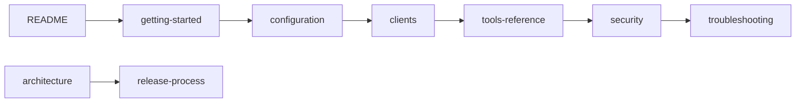
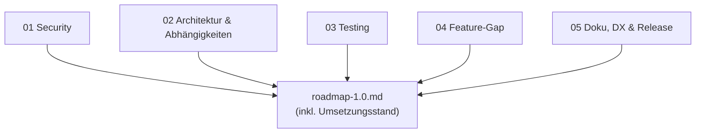

# Dokumentation

Willkommen in der Dokumentation des MCP-Servers `keycloak-model-context-protocol` (Version 1.0). Die Nutzer-Doku ist auf Englisch, damit sie zum Paket, zur README und zu den Tool-Beschreibungen passt. Dieser Index ist auf Deutsch.

Eine Kurzübersicht und die Schnellinstallation stehen in der [README](../README.md). Änderungen und die Migration von 0.0.x stehen im [CHANGELOG](../CHANGELOG.md#migration).

## Nutzer- und Projekt-Doku

| Dokument | Inhalt |
|---|---|
| [getting-started.md](getting-started.md) | Erste Schritte: lokales Keycloak, Service-Account anlegen, erster Start |
| [configuration.md](configuration.md) | Alle Umgebungsvariablen, Rollenmatrix je Tool, Rollenprofile, TLS |
| [clients.md](clients.md) | Einrichtung in Claude Desktop, Claude Code, VS Code, Cursor und anderen MCP-Clients |
| [tools-reference.md](tools-reference.md) | Alle 24 Tools, Prompts und Resources mit Parametern und Ausgaben. **Generiert** mit `npm run docs:tools`, nicht von Hand ändern |
| [security.md](security.md) | Sicherheitsmodell, Guard-Kette, Least Privilege, Audit-Log, Status der Analysebefunde SEC-01 bis SEC-15 |
| [troubleshooting.md](troubleshooting.md) | Symptome, Ursachen und Lösungen mit den wörtlichen Fehlermeldungen |
| [architecture.md](architecture.md) | Module, Request-Lebenszyklus, Designentscheidungen, neues Tool hinzufügen, Teststrategie |
| [release-process.md](release-process.md) | Release mit release-please, npm Trusted Publishing und MCP Registry |

Weitere Dateien im Projekt-Root: [SECURITY.md](../SECURITY.md) (Schwachstellen melden), [CONTRIBUTING.md](../CONTRIBUTING.md), [CODE_OF_CONDUCT.md](../CODE_OF_CONDUCT.md).

Wer den Server nur nutzen will, liest `getting-started`, `configuration` und `clients` und danach `security`. Wer mitentwickeln will, beginnt mit `architecture` und `CONTRIBUTING.md`.

## Historisch: Analyse und Planung aus der 0.0.2-Zeit

Diese Dokumente sind vor der Umsetzung von 1.0 entstanden und beschreiben den **Stand 0.0.2**. Sie bleiben als Begründung der Entscheidungen erhalten, geben aber nicht mehr den aktuellen Code wieder. Maßgeblich ist der Code und die Nutzer-Doku oben. Den Umsetzungsstand zeigt der Block am Anfang der Roadmap.

| Dokument | Inhalt |
|---|---|
| [roadmap-1.0.md](roadmap-1.0.md) | Konsolidierte Roadmap mit Leitentscheidungen, Phasen und Definition of Done. Enthält oben den **Umsetzungsstand 1.0** |
| [analysis/01-security.md](analysis/01-security.md) | Sicherheitsanalyse: 15 Befunde (SEC-01 bis SEC-15). Aktueller Status je Befund in [security.md](security.md#findings-of-the-analysis-and-their-status-in-10) |
| [analysis/02-architecture-and-dependencies.md](analysis/02-architecture-and-dependencies.md) | Code-Qualität, Architektur, Abhängigkeiten: 19 Befunde (ARCH-01 bis ARCH-19), Zielarchitektur |
| [analysis/03-testing-strategy.md](analysis/03-testing-strategy.md) | Teststrategie: Testpyramide, Werkzeuge, Testfall-Katalog, CI-Pipeline |
| [analysis/04-feature-gap.md](analysis/04-feature-gap.md) | Funktionsumfang: MCP-Features, Keycloak-API, Konkurrenzvergleich, Tool-Katalog |
| [analysis/05-docs-dx-release.md](analysis/05-docs-dx-release.md) | Doku, Developer Experience, Packaging, Release-Prozess: 22 Befunde (DOC-01 bis DOC-22) |

**Wie die Analysen entstanden sind:** Fünf Agenten haben parallel je einen Schwerpunkt untersucht. Sie haben den Code gelesen, das veröffentlichte npm-Paket und den lokalen Build ausgeführt, `npm audit` laufen lassen und aktuelle Paketversionen sowie Spezifikationen abgefragt. Die Laufzeit-Nachweise der Security-Analyse stammen von einem nachgebauten Keycloak (Mock), nicht von einer echten Instanz. Befunde, die gegen einen echten Keycloak noch zu bestätigen sind, sind in den Dokumenten markiert. Das gilt etwa für SEC-08 und die Tool→Rollen-Matrix.

**Befund-IDs** (`SEC-xx`, `ARCH-xx`, `DOC-xx`) sind stabil und können in Issues, Commits und PRs referenziert werden. Überschneidungen sind gewollt: Derselbe Fehler erscheint aus mehreren Blickwinkeln, zum Beispiel der fehlende Shebang als DOC-01 und ARCH-01 oder der Realm-Bug als SEC-02 und ARCH-03. Die Roadmap führt sie zusammen.
