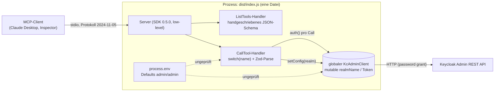
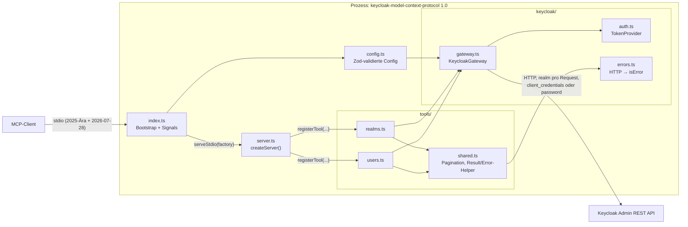
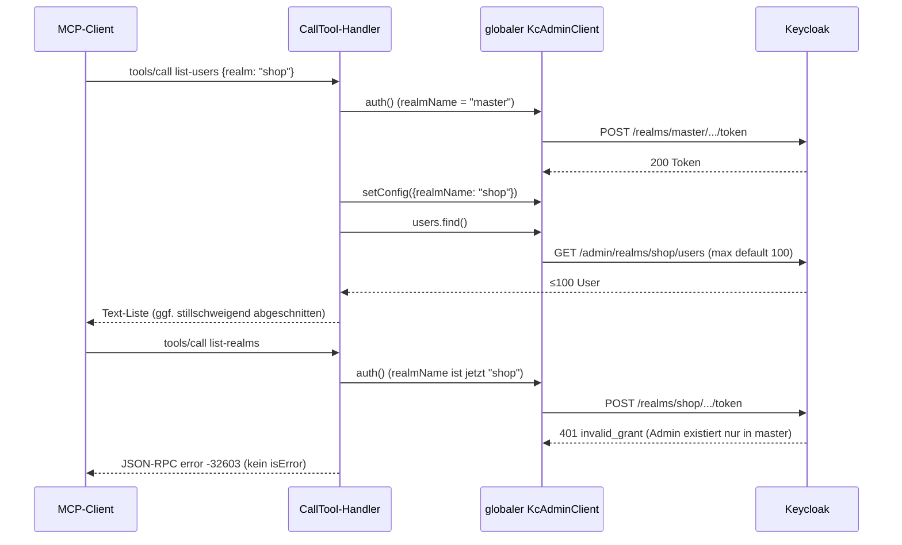
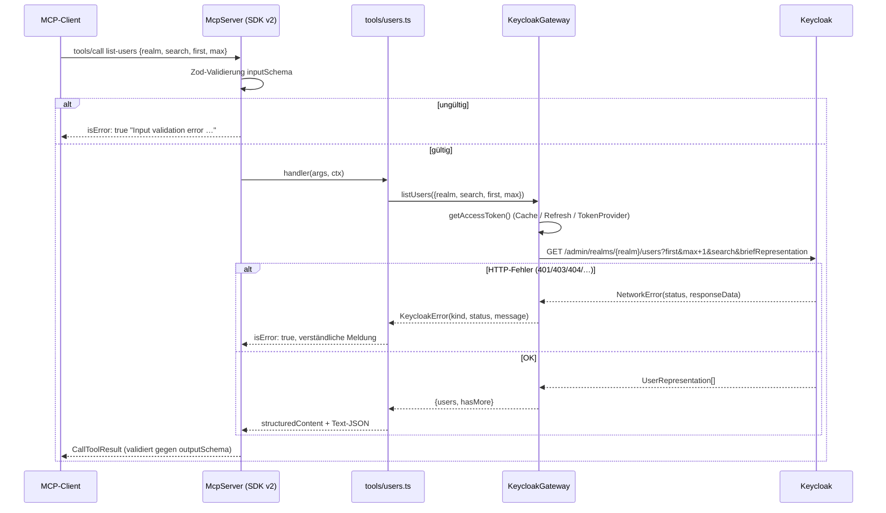

# 02 – Code-Qualität, Architektur und Abhängigkeiten / Migration

> Analysestand: 2026-10-24 · Gegenstand: `keycloak-model-context-protocol` v0.0.2 (Commit `2e8bc85`)
> Schwerpunkt: Code-Qualität, Architektur, Abhängigkeiten und Migrationspfad zu einer stabilen 1.0.

## Wie geprüft wurde

Alle Aussagen in diesem Dokument sind auf eine der folgenden Arten nachgeprüft. Wo etwas nicht nachgeprüft werden konnte, steht das ausdrücklich dabei.

- **Repo-Stand:** `src/index.ts`, `package.json`, `package-lock.json`, `tsconfig.json`, `README.md` und `.github/workflows/npm-publish.yml` vollständig gelesen. `npm ci`, `npm outdated`, `npm audit` und `tsc --noEmit` im Repo ausgeführt.
- **Veröffentlichtes Paket:** Den Tarball `keycloak-model-context-protocol@0.0.2` mit `npm pack` geholt, in ein Scratch-Projekt installiert und das `bin` ausgeführt.
- **Laufzeitverhalten:** Den aktuellen Code gebaut und per stdio mit JSON-RPC angesprochen (initialize, tools/call ohne erreichbares Keycloak, unbekanntes Tool).
- **Ziel-APIs:** `@modelcontextprotocol/sdk@1.32.2`, `@modelcontextprotocol/server@2.4.0`, `@keycloak/keycloak-admin-client@26.8.1` und `zod@4.6.7` installiert. Typdefinitionen (`mcp.d.ts`, `client.d.ts`, `users.d.ts`), READMEs und Laufzeitkonstanten gelesen. Je ein Beispiel-Tool für SDK v1.32 und v2.4 mit `skipLibCheck: false` kompiliert und per stdio aufgerufen (`tools/list`, `tools/call`, Validierungsfehler).
- **Upstream-Quellen:** Keycloak-Quellcode (`UsersResource.java`, `Constants.java`) und Upgrade-Notes (`docs/documentation/upgrading/topics/changes/*.adoc`) auf GitHub; der Node.js-Release-Plan (`nodejs/Release/schedule.json`); der v2-Migrationsleitfaden des MCP-SDK (`ts.sdk.modelcontextprotocol.io/v2/migration/upgrade-to-v2`).

## Zusammenfassung

Der Server ist ein Prototyp auf dem Stand vom Januar 2025. Er besteht aus einer Datei mit rund 200 Zeilen und basiert auf der Low-level-`Server`-API von `@modelcontextprotocol/sdk@0.5.0` (Protokollversion `2024-11-05`). Für eine 1.0 sind drei Probleme besonders schwerwiegend:

1. **Das veröffentlichte npm-Paket startet auf macOS und Linux nicht.** `dist/index.js` hat keine Shebang-Zeile, deshalb führt die Shell die Datei als Shell-Skript aus (`import: command not found`). Damit funktioniert der im README empfohlene Weg `npx -y keycloak-model-context-protocol` auf Unix-Systemen nicht (ARCH-01, verifiziert).
2. **Der globale, veränderliche Admin-Client verschleppt den Realm.** `setConfig({ realmName })` ändert dauerhaft auch den Realm, gegen den `auth()` beim nächsten Tool-Call den Token holt. Nach dem ersten Aufruf mit einem Realm ungleich `master` läuft jede folgende Authentifizierung gegen `/realms/<anderer-realm>/protocol/openid-connect/token`. Mit einem Admin, der nur in `master` existiert, schlägt sie fehl (ARCH-03, im Quellcode beider Client-Versionen verifiziert).
3. **Fehler werden nicht als Tool-Fehler zurückgegeben.** Keycloak-HTTP-Fehler (404/409/401), Netzwerk- und Authentifizierungsfehler sowie unbekannte Tools landen als JSON-RPC-Fehler `-32603` beim Client und nicht als `isError`-Ergebnis, mit dem das Modell weiterarbeiten kann (ARCH-04, beobachtet).

Bei den Abhängigkeiten gibt es eine Abweichung von der Ausgangsannahme: **`@modelcontextprotocol/sdk` 1.32.x ist nicht mehr die aktuelle Hauptlinie.** Die README des Pakets beschreibt v1.x als „maintenance line“. Seit 2026-07-27 ist **v2** die stabile Linie (aktuell `@modelcontextprotocol/server@2.4.0`). Sie implementiert die Spezifikation `2026-07-28`, verlangt `zod ^4.2.0` und Node ≥ 20. Für v1.x sind Bugfixes und Sicherheitsupdates nur „for at least six months after the v2 release“ zugesagt. **Empfehlung: Für 1.0 direkt auf SDK v2 migrieren.** Bei 200 Zeilen ist eine Neuschreibung billiger als zwei Migrationen hintereinander.

`@keycloak/keycloak-admin-client` lässt sich von 22.0.5 auf 26.8.1 ohne Codeänderung anheben (verifiziert per Kompilierung). Zod 4 bricht genau eine Zeile (`error.errors` → `error.issues`). `npm audit` meldet derzeit 6 Schwachstellen (1 low, 5 high), darunter direkt `zod` (< 4.6.6), `@modelcontextprotocol/sdk` 0.5.0 und `@keycloak/keycloak-admin-client` 22.

### Befundtabelle

| ID | Titel | Schweregrad | Aufwand | Blocker für 1.0 |
|---|---|---|---|---|
| ARCH-01 | Veröffentlichtes `bin` ohne Shebang: `npx`-Start unter macOS/Linux schlägt fehl | Kritisch | S | ja |
| ARCH-02 | MCP-SDK 0.5.0 (Protokoll 2024-11-05, Low-level-API); aktuelle stabile Linie ist v2 | Hoch | M | ja |
| ARCH-03 | Globaler veränderlicher Admin-Client: Realm leckt in `auth()` und zwischen parallelen Calls | Hoch | S | ja |
| ARCH-04 | Fehlerbehandlung: Keycloak-, Auth- und Unknown-Tool-Fehler werden zu JSON-RPC `-32603` statt `isError` | Hoch | S | ja |
| ARCH-05 | Keine Konfigurationsvalidierung, unsichere Defaults (`admin`/`admin`), nur Password-Grant, Auth bei jedem Call | Hoch | S | ja |
| ARCH-06 | `@keycloak/keycloak-admin-client` ^22 statt 26.8.1 (Advisory, kein Token-Refresh in 22) | Hoch | S | ja |
| ARCH-07 | Zod ^3.22 statt 4.x (Advisory, SDK v2 verlangt ^4.2) | Hoch | S | ja |
| ARCH-08 | Abhängigkeitshygiene: 6 Audit-Findings, kein Renovate/Dependabot, devDeps veraltet | Mittel | S | ja |
| ARCH-09 | Duplikation Zod-Schema ↔ handgeschriebenes JSON-Schema | Mittel | S | ja (entfällt mit ARCH-02) |
| ARCH-10 | `list-users` ohne Paginierung/Suche; Keycloak kappt stillschweigend bei 100 | Mittel | S | ja |
| ARCH-11 | Nur Text-Output: kein `outputSchema`/`structuredContent`, keine `title`/`annotations` | Mittel | S | ja |
| ARCH-12 | Monolith in einer Datei; keine Module, keine Server-Factory, nicht testbar | Mittel | M | ja |
| ARCH-13 | Kein Lint/Format/Test-Tooling; CI prüft nur den Build | Mittel | S | ja |
| ARCH-14 | Node-Version: README nennt 18 (EOL), kein `engines`-Feld | Mittel | S | ja |
| ARCH-15 | Server-Version hart `"0.0.1"`, abweichend von `package.json` (`0.0.2`) | Niedrig | S | ja |
| ARCH-16 | `package.json`-Hygiene: kein `exports`/`repository`, `prepare` baut in CI doppelt, `chmod` auf alle Dateien | Niedrig | S | nein |
| ARCH-17 | `tsconfig.json` ausbaufähig (Strenge, `types`, Target) | Niedrig | S | nein |
| ARCH-18 | Kein Shutdown-/Logging-Konzept | Niedrig | S | nein |
| ARCH-19 | Nur stdio-Transport; Streamable HTTP fehlt | Info | M | nein |

Aufwand: S = bis 1 PT, M = 1–3 PT, L = mehr als 3 PT.

### Abhängigkeitsstand (verifiziert mit `npm outdated` / `npm view`, 2026-10-24)

| Paket | Range in `package.json` | Lockfile | Aktuell | Bemerkung |
|---|---|---|---|---|
| `@modelcontextprotocol/sdk` | `0.5.0` (exakt) | 0.5.0 (2024-11-15) | 1.32.2 (2026-10-23) | v1 = maintenance line; v2 = `@modelcontextprotocol/server` 2.4.0 |
| `@keycloak/keycloak-admin-client` | `^22.0.5` | 22.0.5 (2023-10-24) | 26.8.1 (2026-10-13) | ESM (`"type": "module"`), `engines.node >=18` |
| `zod` | `^3.22.4` | 3.24.1 | 4.6.7 | Advisory GHSA-mrhx-c7xc-m3w5 betrifft `< 4.6.6` |
| `typescript` | `^5.3.3` | 5.7.2 | 7.0.2 (5.9.3 letzte 5.x) | Probe-Code kompiliert mit 7.0.2 |
| `@types/node` | `^22` | 22.10.5 | 26.6.5 | an die Ziel-Node-Version koppeln |
| `shx` | `^0.3.4` | 0.3.4 | 0.4.0 | wird bei sauberem Build entbehrlich |

---

## Befunde im Detail

### ARCH-01 – Veröffentlichtes `bin` ohne Shebang (Kritisch, S, Blocker)

**Beschreibung:** `package.json` deklariert `dist/index.js` als `bin` ([package.json:8-10](https://github.com/ChristophEnglisch/keycloak-model-context-protocol/blob/2e8bc85/package.json#L8-L10)). Die Quelldatei beginnt direkt mit `import` ([src/index.ts:1](https://github.com/ChristophEnglisch/keycloak-model-context-protocol/blob/2e8bc85/src/index.ts#L1)), es fehlt `#!/usr/bin/env node`. Das Build-Script setzt zwar das Ausführungsrecht ([package.json:15](https://github.com/ChristophEnglisch/keycloak-model-context-protocol/blob/2e8bc85/package.json#L15)), einen Interpreter legt es aber nicht fest.

**Verifikation:** Den Tarball `keycloak-model-context-protocol@0.0.2` aus der Registry in ein leeres Projekt installiert und `node_modules/.bin/keycloak-model-context-protocol` ausgeführt. Ergebnis: `line 1: import: command not found` (die Shell interpretiert die JS-Datei).

**Folge:** Der empfohlene Installationsweg aus dem README (`npx -y keycloak-model-context-protocol`, Claude-Desktop-Konfiguration mit `command: "npx"`) funktioniert unter macOS und Linux nicht. Nur `node path/to/dist/index.js` funktioniert. Unter Windows erzeugt npm einen `.cmd`-Wrapper, das wurde hier nicht geprüft.

**Empfehlung:** `#!/usr/bin/env node` als erste Zeile in den Einstiegspunkt aufnehmen (`tsc` übernimmt die Shebang-Zeile). Einen CI-Smoke-Test ergänzen, der `npm pack`, eine Installation in ein temporäres Verzeichnis und einen Start des `bin` mit einem `initialize`-Request ausführt. Kurzfristig lohnt sich ein Patch-Release 0.0.3.

### ARCH-02 – MCP-SDK 0.5.0 und Low-level-API (Hoch, M, Blocker)

**Beschreibung:** Der Code nutzt die Low-level-Klasse `Server` mit manuellem `setRequestHandler(ListToolsRequestSchema | CallToolRequestSchema)` und einem `switch` über Tool-Namen ([src/index.ts:1-3](https://github.com/ChristophEnglisch/keycloak-model-context-protocol/blob/2e8bc85/src/index.ts#L1-L3), [src/index.ts:44-96](https://github.com/ChristophEnglisch/keycloak-model-context-protocol/blob/2e8bc85/src/index.ts#L44-L96), [src/index.ts:99-199](https://github.com/ChristophEnglisch/keycloak-model-context-protocol/blob/2e8bc85/src/index.ts#L99-L199)). Die Version ist exakt auf `0.5.0` gepinnt ([package.json:20](https://github.com/ChristophEnglisch/keycloak-model-context-protocol/blob/2e8bc85/package.json#L20)).

**Verifizierter Stand der SDK-Linien:**

| Aspekt | 0.5.0 (im Repo) | 1.32.2 (v1, maintenance) | 2.4.0 (v2, stable) |
|---|---|---|---|
| Paket(e) | `@modelcontextprotocol/sdk` | `@modelcontextprotocol/sdk` | `@modelcontextprotocol/server` (+ `/core`, optional `/node`, `/express`, `/hono`, `/fastify`) |
| `LATEST_PROTOCOL_VERSION` | `2024-11-05` | `2025-11-25` | `2025-11-25` (Legacy-Handshake) + modern `2026-07-28` via `server/discover` |
| Unterstützte Legacy-Versionen | – | `2025-11-25, 2025-06-18, 2025-03-26, 2024-11-05, 2024-10-07` | identisch |
| High-level-API | – (nur `Server`) | `McpServer` mit `registerTool/registerResource/registerPrompt`; `tool()/resource()/prompt()` `@deprecated` | `McpServer`; `tool()/resource()/prompt()` entfernt |
| `registerTool`-Config | – | `title, description, inputSchema, outputSchema, annotations, _meta` | zusätzlich `icons`, `scopeChallenge`; `inputSchema` als Standard Schema (`z.object(...)`), Raw-Shape `@deprecated` |
| Tool-Callback | – | `(args, extra)` | `(args, ctx)`; `ctx.mcpReq.signal` statt `extra.signal` |
| stdio | `server/stdio.js` | `@modelcontextprotocol/sdk/server/stdio.js` | `@modelcontextprotocol/server/stdio`: `StdioServerTransport` oder `serveStdio(factory)` |
| HTTP | SSE | Streamable HTTP (`server/streamableHttp.js`), SSE deprecated | `WebStandardStreamableHTTPServerTransport`, `createMcpHandler`; Node-Adapter `@modelcontextprotocol/node`; SSE entfernt |
| Zod | `^3.23.8` (Dependency) | Peer `^3.25 \|\| ^4.0`, intern `zod/v4` | `^4.2.0` („Zod v3 is no longer supported“) |
| Node | – | `>=18` | `>=20` |
| Emittiertes JSON-Schema | handgeschrieben | Draft-07 (beobachtet) | 2020-12 (beobachtet) |
| Fehlerklassen | `McpError` | `McpError` | `ProtocolError`, `SdkError`, `SdkHttpError` |

Beobachtetes Laufzeitverhalten beider Ziel-Linien: Eine Zod-Validierung der Tool-Argumente schlägt automatisch als `isError: true` mit `Input validation error: …` fehl. Wirft der Callback eine Exception, wird daraus ebenfalls ein `isError`-Ergebnis mit der Fehlermeldung (z. B. `"fetch failed"`). Der aktuelle Server beantwortet ein `initialize` mit `protocolVersion: "2025-11-25"` dagegen mit `2024-11-05`.

**Wichtig zu v2 und dem 2026-07-28-Protokoll:** Laut Migrationsleitfaden bedient ein Server, der weiter `server.connect(new StdioServerTransport())` nutzt, nur Clients der 2025er-Protokollgeneration. Für beide Generationen braucht es `serveStdio(() => createServer())` (bzw. `createMcpHandler` für HTTP). Das setzt eine **Server-Factory** voraus, siehe ARCH-12.

**Folge:** Neuere Protokollfunktionen (Tool-`title`, `annotations`, `outputSchema`/`structuredContent`, Streamable HTTP, `listChanged`) sind nicht verfügbar. 0.5.0 fällt unter das Audit-Advisory „does not enable DNS rebinding protection by default“ (betrifft die HTTP-Transports, nicht stdio). v1 bekommt nur noch zeitlich begrenzt Fixes.

**Empfehlung:** Direkt auf `@modelcontextprotocol/server@^2.4` migrieren, mit `McpServer.registerTool` und `serveStdio`. Den Code nach der Zielarchitektur (siehe unten) neu aufbauen. Ein Codemod (`@modelcontextprotocol/codemod`, `v1-to-v2`) existiert, er zielt aber auf v1-Code. Bei 0.5er-Low-level-Code bringt er wenig. v1.32 ist nur sinnvoll, wenn Node 18 zwingend unterstützt werden muss, was wegen EOL nicht zu empfehlen ist (ARCH-14).

### ARCH-03 – Globaler veränderlicher Admin-Client: Realm-Leck (Hoch, S, Blocker)

**Beschreibung:** Es gibt genau eine Modul-globale `KcAdminClient`-Instanz ([src/index.ts:20-23](https://github.com/ChristophEnglisch/keycloak-model-context-protocol/blob/2e8bc85/src/index.ts#L20-L23)). Vor jedem Call wird `auth()` aufgerufen ([src/index.ts:101-106](https://github.com/ChristophEnglisch/keycloak-model-context-protocol/blob/2e8bc85/src/index.ts#L101-L106)). In den Tools wird `setConfig({ realmName: realm })` aufgerufen ([src/index.ts:115-117](https://github.com/ChristophEnglisch/keycloak-model-context-protocol/blob/2e8bc85/src/index.ts#L115-L117), [src/index.ts:139-141](https://github.com/ChristophEnglisch/keycloak-model-context-protocol/blob/2e8bc85/src/index.ts#L139-L141), [src/index.ts:170-172](https://github.com/ChristophEnglisch/keycloak-model-context-protocol/blob/2e8bc85/src/index.ts#L170-L172)).

**Verifiziert im Client-Quellcode (22.0.5 und 26.8.1):**
- `auth()` holt den Token mit `realmName: this.realmName` (`lib/client.js`), und `getToken` baut daraus `${baseUrl}/realms/${realmName}/protocol/openid-connect/token` (`utils/auth.js`).
- `setConfig()` überschreibt `this.realmName` dauerhaft.
- Ressourcen lesen den Realm bei jedem Request aus `client.realmName` (`getUrlParams: () => ({ realm: client.realmName })`). Ein `realm` im Payload überschreibt ihn **pro Request** (`urlParams = { ...baseParams, ...pick(payload, …) }`). Genau dieses Muster dokumentiert die README des Admin-Clients („Set a `realm` property to override the realm for only a single operation“).

**Folge:**
1. **Funktionaler Fehler:** Nach `create-user`/`delete-user`/`list-users` mit dem Realm `foo` authentifiziert sich der nächste Call gegen den Token-Endpoint von `foo`. Existieren dort weder `admin-cli` mit Direct Grant noch der Admin-User aus `master`, scheitert jeder weitere Call, auch `list-realms`, bis der Prozess neu startet. (Logisch aus dem Code abgeleitet. Gegen einen laufenden Keycloak wurde das nicht reproduziert, weil keiner verfügbar war.)
2. **Nebenläufigkeit:** MCP-Clients dürfen Requests parallel senden. Parallele Calls überschreiben gegenseitig `realmName`, `accessToken` und `refreshToken` derselben Instanz. `list-users` übergibt den Realm nicht im Payload ([src/index.ts:174](https://github.com/ChristophEnglisch/keycloak-model-context-protocol/blob/2e8bc85/src/index.ts#L174)) und hängt deshalb vom globalen Zustand ab.

**Empfehlung:** Den Admin-Client einmalig gegen den **Auth-Realm** (konfigurierbar, Default `master`) authentifizieren und `setConfig` nie wieder aufrufen. Den Ziel-Realm **immer** per Payload übergeben (`users.find({ realm, … })`). Den Client hinter einem `KeycloakGateway` kapseln, der den Token-Lebenszyklus verwaltet (siehe ARCH-05).

### ARCH-04 – Fehlerbehandlung (Hoch, S, Blocker)

**Beschreibung:**
- `auth()` steht **vor** dem `try` ([src/index.ts:101-106](https://github.com/ChristophEnglisch/keycloak-model-context-protocol/blob/2e8bc85/src/index.ts#L101-L106)). Auth-Fehler (falsches Passwort, Keycloak nicht erreichbar) gehen deshalb ungefangen an das SDK.
- Der `catch` behandelt nur `ZodError` und wirft alles andere weiter ([src/index.ts:187-198](https://github.com/ChristophEnglisch/keycloak-model-context-protocol/blob/2e8bc85/src/index.ts#L187-L198)). Keycloak-Fehler (`NetworkError` mit `response.status` und `responseData`, z. B. 404 bei unbekannter `userId`, 409 bei doppeltem `username`) werden nicht übersetzt.
- Unbekannte Tools werfen `Error` ([src/index.ts:184-185](https://github.com/ChristophEnglisch/keycloak-model-context-protocol/blob/2e8bc85/src/index.ts#L184-L185)). Weil die Authentifizierung vorher läuft, verdeckt ein Auth-Fehler sogar diesen Fall.
- [src/index.ts:193](https://github.com/ChristophEnglisch/keycloak-model-context-protocol/blob/2e8bc85/src/index.ts#L193) nutzt `error.errors`. Unter Zod 4 existiert das nicht mehr (Kompilierfehler `TS2339`, verifiziert), korrekt ist `error.issues`.

**Verifikation (Laufzeit):** Gegen einen nicht erreichbaren Keycloak antwortet der Server auf `tools/call list-realms` **und** auf `tools/call nope` jeweils mit `{"error":{"code":-32603,"message":"fetch failed"}}`.

**Folge:** Das Modell erhält statt eines verwertbaren Tool-Ergebnisses einen Protokollfehler. Es kann nicht sinnvoll reagieren, etwa mit „User existiert bereits“ oder „Realm nicht gefunden“. Clients zeigen dann generische Fehler an.

**Empfehlung:** Einen zentralen Mapper `toToolError(e)` einführen: `NetworkError` → `isError: true` mit Status und Keycloak-`errorMessage`. Dazu Klassifikation 401/403 (Konfiguration/Rechte), 404 (nicht gefunden), 409 (Konflikt) und Netzwerkfehler (Keycloak nicht erreichbar). Mit `McpServer` entfallen die Unknown-Tool- und die Zod-Behandlung, weil das SDK beides übernimmt (verifiziert). Authentifizierungsfehler beim Start fail-fast melden (ARCH-05). Bei Laufzeit-Token-Fehlern ebenfalls `isError` zurückgeben.

### ARCH-05 – Konfiguration und Authentifizierung (Hoch, S, Blocker)

**Beschreibung:** `KEYCLOAK_URL`, `KEYCLOAK_ADMIN` und `KEYCLOAK_ADMIN_PASSWORD` werden ohne Validierung gelesen und fallen still auf `http://localhost:8080` bzw. `admin`/`admin` zurück ([src/index.ts:21](https://github.com/ChristophEnglisch/keycloak-model-context-protocol/blob/2e8bc85/src/index.ts#L21), [src/index.ts:102-103](https://github.com/ChristophEnglisch/keycloak-model-context-protocol/blob/2e8bc85/src/index.ts#L102-L103)). Auth-Realm (`master`) und Client-ID (`admin-cli`) sind hart kodiert ([src/index.ts:22](https://github.com/ChristophEnglisch/keycloak-model-context-protocol/blob/2e8bc85/src/index.ts#L22), [src/index.ts:105](https://github.com/ChristophEnglisch/keycloak-model-context-protocol/blob/2e8bc85/src/index.ts#L105)). Es wird nur der Grant `password` genutzt, und zwar bei **jedem** Tool-Call neu.

**Verifiziert:** Der Admin-Client unterstützt `grantType: "client_credentials" | "password" | "refresh_token"` mit `clientSecret` (`utils/auth.d.ts`). Version 26.8.1 erneuert abgelaufene Access-Tokens in `getAccessToken()` automatisch per Refresh-Token, 22.0.5 tut das nicht. Für Tokens ohne Refresh-Token (typisch bei `client_credentials`) gibt es `registerTokenProvider()`. Die Keycloak-26-Upgrade-Notes markieren die **Server**-Variablen `KEYCLOAK_ADMIN`/`KEYCLOAK_ADMIN_PASSWORD` als deprecated (ersetzt durch `KC_BOOTSTRAP_ADMIN_*`). Die gleichnamigen MCP-Variablen sind davon technisch unabhängig, das kann aber zu Verwechslungen führen.

**Folge:** Fehlkonfigurationen fallen erst beim ersten Tool-Call als `fetch failed` oder `-32603` auf. Ein vergessenes Passwort führt still zu einem Login-Versuch mit `admin`/`admin`. Service-Accounts (Least Privilege, kein Benutzerpasswort) lassen sich nicht nutzen. Jeder Call kostet einen zusätzlichen Token-Roundtrip.

**Empfehlung:** Ein `config.ts` mit Zod-Schema über `process.env` anlegen: `KEYCLOAK_URL` (Pflicht, URL), `KEYCLOAK_AUTH_REALM` (Default `master`), `KEYCLOAK_CLIENT_ID`, dazu **entweder** `KEYCLOAK_CLIENT_SECRET` (client_credentials, empfohlen) **oder** Benutzername und Passwort. Außerdem `KEYCLOAK_TIMEOUT_MS` (der Admin-Client kennt `timeout` in `ConnectionConfig`). Beim Start validieren und mit einer klaren Meldung auf stderr und Exit-Code ≠ 0 abbrechen. Kein Default-Passwort. Den Token zentral im Gateway verwalten: Erst-Auth, Refresh und bei `client_credentials` eine Neu-Authentifizierung über einen `TokenProvider`. Alte Variablennamen für eine Übergangszeit als Alias akzeptieren. Die Sicherheitsaspekte im Detail gehören in die Security-Analyse.

### ARCH-06 – Keycloak Admin Client ^22 → 26.8.1 (Hoch, S, Blocker)

**Beschreibung:** `"^22.0.5"` ([package.json:21](https://github.com/ChristophEnglisch/keycloak-model-context-protocol/blob/2e8bc85/package.json#L21)). Durch den Caret bleibt die Installation auf 22.x.

**Verifiziert:**
- **Kompatibilität des bestehenden Codes:** `src/index.ts` kompiliert unverändert mit `@keycloak/keycloak-admin-client@26.8.1` (zusammen mit SDK 0.5.0 und Zod 3.24). Die genutzten APIs `auth`, `setConfig`, `users.create/del/find` und `realms.find` sind stabil.
- **Modulformat:** 22.0.5 und 26.8.1 sind beide reines ESM (`"type": "module"`, `main: lib/index.js`, kein `exports`). Das passt zum ESM-Projekt (`"type": "module"`, `module: NodeNext`). Ein CJS-Konsument könnte das Paket nicht `require`n, das betrifft dieses Projekt aber nicht.
- **Breaking Changes für den JS-Client laut Upgrade-Notes (22 → 26.8):** 26.0 entfernt `groups.setOrCreateChild()`. 26.4 ergänzt die Attributsuche über `exact`. 26.8 deklariert bei Single-Lookups (`users.findOne()`, `clients.findOne()`, …) `null` statt `undefined` (nur Typen). Für die Zukunft (Notes zu 27.0 im Keycloak-`main`, noch nicht auf npm): `organizations.findOne` liefert `undefined` statt 404, `getServiceAccountUser()` entfällt. Keine dieser Änderungen betrifft den heutigen Code.
- **Neue Abhängigkeiten in 26.8.1:** `@microsoft/kiota-*` in der Version `1.0.0-preview.103` (für die experimentellen v2-APIs, `enableExperimentalApis`). Für die Supply-Chain-Bewertung ist das relevant.
- **Audit:** 22.x fällt unter „Keycloak vulnerable to authorization bypass via the Admin API“ (Schweregrad low, Fix in 26.8.1). Außerdem zieht 22.x `lodash-es` mit drei High-Advisories nach.
- **Server-Kompatibilität:** Die README des Clients sagt nur „Latest Keycloak version supported“. Eine Kompatibilitätsmatrix zu älteren Keycloak-Servern wurde **nicht gefunden**. Die genutzten Endpunkte (`/admin/realms`, `/admin/realms/{realm}/users`) sind langjährig stabil, das ist aber nicht formal zugesichert.

**Folge:** Ohne Upgrade bleiben die Advisories offen und es fehlt der automatische Token-Refresh.

**Empfehlung:** Auf `^26.8.1` anheben. Die unterstützten Keycloak-Server-Versionen in README und CI festlegen, z. B. eine Integrationstest-Matrix gegen die letzten zwei bis drei Keycloak-Majors per Container. Keycloak 27 bei Erscheinen gezielt prüfen.

### ARCH-07 – Zod 3 → 4 (Hoch, S, Blocker)

**Beschreibung:** `"zod": "^3.22.4"` ([package.json:22](https://github.com/ChristophEnglisch/keycloak-model-context-protocol/blob/2e8bc85/package.json#L22)), im Lockfile 3.24.1.

**Verifiziert:** SDK v1.32.2 verlangt als Peer `^3.25 || ^4.0`, die Range im Repo erlaubt also eine inkompatible 3.22–3.24. SDK v2 verlangt `^4.2.0`. Laut Migrationsleitfaden fällt Zod 4.0–4.1 auf einen Konverter zurück, der `.describe()`-Texte verliert. `npm audit`: GHSA-mrhx-c7xc-m3w5 („can exhaust memory while validating oversized constrained collections“) betrifft `zod < 4.6.6`, also alle 3.x-Versionen. Unter Zod 4 bricht genau [src/index.ts:193](https://github.com/ChristophEnglisch/keycloak-model-context-protocol/blob/2e8bc85/src/index.ts#L193) (`errors` → `issues`).

**Empfehlung:** `zod@^4.6.6` verwenden. Mit `McpServer` entfällt die eigene `ZodError`-Formatierung ganz.

### ARCH-08 – Abhängigkeitshygiene (Mittel, S, Blocker)

**Beschreibung:** `npm audit` meldet 6 Schwachstellen (1 low, 5 high): direkt `@modelcontextprotocol/sdk` (DNS-Rebinding-Default, Cross-Origin-Redirects im Client-Transport, transitiv `zod`), `zod`, `@keycloak/keycloak-admin-client` (low), transitiv `lodash-es`, `minimatch` und `brace-expansion` (letztere über die devDependency `shx`). Es gibt weder Renovate noch Dependabot. Die devDependencies `typescript` (5.7.2 → 5.9.3/7.0.2), `@types/node` (22 → 26) und `shx` (0.3.4 → 0.4.0) sind veraltet.

**Folge:** Ein 1.0-Release mit bekannten High-Advisories in direkten Abhängigkeiten ist nicht vertretbar, auch wenn einige davon nur HTTP-Transports betreffen.

**Empfehlung:** Die Upgrades aus ARCH-02/06/07 lösen die direkten Findings. Zusätzlich `npm audit --omit=dev --audit-level=high` als CI-Gate einführen und Renovate oder Dependabot mit gruppierten Updates für das MCP-SDK und den Keycloak-Client einrichten. `shx` entfernen (ARCH-16).

### ARCH-09 – Duplikation Zod ↔ JSON-Schema (Mittel, S, Blocker → entfällt mit ARCH-02)

**Beschreibung:** Jedes Tool ist doppelt definiert: als Zod-Schema ([src/index.ts:26-41](https://github.com/ChristophEnglisch/keycloak-model-context-protocol/blob/2e8bc85/src/index.ts#L26-L41)) und als handgeschriebenes JSON-Schema in `tools/list` ([src/index.ts:50-60](https://github.com/ChristophEnglisch/keycloak-model-context-protocol/blob/2e8bc85/src/index.ts#L50-L60), [src/index.ts:66-72](https://github.com/ChristophEnglisch/keycloak-model-context-protocol/blob/2e8bc85/src/index.ts#L66-L72), [src/index.ts:87-92](https://github.com/ChristophEnglisch/keycloak-model-context-protocol/blob/2e8bc85/src/index.ts#L87-L92)). `list-realms` hat gar kein Zod-Schema. Beschreibungen einzelner Felder fehlen in beiden Varianten.

**Folge:** Schema-Drift ist vorprogrammiert, und dem Modell fehlen Feldbeschreibungen.

**Empfehlung:** Mit `registerTool` ist das Zod-Schema die einzige Quelle. Das SDK erzeugt daraus das JSON-Schema (verifiziert: `.describe()`, `.min()`, `.default()` und `.max()` erscheinen in `tools/list`). Jedes Feld mit `.describe()` dokumentieren.

### ARCH-10 – `list-users` ohne Paginierung/Suche (Mittel, S, Blocker)

**Beschreibung:** `kcAdminClient.users.find()` wird ohne Parameter aufgerufen ([src/index.ts:174](https://github.com/ChristophEnglisch/keycloak-model-context-protocol/blob/2e8bc85/src/index.ts#L174)), und das Ergebnis wird vollständig als Text ausgegeben ([src/index.ts:179](https://github.com/ChristophEnglisch/keycloak-model-context-protocol/blob/2e8bc85/src/index.ts#L179)).

**Verifiziert:** Im Keycloak-Quellcode gilt `maxResults = maxResults != null ? maxResults : Constants.DEFAULT_MAX_RESULTS` mit `DEFAULT_MAX_RESULTS = 100` (`UsersResource.java`, `Constants.java`). Der Client unterstützt `first`, `max`, `search`, `q`, `exact` und `briefRepresentation` (`UserQuery extends PaginationQuery, SearchQuery, UserBaseQuery`) sowie `users.count()`.

**Folge:** Bei mehr als 100 Usern liefert das Tool **stillschweigend** eine abgeschnittene Liste, ohne Hinweis auf weitere Seiten. Das Modell zieht dann falsche Schlüsse („User existiert nicht“). Die Ausgabe ist unbegrenzt groß, das kostet Kontext-Budget.

**Empfehlung:** Die Parameter `search`, `first` (Default 0) und `max` (Default 20, Obergrenze 100) einführen, dazu `briefRepresentation: true`. Die Antwort enthält `first`, `max` und einen Hinweis `hasMore` (über `max + 1`-Abfrage oder `users.count`). Dasselbe Muster gilt für künftige Listen-Tools (Gruppen, Clients, Rollen).

### ARCH-11 – Nur Text-Output, keine Tool-Metadaten (Mittel, S, Blocker)

**Beschreibung:** Alle Ergebnisse sind formatierte Strings ([src/index.ts:131](https://github.com/ChristophEnglisch/keycloak-model-context-protocol/blob/2e8bc85/src/index.ts#L131), [src/index.ts:151](https://github.com/ChristophEnglisch/keycloak-model-context-protocol/blob/2e8bc85/src/index.ts#L151), [src/index.ts:162](https://github.com/ChristophEnglisch/keycloak-model-context-protocol/blob/2e8bc85/src/index.ts#L162), [src/index.ts:179](https://github.com/ChristophEnglisch/keycloak-model-context-protocol/blob/2e8bc85/src/index.ts#L179)). Es gibt weder `title` noch `annotations` noch `outputSchema`.

**Verifiziert:** `registerTool` akzeptiert in v1.32 und v2.4 `title`, `outputSchema` und `annotations` (`readOnlyHint`, `destructiveHint`, `idempotentHint`, `openWorldHint`). In beiden Linien liefert das SDK `structuredContent` aus und listet das `outputSchema` in `tools/list` (beobachtet).

**Folge:** Clients können Ergebnisse nicht maschinell weiterverarbeiten. Ohne `destructiveHint: true` an `delete-user` fehlt Clients das Signal für eine Bestätigungsabfrage vor destruktiven Aktionen.

**Empfehlung:** Jedes Tool bekommt `title`, `annotations` und ein `outputSchema`. Das Ergebnis enthält `structuredContent` und eine kompakte Textfassung (JSON) für ältere Clients. Mindestvorgabe: `list-*` mit `readOnlyHint: true`, `delete-user` mit `destructiveHint: true, idempotentHint: true`, `create-user` mit `destructiveHint: false, idempotentHint: false`. Bei allen `openWorldHint` passend setzen, da Keycloak ein externes System ist.

### ARCH-12 – Monolith, keine Modulstruktur (Mittel, M, Blocker)

**Beschreibung:** Server-Setup, Konfiguration, Keycloak-Client, Schemas, Tool-Registry, Dispatch, Fehlerbehandlung und Transport-Start stehen in einer Datei mit Top-Level-Seiteneffekten ([src/index.ts:7-23](https://github.com/ChristophEnglisch/keycloak-model-context-protocol/blob/2e8bc85/src/index.ts#L7-L23), [src/index.ts:202-204](https://github.com/ChristophEnglisch/keycloak-model-context-protocol/blob/2e8bc85/src/index.ts#L202-L204)). Eine Factory und Dependency Injection gibt es nicht.

**Folge:** Ohne laufenden Prozess und echtes Keycloak ist nichts unit-testbar. Jedes neue Tool vergrößert `switch` und `tools/list` an zwei Stellen. `serveStdio` (v2) und HTTP-Transports brauchen eine `createServer()`-Factory, die es noch nicht gibt.

**Empfehlung:** Den Code nach der unten beschriebenen Zielarchitektur aufteilen: `config`, `keycloak` (Gateway + Fehler-Mapping), `tools/<domäne>.ts` (je Domäne eine `register…Tools(server, gateway)`-Funktion), `server.ts` (Factory) und `index.ts` (nur Bootstrap). Das Gateway wird injiziert, Tests nutzen einen Fake und den `InMemoryTransport` des SDK (in v2 exportiert, verifiziert).

### ARCH-13 – Kein Lint/Format/Test-Tooling (Mittel, S, Blocker)

**Beschreibung:** `scripts` enthält nur `build`, `prepare` und `watch` ([package.json:14-18](https://github.com/ChristophEnglisch/keycloak-model-context-protocol/blob/2e8bc85/package.json#L14-L18)). Es gibt keine Tests, keinen Linter und keinen Formatter. Die CI führt nur `npm ci` und `npm run build` aus ([.github/workflows/npm-publish.yml:19-21](https://github.com/ChristophEnglisch/keycloak-model-context-protocol/blob/2e8bc85/.github/workflows/npm-publish.yml#L19-L21)).

**Folge:** Regressionen wie ARCH-01 oder ARCH-03 fallen erst beim Anwender auf.

**Empfehlung:** Entweder **Biome** (`@biomejs/biome` 2.6.x, Lint und Format in einem Tool) oder ESLint 10 mit `typescript-eslint` 8.x und Prettier 3.x. Für ein kleines Projekt ist Biome die schlankere Wahl. Dazu **Vitest** (5.x) für Unit-Tests mit Fake-Gateway und `InMemoryTransport` sowie ein Integrationstest gegen einen Keycloak-Container. Scripts: `lint`, `format`, `typecheck`, `test`, `test:integration`. CI-Jobs: lint, typecheck, test, Pack-Smoke-Test (ARCH-01) und audit (ARCH-08).

### ARCH-14 – Node-Version und `engines` (Mittel, S, Blocker)

**Beschreibung:** Das README nennt „Node.js 18 or higher“ ([README.md:142](https://github.com/ChristophEnglisch/keycloak-model-context-protocol/blob/2e8bc85/README.md#L142)). `package.json` hat kein `engines`-Feld. Die CI nutzt Node 22 ([.github/workflows/npm-publish.yml:16](https://github.com/ChristophEnglisch/keycloak-model-context-protocol/blob/2e8bc85/.github/workflows/npm-publish.yml#L16)).

**Verifiziert (nodejs/Release schedule.json):** Node 18 EOL 2025-04-30. Node 20 EOL 2026-04-30. Node 22 ist in Maintenance bis 2027-04-30. Node 24 ist in Maintenance seit 2026-10-20, Ende 2028-04-30. Node 26 wird am 2026-10-28 LTS. SDK v2 verlangt `>=20`.

**Empfehlung:** `"engines": { "node": ">=22" }` setzen, README und CI-Matrix (22, 24, 26) anpassen und `@types/node` auf die niedrigste unterstützte Major-Version pinnen.

### ARCH-15 – Hart kodierte Server-Version (Niedrig, S, Blocker)

**Beschreibung:** `version: "0.0.1"` ([src/index.ts:10](https://github.com/ChristophEnglisch/keycloak-model-context-protocol/blob/2e8bc85/src/index.ts#L10)) widerspricht `package.json` `0.0.2` ([package.json:3](https://github.com/ChristophEnglisch/keycloak-model-context-protocol/blob/2e8bc85/package.json#L3)). Verifiziert: Die `serverInfo` im `initialize`-Ergebnis meldet `0.0.1`.

**Empfehlung:** Die Version aus `package.json` lesen, z. B. per `createRequire(import.meta.url)("../package.json").version` (`package.json` ist immer im npm-Tarball enthalten) oder per Build-Zeit-Konstante. Einen Test ergänzen, der `serverInfo.version` mit `package.json` vergleicht.

### ARCH-16 – `package.json`-Hygiene (Niedrig, S, kein Blocker)

**Beschreibung:**
- Es fehlen `exports`, `repository`, `homepage`, `bugs`, `keywords` und `engines` ([package.json:1-29](https://github.com/ChristophEnglisch/keycloak-model-context-protocol/blob/2e8bc85/package.json#L1-L29)). Für ein reines CLI-Paket ist `exports` optional. Setzt man es (z. B. `"exports": { "./package.json": "./package.json" }`), verhindert es Deep-Imports in Interna. Eine Programmier-API sollte erst bewusst entschieden werden.
- `prepare` ruft `build` auf ([package.json:16](https://github.com/ChristophEnglisch/keycloak-model-context-protocol/blob/2e8bc85/package.json#L16)). `npm ci` führt `prepare` aus, und die CI ruft danach noch einmal `npm run build` auf, baut also doppelt. Für Konsumenten aus der Registry läuft `prepare` nicht.
- `shx chmod +x dist/*.js` setzt das Ausführungsrecht auf **alle** Dateien in `dist`. Bei mehreren Modulen ist das unnötig. Notwendig ist das Recht nur für das `bin`, und den Kern des Problems löst erst die Shebang-Zeile (ARCH-01).
- Ein `clean`-Schritt fehlt. Verwaiste Dateien in `dist/` würden mit veröffentlicht.

**Empfehlung:** `prepare` durch `prepublishOnly: "npm run clean && npm run build && npm test"` ersetzen (oder nur in der CI bauen), `clean` per `node -e "fs.rmSync('dist',{recursive:true,force:true})"` umsetzen und `shx` entfernen. Metadaten ergänzen und `npm pack --dry-run` in der CI prüfen.

### ARCH-17 – `tsconfig.json` (Niedrig, S, kein Blocker)

**Beschreibung:** Die Basis ist solide (`strict`, `NodeNext`) ([tsconfig.json:3-12](https://github.com/ChristophEnglisch/keycloak-model-context-protocol/blob/2e8bc85/tsconfig.json#L3-L12)). `skipLibCheck: true` versteckt Typfehler in Abhängigkeiten. `types` fehlt: Laut README von `@modelcontextprotocol/server` bindet TypeScript ≥ 6.0 `@types/*` nicht mehr automatisch ein, und `"types": ["node"]` ist nötig.

**Empfehlung:** `"types": ["node"]` ergänzen, ebenso `noUncheckedIndexedAccess`, `exactOptionalPropertyTypes` (prüfen, ob die SDK-Typen das tragen), `noImplicitOverride`, `verbatimModuleSyntax`, `declaration: false` und `sourceMap: true`. `target` an die Ziel-Node-Version anpassen (Node 22: ES2023/ES2024). Testdateien über ein separates `tsconfig.build.json` ausschließen. Der Probe-Code kompilierte mit TS 7.0.2, `skipLibCheck: false` und `noUncheckedIndexedAccess` fehlerfrei gegen SDK v1.32.2, SDK v2.4.0 und Admin-Client 26.8.1.

### ARCH-18 – Shutdown und Logging (Niedrig, S, kein Blocker)

**Beschreibung:** Es gibt nur ein `console.error` beim Start ([src/index.ts:204](https://github.com/ChristophEnglisch/keycloak-model-context-protocol/blob/2e8bc85/src/index.ts#L204)). Ein strukturiertes Logging, Log-Level oder Request-Korrelation fehlen, ebenso eine Behandlung von SIGINT/SIGTERM.

**Empfehlung:** Ein kleines stderr-Logger-Modul einführen (stdout gehört bei stdio dem Protokoll) mit Level über `LOG_LEVEL`. Secrets in Logs maskieren. Bei SIGINT/SIGTERM `server.close()` bzw. `handle.close()` (der Rückgabewert von `serveStdio` hat `close()`, verifiziert).

### ARCH-19 – Nur stdio (Info, M, kein Blocker)

**Beschreibung:** Es gibt nur `StdioServerTransport` ([src/index.ts:202-203](https://github.com/ChristophEnglisch/keycloak-model-context-protocol/blob/2e8bc85/src/index.ts#L202-L203)).

**Empfehlung:** Für 1.0 reicht stdio. Die Factory-Architektur (ARCH-12) macht Streamable HTTP später billig: `createMcpHandler(() => createServer())` (v2) bzw. `@modelcontextprotocol/node`. Ein HTTP-Betrieb bringt eigene Anforderungen mit (Authentifizierung des MCP-Clients, DNS-Rebinding-Schutz, Mandantentrennung pro Session statt eines globalen Admin-Tokens). Das sollte als eigenes ADR nach 1.0 entschieden werden.

---

## Zielarchitektur 1.0

### Vorgeschlagene Ordnerstruktur

```text
src/
├── index.ts                 # Bin-Einstieg: Shebang, loadConfig(), Gateway, serveStdio(createServer), Signal-Handling
├── server.ts                # createServer(deps): McpServer-Factory, registriert alle Tool-Domänen
├── config.ts                # Zod-Schema über process.env, loadConfig() → Config (fail-fast)
├── version.ts               # Version aus package.json
├── logging.ts               # stderr-Logger mit Level und Secret-Maskierung
├── keycloak/
│   ├── gateway.ts           # KeycloakGateway: einziger Besitzer von KcAdminClient, Token-Lebenszyklus, Realm pro Request
│   ├── auth.ts              # Credentials aus Config (client_credentials | password), TokenProvider
│   └── errors.ts            # NetworkError/HTTP-Status → Domänenfehler → CallToolResult (isError)
└── tools/
    ├── index.ts             # registerAllTools(server, gateway)
    ├── shared.ts            # Pagination-Schema, toResult()/toToolError(), gemeinsame Zod-Typen (realm, userId)
    ├── realms.ts            # list-realms
    └── users.ts             # list-users, create-user, delete-user (später get-user, update-user …)
test/
├── unit/                    # Tools gegen Fake-Gateway über InMemoryTransport, Config-Validierung, Error-Mapping
├── integration/             # gegen Keycloak-Container (Version-Matrix)
└── smoke/                   # npm pack → install → bin starten → initialize
```

Regeln: `tools/*` kennt nur das `KeycloakGateway`-Interface und nie `KcAdminClient` direkt. `keycloak/*` kennt kein MCP. Nur `index.ts` hat Seiteneffekte.

### Komponentendiagramm Ist



### Komponentendiagramm Soll



### Sequenz Ist: Realm-Leck (ARCH-03)



### Sequenz Soll: Tool-Call `list-users`



---

## Migrationspfad

Die Reihenfolge sichert jeden Schritt durch Tests ab und hält jeden Schritt einzeln releasefähig.

1. **Hotfix-Release 0.0.3.** Shebang ergänzen (ARCH-01). In `auth()` den Realm stabil halten: Den Ziel-Realm nur noch per Payload übergeben (`users.find({ realm })`) und `setConfig`-Aufrufe entfernen (ARCH-03). Die Server-Version aus `package.json` lesen (ARCH-15). Einen Pack-Smoke-Test in die CI aufnehmen.
2. **Tooling-Basis.** `engines: ">=22"`, CI-Matrix 22/24/26, Biome (oder ESLint und Prettier), Vitest, Scripts `lint/typecheck/test`, `prepublishOnly` statt `prepare`, `shx` entfernen, Renovate, Audit-Gate (ARCH-08, -13, -14, -16, -17).
3. **Zod 4.** `zod@^4.6.6` installieren und `error.errors` → `error.issues` ([src/index.ts:193](https://github.com/ChristophEnglisch/keycloak-model-context-protocol/blob/2e8bc85/src/index.ts#L193)) anpassen. Das ist die einzige verifizierte Bruchstelle. Die Zeile entfällt in Schritt 5 ohnehin (ARCH-07).
4. **Admin-Client 26.8.1.** `@keycloak/keycloak-admin-client@^26.8.1` installieren. Der bestehende Code kompiliert unverändert (verifiziert). Einen Integrationstest gegen einen Keycloak-Container ergänzen, der unter anderem zwei Calls auf verschiedene Realms nacheinander ausführt (Regressionstest für ARCH-03) (ARCH-06).
5. **SDK-Migration auf v2 und Refactoring in einem Zug.**
   - `npm rm @modelcontextprotocol/sdk && npm i @modelcontextprotocol/server@^2.4`
   - Die Struktur aus „Zielarchitektur 1.0“ anlegen: `config.ts` (ARCH-05), `keycloak/gateway.ts` + `errors.ts` (ARCH-03, -04), `tools/*.ts` mit `registerTool` (ARCH-09, -11), `server.ts` als Factory, `index.ts` mit `serveStdio(createServer)` (ARCH-02, -12).
   - Dabei `list-users` paginieren (ARCH-10) und `title`, `annotations` und `outputSchema` je Tool setzen (ARCH-11).
   - Unit-Tests pro Tool über `InMemoryTransport` mit Fake-Gateway.
6. **Härtung und Release 1.0.0.** Error-Mapping-Tests (404/409/401/Netzwerk), Logging/Shutdown (ARCH-18), README aktualisieren (Node ≥ 22, neue Env-Variablen, unterstützte Keycloak-Versionen), CHANGELOG mit Breaking Changes (Env-Variablen, Tool-Parameter, Output-Format). Streamable HTTP als eigenes ADR nach 1.0 (ARCH-19).

### Beispiel: Tool mit der aktuellen SDK-API (v2, `@modelcontextprotocol/server@2.4.0`)

Der Kern dieses Beispiels wurde mit `@modelcontextprotocol/server@2.4.0`, `@keycloak/keycloak-admin-client@26.8.1`, `zod@4.6.7` und TypeScript 7.0.2 (`strict`, `skipLibCheck: false`) kompiliert und per stdio aufgerufen: Imports, `new McpServer(...)`, `registerTool` mit `z.object`-Input-/Output-Schema und `annotations`, der Callback mit `structuredContent` und `NetworkError`-Mapping sowie `serveStdio(factory)`. Geprüft wurden `tools/list` (Schema inklusive `title`, `annotations` und `outputSchema` vorhanden) und `tools/call` (Validierungsfehler und Laufzeitfehler kommen als `isError` zurück). Für die Darstellung wurde der Code auf die Zielarchitektur zugeschnitten. `loadConfig`, `createGateway`/`KeycloakGateway` und `version` sind Platzhalter der Zielarchitektur. Im Probe-Code stand an dieser Stelle direkt ein `KcAdminClient`, dessen `users.find` dieselbe Signatur hat. Die `hasMore`-Logik (`max + 1`) kam nachträglich dazu und war nicht Teil des Probe-Laufs.

```ts
#!/usr/bin/env node
// src/index.ts
import { McpServer } from "@modelcontextprotocol/server";
import { serveStdio } from "@modelcontextprotocol/server/stdio";
import { NetworkError } from "@keycloak/keycloak-admin-client";
import * as z from "zod";
import { loadConfig } from "./config.js";
import { createGateway, type KeycloakGateway } from "./keycloak/gateway.js";
import { version } from "./version.js";

function registerUserTools(server: McpServer, kc: KeycloakGateway) {
  server.registerTool(
    "list-users",
    {
      title: "List users",
      description: "List users of a realm. Paginated; use `search` to filter by username, email, first or last name.",
      inputSchema: z.object({
        realm: z.string().min(1).describe("Realm name"),
        search: z.string().optional().describe("Free-text search"),
        first: z.number().int().min(0).default(0),
        max: z.number().int().min(1).max(100).default(20),
      }),
      outputSchema: z.object({
        users: z.array(z.object({ id: z.string(), username: z.string(), email: z.string().optional() })),
        first: z.number(),
        max: z.number(),
        hasMore: z.boolean(),
      }),
      annotations: { readOnlyHint: true, openWorldHint: true },
    },
    async ({ realm, search, first, max }) => {
      try {
        // Realm pro Request im Payload – kein setConfig()
        const page = await kc.users.find({ realm, search, first, max: max + 1, briefRepresentation: true });
        const output = {
          users: page.slice(0, max).map((u) => ({ id: u.id!, username: u.username!, email: u.email })),
          first,
          max,
          hasMore: page.length > max,
        };
        return { content: [{ type: "text", text: JSON.stringify(output) }], structuredContent: output };
      } catch (e) {
        if (e instanceof NetworkError) {
          return {
            isError: true,
            content: [{ type: "text", text: `Keycloak responded ${e.response.status}: ${JSON.stringify(e.responseData)}` }],
          };
        }
        throw e; // wird vom SDK ebenfalls als isError-Ergebnis ausgeliefert
      }
    },
  );
}

const config = loadConfig();              // fail-fast bei ungültiger Konfiguration
const gateway = await createGateway(config);

export function createServer(): McpServer {
  const server = new McpServer({ name: "keycloak-admin", version }, { capabilities: { tools: {} } });
  registerUserTools(server, gateway);
  return server;
}

serveStdio(createServer);                 // bedient 2025er-Clients und das 2026-07-28-Protokoll
```

Zum Vergleich die **v1.32.2-Form** (ebenfalls kompiliert und ausgeführt): Import aus `@modelcontextprotocol/sdk/server/mcp.js` bzw. `…/server/stdio.js`. `registerTool(name, { title, description, inputSchema, outputSchema, annotations }, cb)` akzeptiert dort sowohl Raw-Shapes (`{ realm: z.string() }`) als auch `z.object(...)`. Gestartet wird mit `await server.connect(new StdioServerTransport())`. v1 emittiert JSON-Schema Draft-07 und unterstützt nur Protokolle bis `2025-11-25`.

### Hinweise zur Umsetzung

- `userId` nicht als `z.string().uuid()` validieren. Keycloak vergibt zwar standardmäßig UUIDs, föderierte User (z. B. aus LDAP) können aber andere ID-Formate haben. `z.string().min(1)` reicht.
- Raw-Shape-`inputSchema` (`{ field: z.string() }`) ist in v2 `@deprecated`. Immer `z.object(...)` verwenden.
- Mit Zod 4.0–4.1 verliert der Schema-Konverter laut Migrationsleitfaden `.describe()`-Texte. Deshalb mindestens `^4.2`, wegen des Advisories besser `^4.6.6`.
- Unter TypeScript ≥ 6 `"types": ["node"]` in die `tsconfig.json` aufnehmen (README von `@modelcontextprotocol/server`).
