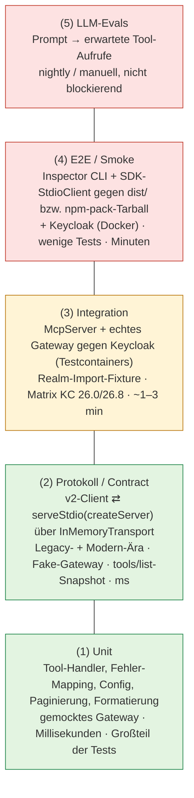
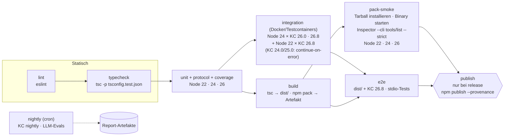

# Teststrategie: keycloak-model-context-protocol (Weg zu 1.0)

> Analysegegenstand: [src/index.ts](https://github.com/ChristophEnglisch/keycloak-model-context-protocol/blob/2e8bc85/src/index.ts), [package.json](https://github.com/ChristophEnglisch/keycloak-model-context-protocol/blob/2e8bc85/package.json), [tsconfig.json](https://github.com/ChristophEnglisch/keycloak-model-context-protocol/blob/2e8bc85/tsconfig.json), [.github/workflows/npm-publish.yml](https://github.com/ChristophEnglisch/keycloak-model-context-protocol/blob/2e8bc85/.github/workflows/npm-publish.yml), [README.md](https://github.com/ChristophEnglisch/keycloak-model-context-protocol/blob/2e8bc85/README.md).
> Stand: 2026-10-24. Versionsangaben sind gegen die npm-Registry bzw. quay.io geprüft (Abschnitt [Verifizierte Annahmen](#10-verifizierte-annahmen)).
> Annahme für 1.0: Umstieg auf das **MCP TypeScript SDK v2**, also `@modelcontextprotocol/server@2.4.0` (Abhängigkeiten `@modelcontextprotocol/core` 2.4.0 und `zod ^4.2.0`) und als Testclient `@modelcontextprotocol/client@2.4.0`. `@modelcontextprotocol/sdk@1.32.2` ist nur noch die Maintenance-Linie und dient hier als Fallback. Dazu `@keycloak/keycloak-admin-client` 26.x, Aufteilung in Module (config, auth, Keycloak-Wrapper, Tools je Domäne), viele neue Tools und eventuell Streamable HTTP.

## Zusammenfassung

- **Heute gibt es keinen einzigen Test.** `package.json` hat kein `test`-Script, kein Test-Framework, und die CI führt nur `npm ci` und `npm run build` aus ([npm-publish.yml:19-21](https://github.com/ChristophEnglisch/keycloak-model-context-protocol/blob/2e8bc85/.github/workflows/npm-publish.yml#L19-L21)).
- **Der Code ist in seiner jetzigen Form nicht unit-testbar.** Schon das Importieren von `src/index.ts` erzeugt einen Keycloak-Client, verbindet stdin/stdout mit einem MCP-Transport und schreibt auf stderr. Die einzige saubere Testmöglichkeit ist heute Blackbox: das gebaute Binary per stdio starten, gegen einen echten Keycloak.
- **Ein konkreter Bug ist schon beim Lesen sichtbar und eignet sich als erster Regressionstest.** Der geteilte Admin-Client merkt sich den Realm des letzten Calls (`setConfig`), und `auth()` verwendet genau diesen Realm für den Token-Request. Nach `list-users` in Realm `demo` meldet sich der nächste Call deshalb bei `demo` statt bei `master` an und scheitert. Das ist im Quellcode des Admin-Clients 22.0.5 und 26.8.1 verifiziert (Details in [Abschnitt 1.3](#13-realm-drift-im-geteilten-client)).
- **Empfehlung:** Vitest 5 als einziges Test-Framework. Fünf Ebenen: Unit-Tests gegen einen gefakten Keycloak-Port, Protokolltests In-Process (`Client` aus `@modelcontextprotocol/client` und `InMemoryTransport`, das `@modelcontextprotocol/server` und `@modelcontextprotocol/client` aus dem Paket-Root exportieren, `@modelcontextprotocol/core` dagegen nicht; die Server-Seite läuft über den echten Einstieg `serveStdio(factory, { transport })`, beide Protokoll-Ären werden getestet), Integrationstests gegen Keycloak per Testcontainers (`GenericContainer`, ein offizielles Keycloak-Modul für Node gibt es nicht), E2E-Smoke-Tests mit der Inspector-CLI gegen `dist/` bzw. das gepackte Tarball, optional LLM-Evals.
- **CI-Matrix:** Node 22/24/26 statt 20/22/24. Node 20 ist seit 2026-04-30 EOL, und Vitest 5, Testcontainers 12 und Inspector 2 laufen nicht mehr darauf. Keycloak `26.0` und `26.8` als Pflicht, `25.0`/`24.0` höchstens als Kompatibilitätsjob, der fehlschlagen darf.
- **Reihenfolge:** Zuerst Charakterisierungstests gegen das **bestehende** Binary schreiben (Phase 0), danach refaktorieren. So sichern die Tests das Refactoring ab, statt erst nach ihm zu entstehen.

---

## 1. Ist-Zustand und warum der Code schwer testbar ist

### 1.1 Befunde mit Fundstellen

| # | Befund | Fundstelle | Auswirkung auf Tests |
|---|---|---|---|
| T1 | Server-Instanz wird auf Modulebene erzeugt | [src/index.ts:7-17](https://github.com/ChristophEnglisch/keycloak-model-context-protocol/blob/2e8bc85/src/index.ts#L7-L17) | Kein Factory-Aufruf möglich. Jeder Test teilt dieselbe Instanz, frische Instanzen pro Test gibt es nicht. |
| T2 | Keycloak-Client wird auf Modulebene erzeugt, `baseUrl` direkt aus `process.env` | [src/index.ts:20-23](https://github.com/ChristophEnglisch/keycloak-model-context-protocol/blob/2e8bc85/src/index.ts#L20-L23), [src/index.ts:21](https://github.com/ChristophEnglisch/keycloak-model-context-protocol/blob/2e8bc85/src/index.ts#L21) | Der Client lässt sich nicht injizieren. Mocken geht nur über `vi.mock('@keycloak/keycloak-admin-client')` vor dem Import, und die Env muss vor dem Import gesetzt sein. |
| T3 | `server.connect(new StdioServerTransport())` per Top-Level-`await` beim Import | [src/index.ts:202-204](https://github.com/ChristophEnglisch/keycloak-model-context-protocol/blob/2e8bc85/src/index.ts#L202-L204) | **Ein Import im Test kapert stdin/stdout des Test-Runners.** Das ist das zentrale Hindernis. |
| T4 | Env-Zugriff ist verstreut: `KEYCLOAK_URL` beim Start, `KEYCLOAK_ADMIN`/`KEYCLOAK_ADMIN_PASSWORD` in jedem Call, Fallback jeweils `admin`/`admin` | [src/index.ts:21](https://github.com/ChristophEnglisch/keycloak-model-context-protocol/blob/2e8bc85/src/index.ts#L21), [src/index.ts:102-103](https://github.com/ChristophEnglisch/keycloak-model-context-protocol/blob/2e8bc85/src/index.ts#L102-L103) | Keine zentrale, validierte Config. Fehlende Variablen fallen nicht auf, weil die Fallbacks greifen. Dafür lässt sich kein sinnvoller Fail-fast-Test schreiben. |
| T5 | Globaler, mutierbarer State: `setConfig({ realmName })` auf dem geteilten Client | [src/index.ts:115-117](https://github.com/ChristophEnglisch/keycloak-model-context-protocol/blob/2e8bc85/src/index.ts#L115-L117), [src/index.ts:139-141](https://github.com/ChristophEnglisch/keycloak-model-context-protocol/blob/2e8bc85/src/index.ts#L139-L141), [src/index.ts:170-172](https://github.com/ChristophEnglisch/keycloak-model-context-protocol/blob/2e8bc85/src/index.ts#L170-L172) | Das Ergebnis hängt von der Reihenfolge der Calls ab. Tests beeinflussen sich gegenseitig, siehe 1.3. |
| T6 | `auth()` vor jedem Call und **außerhalb** des `try` | [src/index.ts:101-106](https://github.com/ChristophEnglisch/keycloak-model-context-protocol/blob/2e8bc85/src/index.ts#L101-L106) | Auth-Fehler werden zum JSON-RPC-Error statt zum `isError`-Result. Jeder Unit-Test muss zusätzlich `auth` mocken. |
| T7 | Alle Tools stecken in einem `switch` im einzigen CallTool-Handler | [src/index.ts:99-199](https://github.com/ChristophEnglisch/keycloak-model-context-protocol/blob/2e8bc85/src/index.ts#L99-L199) | Ein einzelnes Tool lässt sich nicht isoliert aufrufen. Testen geht nur über den gesamten Request-Handler. |
| T8 | Input-Schema doppelt gepflegt: Zod ([src/index.ts:26-41](https://github.com/ChristophEnglisch/keycloak-model-context-protocol/blob/2e8bc85/src/index.ts#L26-L41)) und handgeschriebenes JSON-Schema ([src/index.ts:44-96](https://github.com/ChristophEnglisch/keycloak-model-context-protocol/blob/2e8bc85/src/index.ts#L44-L96)) | s. links | Die beiden Schemas können auseinanderlaufen. Ein Protokolltest muss prüfen, dass `tools/list` und die tatsächliche Validierung übereinstimmen. |
| T9 | Nur `ZodError` wird in ein `isError`-Result übersetzt, alles andere wird weitergeworfen | [src/index.ts:187-198](https://github.com/ChristophEnglisch/keycloak-model-context-protocol/blob/2e8bc85/src/index.ts#L187-L198) | 404/409/401 von Keycloak kommen beim Client als JSON-RPC-Error ohne fachliche Meldung an. Es gibt keine testbare Abbildung von Fehlern auf Meldungen. |
| T10 | `error.errors` ist Zod-3-API | [src/index.ts:193](https://github.com/ChristophEnglisch/keycloak-model-context-protocol/blob/2e8bc85/src/index.ts#L193) | SDK v2 setzt `zod ^4.2.0` voraus, und in Zod 4 heißt das Feld `error.issues`. Der Pfad bricht beim Upgrade also sicher. Im Zielbild übernimmt das SDK die Eingabevalidierung (`inputSchema: z.object(…)`). Eigene Zod-Fehlerformatierung braucht dann einen eigenen Unit-Test. |
| T11 | `list-users` ruft `users.find()` ohne `realm`, ohne `first`/`max` | [src/index.ts:174](https://github.com/ChristophEnglisch/keycloak-model-context-protocol/blob/2e8bc85/src/index.ts#L174) | Der Realm kommt nur über den globalen State (T5). Bei großen Realms wird die Liste stillschweigend abgeschnitten. Dafür braucht es einen Paginierungstest. |
| T12 | Server-Version hart auf `0.0.1`, das Paket ist `0.0.2` | [src/index.ts:10](https://github.com/ChristophEnglisch/keycloak-model-context-protocol/blob/2e8bc85/src/index.ts#L10), [package.json:3](https://github.com/ChristophEnglisch/keycloak-model-context-protocol/blob/2e8bc85/package.json#L3) | Lässt sich mit einem trivialen Protokolltest verhindern (`serverInfo.version === pkg.version`). |
| T13 | `console.error` beim Start | [src/index.ts:204](https://github.com/ChristophEnglisch/keycloak-model-context-protocol/blob/2e8bc85/src/index.ts#L204) | Unkritisch, weil stderr. Ein E2E-Test sollte aber festschreiben, dass stdout nur JSON-RPC enthält. |
| T14 | `tsconfig.json` hat `rootDir: ./src` und `include: src/**/*` | [tsconfig.json:11-14](https://github.com/ChristophEnglisch/keycloak-model-context-protocol/blob/2e8bc85/tsconfig.json#L11-L14) | Testdateien außerhalb von `src/` werden nicht typgeprüft. Es braucht eine eigene `tsconfig.test.json`. |
| T15 | Kein `test`-Script, kein `engines`-Feld | [package.json:14-18](https://github.com/ChristophEnglisch/keycloak-model-context-protocol/blob/2e8bc85/package.json#L14-L18) | Laut README reicht Node 18+, das wird aber nirgends geprüft oder getestet. |

### 1.2 Was heute trotzdem schon testbar ist

Nur **Blackbox über stdio**: `npm run build`, dann `dist/index.js` mit dem SDK-Client (`StdioClientTransport`) oder der Inspector-CLI starten, gegen einen Keycloak in Docker. Genau damit beginnt Phase 0 (Abschnitt 9). Diese Tests überstehen das Refactoring unverändert, weil sie nur das Protokoll sehen.

### 1.3 Realm-Drift im geteilten Client

Ablauf, im Quellcode des Admin-Clients nachvollzogen:

1. `KeycloakAdminClient.auth()` holt den Token mit `realmName: this.realmName` (`lib/client.js`, in Version 22.0.5 und 26.8.1 identisch).
2. `setConfig({ realmName })` überschreibt `this.realmName` dauerhaft.
3. Ressourcen wie `users` lesen den Realm über `getUrlParams: () => ({ realm: client.realmName })`, und zwar **synchron beim Aufruf**. Ein explizit übergebenes `realm` im Payload hat Vorrang.

Folgen für den heutigen Code:

- Das Daten-Routing in einem einzelnen Call stimmt meistens: `setConfig` und `users.find()` laufen nach dem `await auth()` ohne Unterbrechung hintereinander.
- **Der nächste Call (sequenziell) authentifiziert sich gegen den Realm des vorigen Calls.** Nach `list-users {realm:"demo"}` schickt `list-realms` den Password-Grant an `/realms/demo/protocol/openid-connect/token`. Gibt es dort keinen User `admin`, schlägt der Call mit 401 fehl.
- Bei **parallelen** Calls hängt das Ergebnis von der Reihenfolge ab, in der die Promises auflösen: Ein Call kann sich gegen den Realm eines anderen, gerade laufenden Calls anmelden. Außerdem überschreiben sich die Access-Tokens gegenseitig (`setAccessToken`).

**Regressionstests dafür** (im Katalog X-05 und LR-03):

- (a) Sequenziell: ein realm-spezifischer Call, danach `list-realms`. Beide müssen erfolgreich sein.
- (b) Parallel: 20 gemischte Calls in zwei Realms. Keiner darf scheitern, keiner darf User des anderen Realms enthalten.

Gegen v0.0.2 ist (a) deterministisch rot, sobald der Ziel-Realm keinen gleichnamigen Admin hat. Gegen 1.0 müssen beide grün sein.

---

## 2. Zielarchitektur aus Testsicht (Voraussetzung für Ebenen 1 und 2)

Die Modulaufteilung ist schon geplant. Für die Testbarkeit kommt es auf vier Regeln an:

1. **Keine Seiteneffekte beim Import.** Nur der Bin-Einstieg `src/index.ts` liest die Env, baut die Objekte zusammen und ruft `serveStdio(() => createServer(deps))` aus `@modelcontextprotocol/server/stdio` auf. Alles andere exportiert Funktionen oder Factories.
2. **`createServer(deps)` gibt einen `McpServer` zurück (`new McpServer({ name, version })`, Tools über `registerTool(name, { title, description, inputSchema: z.object(…), outputSchema, annotations }, handler)`), ohne zu verbinden.** Tests geben dieselbe Factory an `serveStdio(factory, { transport })` und setzen dabei ein `InMemoryTransport` ein (Abschnitt 5.2). Die Produktion nutzt den Default-stdio-Transport bzw. später Streamable HTTP.
3. **Keycloak steckt hinter einem schmalen Port** (z. B. `KeycloakGateway`) mit **explizitem `realm` in jeder Methode** und ohne `setConfig`. Tools hängen nur vom Port ab, nicht von `KcAdminClient`.
4. **Config ist eine reine Funktion**, z. B. `loadConfig(env: NodeJS.ProcessEnv): Config`, mit Zod validiert. Das ist mit beliebigen Env-Objekten testbar, ohne `process.env` zu verändern.

```ts
// src/keycloak/gateway.ts (Skizze; Namen sind Vorschlag)
export interface KeycloakGateway {
  listRealms(): Promise<Array<{ realm: string; enabled?: boolean }>>;
  listUsers(realm: string, q: { first: number; max: number; search?: string }): Promise<UserSummary[]>;
  countUsers(realm: string, q?: { search?: string }): Promise<number>;
  createUser(realm: string, u: NewUser): Promise<{ id: string }>;
  deleteUser(realm: string, id: string): Promise<void>;
}

// Fehler werden im Gateway auf Domänenfehler abgebildet, nicht in jedem Tool:
export class KeycloakError extends Error {
  constructor(readonly kind: "auth" | "forbidden" | "not_found" | "conflict" | "unavailable" | "unknown",
              message: string, readonly status?: number) { super(message); }
}
```

Der Admin-Client 26.8.1 exportiert `NetworkError` mit `response: Response` und `responseData` (`lib/utils/fetchWithError.d.ts`, re-exportiert aus `lib/index.d.ts`). Das Gateway kann deshalb sauber nach `response.status` auf die Domänenfehler abbilden, und diese Abbildung ist unit-testbar.

---

## 3. Testpyramide



| Ebene | Was wird geprüft | Abhängigkeiten | Läuft in CI | Richtwert Anteil |
|---|---|---|---|---|
| 1 Unit | Handler-Logik, Input→Gateway-Aufruf, Fehler→`isError`-Text, Config-Validierung, Paginierung, Ausgabeformat | keine | jeder Push, Node 22/24/26 | ~60 % |
| 2 Protokoll | Tool-Registrierung, JSON-Schema in `tools/list`, SDK-Validierung, Annotations, `serverInfo`, Verhalten bei unbekannten Tools, Aushandlung beider Protokoll-Ären (2025 `initialize` und `2026-07-28` `server/discover`) | SDK, Fake-Gateway | jeder Push | ~20 % |
| 3 Integration | Echte REST-Semantik von Keycloak (404/409/403, Paginierung, Token-Refresh, Parallelität) | Docker | jeder Push / PR, KC-Matrix | ~15 % |
| 4 E2E/Smoke | Gebautes Binary startet, stdio-Hygiene, Env-Konfiguration, Paket ist vollständig (`files`, `bin`, Shebang) | Docker, Build | PR + Release | ~5 % |
| 5 LLM-Evals | Tool-Beschreibungen führen ein LLM zum richtigen Tool mit den richtigen Argumenten | API-Key, Kosten | nightly / manuell | eigene Metrik |

---

## 4. Tool-Empfehlung

### 4.1 Framework: Vitest 5

| Kriterium | **Vitest 5.0.5** | Jest 30.5.2 | `node:test` |
|---|---|---|---|
| ESM-Projekt (`"type": "module"`, `NodeNext`) | nativ | ESM laut Jest-Doku weiterhin experimentell (`--experimental-vm-modules`) | nativ |
| ESM-only-Abhängigkeit `@keycloak/keycloak-admin-client` (`"type": "module"`, nur `main: lib/index.js`) | problemlos | Reibung mit Transform/`transformIgnorePatterns` | problemlos |
| TypeScript ohne Build | über Vite-Transform | `ts-jest` (29.4.15, Major hinkt Jest 30 hinterher) oder SWC | Type Stripping, aber keine TS-Features wie `enum` |
| Modul-Mocks | `vi.mock`, `vi.fn` ausgereift | ausgereift | `mock.module` nur experimentell |
| Coverage | `@vitest/coverage-v8` 5.0.5, Schwellwerte in der Config | eingebaut | experimentell |
| Mehrere Suites (unit/integration/e2e) mit eigenem Setup | `test.projects` + `globalSetup` + `provide`/`inject` | `projects` | eigene Skripte |
| Node-Engines | `^22.12 \|\| ^24 \|\| >=26` | `^18.14 \|\| ^20 \|\| ^22 \|\| >=24` | — |

**Begründung:** Das Projekt ist reines ESM mit einer ESM-only-Kernabhängigkeit. Vitest deckt ESM, TypeScript, Mocks, Coverage und mehrere Projekte (unit/integration/e2e) ohne zusätzliche Transform-Konfiguration ab. Mit `globalSetup` und `project.provide()`/`inject()` startet ein Keycloak-Container einmal pro Lauf und seine URL steht typisiert in allen Tests bereit (im Vitest-5-Paket verifiziert: `TestProject.provide`, `inject`, `ProvidedContext`). Jest wäre nur noch nötig, wenn Node 20 weiter unterstützt werden müsste, und Node 20 ist EOL.

### 4.2 Weitere Dev-Abhängigkeiten (alle in der Registry geprüft)

| Paket | Version | Zweck |
|---|---|---|
| `@modelcontextprotocol/client` | 2.4.0 (engines `>=20`) | Testclient (`Client`, `InMemoryTransport`, `StdioClientTransport` über `/stdio`). Nur devDependency, zur Laufzeit wird nur `@modelcontextprotocol/server` gebraucht |
| `vitest`, `@vitest/coverage-v8` | 5.0.5 | Runner, Coverage |
| `testcontainers` | 12.2.1 (engines `>= 22.22`) | Keycloak-Container für Integration/E2E |
| `@modelcontextprotocol/inspector` | 2.12.0 (engines `>=22.19.0`) | CLI-Smoke-Tests (`--cli`), Schema-Lint (`--strict`) |
| `msw` | 3.0.3 (optional) | HTTP-Contract-Tests des Gateways: Der Admin-Client nutzt global `fetch` (`fetchWithError`), MSW kann das abfangen |
| `@anthropic-ai/sdk` | 1.3.0 (optional) | LLM-Evals |
| `eslint` 10.13.0, `typescript-eslint` 8.72.0 | — | Lint-Job |

Nicht empfohlen: `@testcontainers/keycloak`, denn das Paket **existiert nicht** (npm 404). Es gibt Community-Pakete (`keycloak-testcontainer` 0.2.2 mit einem Maintainer, `testcontainers-keycloak` 0.4.1, zuletzt 2024 gepflegt und noch auf testcontainers 10). Ein eigener Helper mit rund 30 Zeilen auf Basis von `GenericContainer` ist robuster und versionsneutral.

### 4.3 Coverage-Ziel

- **Unit- und Protokollebene zusammen:** `lines ≥ 85 %`, `branches ≥ 80 %`, `functions ≥ 85 %` über `src/**` ohne den Bin-Einstieg `src/index.ts`. Unterschreitet ein PR das, schlägt er fehl (`coverage.thresholds`).
- **Qualitative Regeln, die Coverage nicht abbildet:**
  - Jedes Tool hat mindestens einen Integrationstest für den Erfolgsfall.
  - Jede Fehlerklasse (401/403/404/409/Netzwerk/Validierung) ist mindestens einmal pro Domäne getestet.
  - Destruktive Tools haben einen Test, der den Zustand **nach** dem Call in Keycloak prüft.
- Integrations-Coverage wird erhoben und angezeigt, zählt aber nicht zum Schwellwert, damit Docker-Flakiness keine Coverage-Gates kippt.

### 4.4 Ordnerstruktur

```text
tests/
├── unit/
│   ├── config.test.ts              # loadConfig(env)
│   ├── keycloak/
│   │   └── error-mapping.test.ts   # NetworkError → KeycloakError
│   ├── tools/
│   │   ├── users.test.ts           # create/delete/list-users Handler
│   │   └── realms.test.ts
│   └── protocol/                   # Ebene 2, läuft im Unit-Job (kein Docker)
│       ├── tools-list.test.ts      # Snapshot + Schema-Checks
│       └── call-tool.test.ts
├── integration/
│   ├── global-setup.ts             # startet Keycloak-Container, provide("keycloakUrl")
│   ├── users.int.test.ts
│   ├── realms.int.test.ts
│   └── concurrency.int.test.ts     # Race-Condition-Regression
├── e2e/
│   ├── global-setup.ts             # Keycloak + Pfad zum gebauten Binary
│   ├── stdio.e2e.test.ts           # SDK StdioClientTransport gegen dist/index.js
│   └── smoke.sh                    # Inspector-CLI gegen Tarball
├── evals/                          # optional
│   ├── cases.yaml
│   └── run-evals.ts
├── fixtures/
│   └── realms/
│       ├── mcp-test-realm.json
│       └── mcp-test-b-realm.json
└── helpers/
    ├── fake-gateway.ts
    ├── mcp-harness.ts              # InMemory-Client/Server-Paar
    └── keycloak-container.ts
tsconfig.test.json                  # extends tsconfig.json, include src + tests, noEmit
vitest.config.ts
```

### 4.5 `vitest.config.ts` und Scripts

```ts
// vitest.config.ts
import { defineConfig } from "vitest/config";

export default defineConfig({
  test: {
    projects: [
      { test: { name: "unit", include: ["tests/unit/**/*.test.ts"], environment: "node" } },
      {
        test: {
          name: "integration",
          include: ["tests/integration/**/*.int.test.ts"],
          globalSetup: ["tests/integration/global-setup.ts"],
          testTimeout: 60_000,
          hookTimeout: 240_000,
          fileParallelism: false, // ein Keycloak, Tests teilen Realms
        },
      },
      {
        test: {
          name: "e2e",
          include: ["tests/e2e/**/*.e2e.test.ts"],
          globalSetup: ["tests/e2e/global-setup.ts"],
          testTimeout: 60_000,
          hookTimeout: 240_000,
        },
      },
    ],
    coverage: {
      provider: "v8",
      include: ["src/**/*.ts"],
      exclude: ["src/index.ts"],
      thresholds: { lines: 85, branches: 80, functions: 85, statements: 85 },
    },
  },
});
```

```jsonc
// package.json (Auszug, Vorschlag)
"engines": { "node": ">=22.12" },
"scripts": {
  "lint": "eslint .",
  "typecheck": "tsc -p tsconfig.test.json --noEmit",
  "test": "vitest run --project unit",
  "test:coverage": "vitest run --project unit --coverage",
  "test:integration": "vitest run --project integration",
  "test:e2e": "npm run build && vitest run --project e2e",
  "test:smoke": "bash tests/e2e/smoke.sh"
}
```

---

## 5. Beispielcode je Ebene

Alle Beispiele setzen die Zielarchitektur aus Abschnitt 2 voraus. Importpfade und Signaturen sind gegen `@modelcontextprotocol/server@2.4.0` und `@modelcontextprotocol/client@2.4.0` geprüft. Die Abweichungen für den 1.32-Fallback stehen am Ende von 5.2.

### 5.1 Ebene 1: Unit-Test eines Tool-Handlers

```ts
// tests/helpers/fake-gateway.ts
import { vi } from "vitest";
import type { KeycloakGateway } from "../../src/keycloak/gateway.js";

export function fakeGateway(overrides: Partial<KeycloakGateway> = {}): KeycloakGateway {
  return {
    listRealms: vi.fn(async () => [{ realm: "master" }]),
    listUsers: vi.fn(async () => []),
    countUsers: vi.fn(async () => 0),
    createUser: vi.fn(async () => ({ id: "00000000-0000-0000-0000-000000000001" })),
    deleteUser: vi.fn(async () => undefined),
    ...overrides,
  };
}
```

```ts
// tests/unit/tools/users.test.ts
import { describe, it, expect, vi } from "vitest";
import { createUserHandler, listUsersHandler } from "../../../src/tools/users.js";
import { KeycloakError } from "../../../src/keycloak/gateway.js";
import { fakeGateway } from "../../helpers/fake-gateway.js";

const text = (r: { content: Array<{ type: string; text?: string }> }) => r.content[0]?.text ?? "";

describe("create-user", () => {
  it("übergibt Realm explizit und legt User aktiviert an", async () => {
    const gw = fakeGateway();
    const res = await createUserHandler(gw)({
      realm: "demo", username: "alice", email: "alice@example.test", firstName: "Alice", lastName: "Test",
    });
    expect(gw.createUser).toHaveBeenCalledWith("demo", expect.objectContaining({ username: "alice", enabled: true }));
    expect(res.isError).toBeFalsy();
    expect(text(res)).toContain("00000000-0000-0000-0000-000000000001");
  });

  it("409 wird zu verständlichem isError-Result", async () => {
    const gw = fakeGateway({
      createUser: vi.fn(async () => { throw new KeycloakError("conflict", "User exists with same username", 409); }),
    });
    const res = await createUserHandler(gw)({
      realm: "demo", username: "alice", email: "alice@example.test", firstName: "A", lastName: "T",
    });
    expect(res.isError).toBe(true);
    expect(text(res)).toMatch(/existiert bereits|already exists/i);
  });
});

describe("list-users", () => {
  it("paginiert standardmäßig und meldet Kürzung", async () => {
    const gw = fakeGateway({
      listUsers: vi.fn(async () => Array.from({ length: 100 }, (_, i) => ({ id: `${i}`, username: `u${i}` }))),
      countUsers: vi.fn(async () => 150),
    });
    const res = await listUsersHandler(gw)({ realm: "demo" });
    expect(gw.listUsers).toHaveBeenCalledWith("demo", expect.objectContaining({ first: 0, max: expect.any(Number) }));
    expect(text(res)).toMatch(/100 von 150|100 of 150/);
  });
});
```

Das Fehler-Mapping im Gateway wird separat getestet, mit dem echten `NetworkError` aus dem Admin-Client:

```ts
// tests/unit/keycloak/error-mapping.test.ts
import { it, expect } from "vitest";
import { NetworkError } from "@keycloak/keycloak-admin-client";
import { toKeycloakError } from "../../../src/keycloak/gateway.js";

it.each([
  [401, "auth"], [403, "forbidden"], [404, "not_found"], [409, "conflict"], [503, "unavailable"],
] as const)("HTTP %i → %s", (status, kind) => {
  const err = new NetworkError("HTTP error", { response: new Response(null, { status }), responseData: {} });
  expect(toKeycloakError(err).kind).toBe(kind);
});

it("Verbindungsfehler (fetch wirft TypeError) → unavailable, ohne Passwort in der Meldung", () => {
  const e = toKeycloakError(new TypeError("fetch failed"));
  expect(e.kind).toBe("unavailable");
  expect(e.message).not.toMatch(/password|admin:admin/i);
});
```

### 5.2 Ebene 2: Protokolltest mit `InMemoryTransport` (SDK v2)

Verifiziert in den Tarballs `@modelcontextprotocol/server@2.4.0`, `@modelcontextprotocol/client@2.4.0` und `@modelcontextprotocol/core@2.4.0`:

| Was | Wo (v2) |
|---|---|
| `McpServer`, `InMemoryTransport`, `ProtocolError`, `ProtocolErrorCode` | `@modelcontextprotocol/server` (Root-Export) |
| `serveStdio(factory, { transport?, legacy?, onerror? })`, `StdioServerTransport` | `@modelcontextprotocol/server/stdio` |
| `Client`, `InMemoryTransport`, `ProtocolError`, `ProtocolErrorCode` | `@modelcontextprotocol/client` (Root-Export) |
| `StdioClientTransport({ command, args, env, stderr, cwd })` | `@modelcontextprotocol/client/stdio` |
| `InMemoryTransport` in `@modelcontextprotocol/core`? | **Nein.** Der Core-Root exportiert nur die Zod-Schemas; der Transport wird über `server` bzw. `client` exportiert |

Verhalten, das die Tests berücksichtigen müssen (Quelle: `dist/mcp-*.mjs` bzw. `*.d.mts`):

- **Zwei Protokoll-Ären.** `serveStdio` entscheidet pro Verbindung anhand der ersten Nachricht über die Ära und pinnt dann eine Instanz aus der Factory. Unterschieden werden die 2025-Ära (`initialize`) und die moderne Ära (`server/discover`, Revision `2026-07-28`).
  - Der `Client` verbindet standardmäßig mit `versionNegotiation.mode = 'legacy'`. Mit `{ mode: { pin: '2026-07-28' } }` erzwingt er die moderne Ära, mit `'auto'` probt er erst und fällt sonst auf `initialize` zurück.
  - Da Claude Desktop, Inspector und andere Clients beide Ären sprechen können, sollte jeder Protokolltest in **beiden** Ären laufen (`describe.each`).
- **`serveStdio` akzeptiert ein eigenes `transport`.** Der Test kann damit den **echten Produktions-Einstieg** inklusive Ära-Logik In-Process fahren, statt `server.connect()` direkt aufzurufen.
- **Fehlerverhalten in v2:**
  - Validierungsfehler (`Input validation error: …`) und Exceptions im Handler werden zum `CallToolResult` mit `isError: true`.
  - Ein **unbekanntes oder deaktiviertes Tool** löst dagegen einen `ProtocolError(InvalidParams, "Tool … not found")` aus, also einen JSON-RPC-Fehler. `client.callTool` lehnt dann ab.
  - Das ist eine Abweichung von SDK 1.32, wo auch dieser Fall ein `isError`-Result liefert.
- `client.callTool()` ist in v2 als `Promise<CallToolResult>` typisiert. Casts wie bei 1.x entfallen.

```ts
// tests/helpers/mcp-harness.ts
import { Client, InMemoryTransport } from "@modelcontextprotocol/client";
import { serveStdio } from "@modelcontextprotocol/server/stdio";
import { createServer } from "../../src/server.js";
import type { KeycloakGateway } from "../../src/keycloak/gateway.js";

export type Era = "legacy" | "modern";

export async function connectInMemory(gateway: KeycloakGateway, opts: { era?: Era; version?: string } = {}) {
  const [clientTransport, serverTransport] = InMemoryTransport.createLinkedPair();
  // Gleicher Einstieg wie src/index.ts – nur mit In-Memory- statt Prozess-stdio:
  const handle = serveStdio(() => createServer({ gateway, version: opts.version ?? "1.0.0-test" }), {
    transport: serverTransport,
  });
  const client = new Client(
    { name: "test-client", version: "0.0.0" },
    opts.era === "modern" ? { versionNegotiation: { mode: { pin: "2026-07-28" } } } : {},
  );
  await client.connect(clientTransport);
  return {
    client,
    async close() { await client.close(); await handle.close(); },
  };
}
```

```ts
// tests/unit/protocol/tools-list.test.ts
import { describe, it, expect, afterEach } from "vitest";
import pkg from "../../../package.json" with { type: "json" };
import { connectInMemory, type Era } from "../../helpers/mcp-harness.js";
import { fakeGateway } from "../../helpers/fake-gateway.js";

let h: Awaited<ReturnType<typeof connectInMemory>> | undefined;
afterEach(async () => { await h?.close(); h = undefined; });

describe.each<Era>(["legacy", "modern"])("tools/list (%s-Ära)", (era) => {
  it("ist stabil (Breaking-Change-Detektor für 1.x)", async () => {
    h = await connectInMemory(fakeGateway(), { era });
    const { tools } = await h.client.listTools();
    expect(tools.map((t) => t.name)).toEqual(expect.arrayContaining(["create-user", "delete-user", "list-realms", "list-users"]));
    expect(tools).toMatchSnapshot(); // ein Snapshot je Ära – Unterschiede zwischen den Ären fallen sofort auf
  });

  it("markiert delete-user als destruktiv", async () => {
    h = await connectInMemory(fakeGateway(), { era });
    const { tools } = await h.client.listTools();
    expect(tools.find((t) => t.name === "delete-user")?.annotations).toMatchObject({ destructiveHint: true });
  });

  it("meldet die Paketversion als serverInfo.version", async () => {
    h = await connectInMemory(fakeGateway(), { era, version: pkg.version });
    expect(h.client.getServerVersion()?.version).toBe(pkg.version);
  });
});
```

```ts
// tests/unit/protocol/call-tool.test.ts
import { describe, it, expect } from "vitest";
import { ProtocolErrorCode } from "@modelcontextprotocol/client";
import { connectInMemory, type Era } from "../../helpers/mcp-harness.js";
import { fakeGateway } from "../../helpers/fake-gateway.js";

const firstText = (r: { content: Array<{ type: string; text?: string }> }) =>
  r.content.find((c) => c.type === "text")?.text ?? "";

describe.each<Era>(["legacy", "modern"])("tools/call (%s-Ära)", (era) => {
  it("ungültige E-Mail → isError mit SDK-Validierungsmeldung, Gateway wird nicht aufgerufen", async () => {
    const gw = fakeGateway();
    const h = await connectInMemory(gw, { era });
    const res = await h.client.callTool({
      name: "create-user",
      arguments: { realm: "demo", username: "x", email: "keine-mail", firstName: "A", lastName: "B" },
    });
    expect(res.isError).toBe(true);
    expect(firstText(res)).toMatch(/Input validation error/);
    expect(gw.createUser).not.toHaveBeenCalled();
    await h.close();
  });

  it("unbekanntes Tool → JSON-RPC-Fehler InvalidParams (v2-Verhalten)", async () => {
    const h = await connectInMemory(fakeGateway(), { era });
    await expect(h.client.callTool({ name: "does-not-exist", arguments: {} }))
      .rejects.toMatchObject({ code: ProtocolErrorCode.InvalidParams });
    await h.close();
  });
});
```

**Fallback SDK 1.32 (Maintenance-Linie).** Falls 1.0 doch auf `@modelcontextprotocol/sdk` bleibt, ändert sich im Harness Folgendes:

- Imports: `Client` aus `@modelcontextprotocol/sdk/client/index.js`, `InMemoryTransport` aus `@modelcontextprotocol/sdk/inMemory.js` (über den Wildcard-Export `"./*"`), `McpServer` aus `@modelcontextprotocol/sdk/server/mcp.js`.
- Verbindung: `await Promise.all([server.connect(serverTransport), client.connect(clientTransport)])`. Ein `serveStdio` und eine Ära-Unterscheidung gibt es in 1.32 nicht.
- Fehlerverhalten: Ein unbekanntes Tool liefert in 1.32 `isError: true` statt eines Rejects (`createToolError` in `dist/esm/server/mcp.js`).
- Typen: `callTool` gibt einen Union-Typ zurück, für `content` ist ein Cast nötig.

### 5.3 Ebene 3: Integration gegen Keycloak mit Testcontainers

Es gibt kein offizielles Modul. Die Testcontainers-12.2.1-API für `GenericContainer` ist verifiziert: `withEnvironment`, `withCommand`, `withExposedPorts`, `withCopyFilesToContainer`, `withWaitStrategy`, `withStartupTimeout`, `Wait.forHttp(path, port).forStatusCode(…)`, `getHost()`, `getMappedPort()`. Die Images `quay.io/keycloak/keycloak:24.0`, `25.0`, `26.0`, `26.4` und `26.8` existieren (geprüft über die quay.io-API, neueste Version ist 26.8.1).

```ts
// tests/helpers/keycloak-container.ts
import path from "node:path";
import { GenericContainer, Wait, type StartedTestContainer } from "testcontainers";

export async function startKeycloak(version = process.env.KEYCLOAK_VERSION ?? "26.8"): Promise<StartedTestContainer> {
  const realms = ["mcp-test-realm.json", "mcp-test-b-realm.json"];
  return new GenericContainer(`quay.io/keycloak/keycloak:${version}`)
    .withEnvironment({
      KC_BOOTSTRAP_ADMIN_USERNAME: "admin", KC_BOOTSTRAP_ADMIN_PASSWORD: "admin", // ab 26
      KEYCLOAK_ADMIN: "admin", KEYCLOAK_ADMIN_PASSWORD: "admin",                   // 24/25
    })
    .withCopyFilesToContainer(realms.map((f) => ({
      source: path.resolve("tests/fixtures/realms", f),
      target: `/opt/keycloak/data/import/${f}`,
    })))
    .withCommand(["start-dev", "--import-realm"])
    .withExposedPorts(8080)
    // versionsneutral: Health liegt ab KC 25 auf Management-Port 9000, die Realm-Discovery immer auf 8080
    .withWaitStrategy(Wait.forHttp("/realms/mcp-test-b", 8080).forStatusCode(200))
    .withStartupTimeout(180_000)
    .start();
}
```

```ts
// tests/integration/global-setup.ts
import type { TestProject } from "vitest/node";
import { startKeycloak } from "../helpers/keycloak-container.js";

declare module "vitest" {
  export interface ProvidedContext { keycloakUrl: string }
}

export default async function setup(project: TestProject) {
  const kc = await startKeycloak();
  project.provide("keycloakUrl", `http://${kc.getHost()}:${kc.getMappedPort(8080)}`);
  return async () => { await kc.stop(); };
}
```

```ts
// tests/integration/concurrency.int.test.ts
import { describe, it, expect, inject, beforeAll, afterAll } from "vitest";
import { createKeycloakGateway } from "../../src/keycloak/gateway.js";
import { connectInMemory } from "../helpers/mcp-harness.js";

const textOf = (r: unknown) => ((r as { content: Array<{ text?: string }> }).content[0]?.text ?? "");
let h: Awaited<ReturnType<typeof connectInMemory>>;

beforeAll(async () => {
  const gateway = await createKeycloakGateway({
    baseUrl: inject("keycloakUrl"), authRealm: "master", username: "admin", password: "admin",
  });
  h = await connectInMemory(gateway);
});
afterAll(async () => h.close());

describe("Realm-Isolation (Regression zu src/index.ts:115/139/170)", () => {
  it("sequenziell: nach realm-spezifischem Call authentifiziert der nächste Call weiter gegen master", async () => {
    expect((await h.client.callTool({ name: "list-users", arguments: { realm: "mcp-test" } })).isError).toBeFalsy();
    expect((await h.client.callTool({ name: "list-realms", arguments: {} })).isError).toBeFalsy();
  });

  it("parallel: 20 gemischte Calls in zwei Realms – kein Fehler, kein Übersprechen", async () => {
    const realms = Array.from({ length: 20 }, (_, i) => (i % 2 ? "mcp-test" : "mcp-test-b"));
    const results = await Promise.all(
      realms.map(async (realm) => ({ realm, res: await h.client.callTool({ name: "list-users", arguments: { realm } }) })),
    );
    for (const { realm, res } of results) {
      expect(res.isError, realm).toBeFalsy();
      const [own, foreign] = realm === "mcp-test" ? ["alice", "bert"] : ["bert", "alice"];
      expect(textOf(res)).toContain(own);
      expect(textOf(res)).not.toContain(foreign);
    }
  });
});
```

Weitere Integrationsmuster:

- **Isolation zwischen Tests:** Jeder Test, der schreibt, nutzt eindeutige Namen (`user-${crypto.randomUUID().slice(0, 8)}`) und räumt in `afterEach` über das Gateway auf. Realm-weite Änderungen laufen nur in Realms, die der Test selbst anlegt (`createRealm` im Setup, Löschen im Teardown).
- **Paginierung:** Im `beforeAll` 150 User in einem eigenen Realm anlegen (parallel in Blöcken zu 10) oder eine generierte Realm-JSON importieren. Dann prüfen: Wie viele User liefert `list-users` ohne Parameter, was liefern `first`/`max`, und stimmt der gemeldete Gesamtwert mit `users.count` überein? Den Default-Wert von Keycloak für `max` nicht hart annehmen, sondern im Test messen und festschreiben.
- **403:** Eine Fixture-Realm-JSON definiert einen Client `mcp-readonly` mit Service-Account, der in `realm-management` nur `view-users` hat. Unterstützt 1.0 Client-Credentials-Auth und einen konfigurierbaren Auth-Realm, liefert `delete-user` mit diesem Client einen 403. Erwartet wird ein `isError` mit einer Meldung über fehlende Berechtigung.
- **Token-Ablauf:** Mit `realms.update({ realm: "master" }, { accessTokenLifespan: 5 })` im Setup die Token-Laufzeit verkürzen, 6 s warten, dann einen Call absetzen. Der Call muss erfolgreich sein (Refresh bzw. Re-Auth). Nicht im parallelen Realm-Set laufen lassen.

### 5.4 Ebene 4: E2E/Smoke mit dem gebauten Binary

**a) SDK-Client über stdio** (in Vitest, im Legacy-Modus schon heute gegen v0.0.2 lauffähig; nach dem Umstieg zusätzlich mit `versionNegotiation: { mode: "auto" }`, damit auch die moderne Ära über echtes stdio geprüft wird):

```ts
// tests/e2e/stdio.e2e.test.ts
import { it, expect, inject } from "vitest";
import { Client } from "@modelcontextprotocol/client";
import { StdioClientTransport } from "@modelcontextprotocol/client/stdio";

it("Binary startet, listet Tools und spricht mit Keycloak", async () => {
  const transport = new StdioClientTransport({
    command: process.execPath,
    args: ["dist/index.js"],
    env: {
      PATH: process.env.PATH ?? "",
      KEYCLOAK_URL: inject("keycloakUrl"),
      KEYCLOAK_ADMIN: "admin",
      KEYCLOAK_ADMIN_PASSWORD: "admin",
    },
    stderr: "pipe", // stderr-Logs einsammeln statt in die Testausgabe
  });
  const client = new Client({ name: "e2e", version: "0.0.0" });
  await client.connect(transport); // schlägt fehl, wenn stdout Nicht-JSON-RPC enthält
  const { tools } = await client.listTools();
  expect(tools.length).toBeGreaterThanOrEqual(4);
  const res = await client.callTool({ name: "list-realms", arguments: {} });
  expect(res.isError).toBeFalsy();
  await client.close();
});

// Bekannter Bug in v0.0.2 als ausführbare Doku; nach dem Fix das ".fails" entfernen.
it.fails("v0.0.2: list-realms nach list-users in anderem Realm", async () => { /* … */ });
```

**b) Inspector-CLI gegen das gepackte Tarball.** Die Flags sind in `@modelcontextprotocol/inspector@2.12.0` verifiziert:

- `--cli` muss als Modus-Flag vor allen App-Optionen stehen.
- Optionen: `-e KEY=VALUE`, `--method`, `--tool-name`, `--tool-arg key=value` bzw. `--tool-args-json '{…}'`, `--format json` (ein JSON-Objekt `{"result": …}` auf stdout), `--strict` (Schema-Portabilitätsprobleme führen zu Exit 6), `--protocol-era legacy|auto|modern` (bei Ad-hoc-Targets ist `legacy` der Default). Das Smoke-Skript sollte deshalb nach dem Umstieg auf SDK v2 zusätzlich mit `--protocol-era modern` laufen.
- Inspector 2.12.0 hängt selbst an `@modelcontextprotocol/client`/`server`/`core` 2.3.1, nutzt also schon die v2-Linie.
- Die Server-Kommandozeile folgt nach `--`.
- Exit-Codes: `0` OK, `1` Usage, `4` unreachable, `5` Tool-Fehler (`isError: true` oder Tool nicht gefunden).

```bash
#!/usr/bin/env bash
# tests/e2e/smoke.sh – erwartet laufenden Keycloak auf $KEYCLOAK_URL (z. B. docker compose)
set -euo pipefail
INSPECTOR="npx -y @modelcontextprotocol/inspector@2.12.0 --cli --format json"
TMP=$(mktemp -d)
TARBALL=$(npm pack --pack-destination "$TMP" | tail -n1)
npm install --prefix "$TMP/app" "$TMP/$TARBALL" >/dev/null
BIN="$TMP/app/node_modules/.bin/keycloak-model-context-protocol"   # prüft bin-Eintrag + Shebang + chmod
ENVV=(-e KEYCLOAK_URL="${KEYCLOAK_URL:-http://localhost:8080}" -e KEYCLOAK_ADMIN=admin -e KEYCLOAK_ADMIN_PASSWORD=admin)

# 1) tools/list inkl. Schema-Lint
$INSPECTOR "${ENVV[@]}" --method tools/list --strict -- "$BIN" \
  | jq -e '.result.tools | map(.name) | index("list-realms") != null'

# 2) Lesender Call
$INSPECTOR "${ENVV[@]}" --method tools/call --tool-name list-realms -- "$BIN" \
  | jq -e '.result.content[0].text | contains("master")'

# 3) Fehlerpfad: unbekannter Realm muss Exit 5 (isError) liefern, nicht 0 und nicht Absturz
set +e
$INSPECTOR "${ENVV[@]}" --method tools/call --tool-name list-users --tool-arg realm=does-not-exist -- "$BIN" >/dev/null
test $? -eq 5
```

Hinweis: Laut README von Inspector 2.x landen Secrets aus stdio-`env:`-Einträgen standardmäßig im OS-Keychain bzw. auf Systemen ohne Keychain in `~/.mcp-inspector/secrets.json`. In der CI deshalb nur Wegwerf-Testcredentials verwenden. Ob das auch für `-e` auf der Kommandozeile gilt, wurde nicht geprüft.

**c) Optional, sobald Streamable HTTP kommt:** `@modelcontextprotocol/conformance` (0.1.16) prüft einen Server über `npx @modelcontextprotocol/conformance server --url http://localhost:3000/mcp [--scenario server-initialize]`. Erwartete Fehlschläge lassen sich per `--expected-failures` als Baseline festhalten. Die Suite funktioniert nur über HTTP-URLs, für stdio ist sie nicht geeignet.

### 5.5 Ebene 5: LLM-Evals (optional)

Ziel ist zu prüfen, ob die **Tool-Beschreibungen und Schemas** ein LLM zum richtigen Tool mit den richtigen Argumenten führen. Gerade bei vielen neuen, ähnlichen Tools (z. B. `list-users` und `search-users`, `delete-user` und `logout-user-sessions`) ist das eine eigene Fehlerklasse.

```yaml
# tests/evals/cases.yaml
- prompt: "Leg im Realm acme einen Benutzer jdoe an, John Doe, john@acme.test"
  expect: { tool: create-user, args: { realm: acme, username: jdoe, email: john@acme.test } }
- prompt: "Welche Realms gibt es?"
  expect: { tool: list-realms }
- prompt: "Lösche den User mit der ID 3f2a… aus dem Realm acme"
  expect: { tool: delete-user, args: { realm: acme } }
- prompt: "Zeig mir alle Admins"          # mehrdeutig → erwartet Rückfrage oder list-users, kein delete
  forbid: [delete-user, create-user]
```

```ts
// tests/evals/run-evals.ts (Skizze, nicht Teil von `npm test`)
import Anthropic from "@anthropic-ai/sdk";
// 1. Tools per connectInMemory(fakeGateway()).client.listTools() holen (gleiche Quelle wie Produktion)
// 2. In das Tool-Format der LLM-API umwandeln: { name, description, input_schema: tool.inputSchema }
// 3. Pro Case: messages.create({ model: process.env.EVAL_MODEL, max_tokens: 1024, tools, messages: [{ role: "user", content: prompt }] })
// 4. Erstes tool_use-Block prüfen: Name == expect.tool, args ⊇ expect.args, kein Tool aus forbid
// 5. Trefferquote je Tool ausgeben; Gate z. B. ≥ 90 % insgesamt und 100 % "keine verbotenen destruktiven Calls"
```

Einordnung:

- Nur nightly oder manuell (`workflow_dispatch`) und nicht blockierend, weil die Ergebnisse nichtdeterministisch sind und Kosten verursachen.
- Die Ergebnisse als Artefakt ablegen und über die Zeit vergleichen.
- Statt eines eigenen Skripts sind `promptfoo` (0.125.0) und `mcp-evals` (2.0.1, eine GitHub Action) vorhandene Alternativen. Beide sind als Pakete verifiziert, aber nicht im Detail evaluiert.
- Die Evals laufen gegen das Fake-Gateway: Bewertet wird nur die Tool-Auswahl, Keycloak wird nie verändert.

---

## 6. Testfall-Katalog

Ebenen: **U** = Unit, **P** = Protokoll (InMemory), **I** = Integration (Testcontainers), **E** = E2E (stdio/Inspector).
Status gegen v0.0.2: ✅ erfüllt · ❌ verletzt (Test wäre rot) · ➖ heute nicht anwendbar.

### 6.1 Bestehende Tools

| ID | Tool | Szenario | Ebene | Erwartung (1.0) | v0.0.2 |
|---|---|---|---|---|---|
| CU-01 | create-user | Gültige Eingabe | U, I | Gateway mit `realm` und `enabled: true` aufgerufen; Antwort enthält die neue ID; User existiert danach in Keycloak | ✅ |
| CU-02 | create-user | Ungültige E-Mail | P | `isError`, `Input validation error`, kein Keycloak-Aufruf | ✅ (eigene Zod-Meldung) |
| CU-03 | create-user | Pflichtfeld fehlt (`username`) | P | `isError`, Feld in der Meldung genannt | ✅ |
| CU-04 | create-user | Leerer bzw. Whitespace-`username` | U, P | `isError` (Schema mit `min(1)`/`trim`) | ❌ `z.string()` erlaubt `""` ([src/index.ts:28](https://github.com/ChristophEnglisch/keycloak-model-context-protocol/blob/2e8bc85/src/index.ts#L28)) |
| CU-05 | create-user | Username existiert schon → 409 | U, I | `isError`, Meldung „existiert bereits“, kein Stacktrace | ❌ JSON-RPC-Error ([src/index.ts:197](https://github.com/ChristophEnglisch/keycloak-model-context-protocol/blob/2e8bc85/src/index.ts#L197)) |
| CU-06 | create-user | E-Mail existiert schon (Realm-Default ohne Duplikat-E-Mails) → 409 | I | wie CU-05 | ❌ |
| CU-07 | create-user | Realm existiert nicht → 404 | U, I | `isError`, „Realm … nicht gefunden“ | ❌ |
| CU-08 | create-user | Umlaute/Unicode in Vor- und Nachname | I | Werte kommen unverändert in Keycloak an | ✅ (ungetestet) |
| DU-01 | delete-user | Vorhandener User | I | Erfolg; `users.findOne` danach leer | ✅ |
| DU-02 | delete-user | Unbekannte `userId` → 404 | U, I | `isError`, „User nicht gefunden“ | ❌ |
| DU-03 | delete-user | `userId` existiert, aber in anderem Realm | I | 404 / `isError`; User im anderen Realm unverändert | ✅ (ungetestet) |
| DU-04 | delete-user | `userId` mit Sonderzeichen (`../x`, `%2F`, `?a=b`) | U, I | Kein anderer Endpoint wird getroffen; Validierung oder 404 | ➖ ungeprüft |
| DU-05 | delete-user | Annotation `destructiveHint: true` | P | in `tools/list` vorhanden | ➖ (SDK 0.5 ohne Annotations) |
| LR-01 | list-realms | Normalfall | I, E | enthält `master`, `mcp-test`, `mcp-test-b` | ✅ |
| LR-02 | list-realms | Zusätzliche, unbekannte Argumente | P | Verhalten festgeschrieben (ignoriert oder `isError`), per Snapshot | ➖ |
| LR-03 | list-realms | Nach `list-users {realm: mcp-test}` aufgerufen | I, E | Erfolg | ❌ Auth gegen `mcp-test` ([src/index.ts:101](https://github.com/ChristophEnglisch/keycloak-model-context-protocol/blob/2e8bc85/src/index.ts#L101) + [src/index.ts:170](https://github.com/ChristophEnglisch/keycloak-model-context-protocol/blob/2e8bc85/src/index.ts#L170)) |
| LU-01 | list-users | Normalfall | I | nur User des angefragten Realms | ✅ |
| LU-02 | list-users | Leerer Realm | U | eindeutige Meldung „keine User“ statt leerer Liste | ❌ gibt nur Überschrift aus |
| LU-03 | list-users | Realm existiert nicht → 404 | U, I | `isError` „Realm nicht gefunden“ | ❌ |
| LU-04 | list-users | 150 User im Realm, ohne Parameter | I | Antwort nennt Gesamtzahl und Kürzung, `first`/`max` funktionieren, `max` ist gedeckelt | ❌ kürzt stillschweigend ([src/index.ts:174](https://github.com/ChristophEnglisch/keycloak-model-context-protocol/blob/2e8bc85/src/index.ts#L174)) |
| LU-05 | list-users | `first=100,max=100` bei 150 Usern | I | genau 50 Einträge, keine Überschneidung mit Seite 1 | ➖ |
| LU-06 | list-users | Sehr große Antwort | U | Ausgabe begrenzt (Zeichen- oder Eintragslimit), Hinweis auf Paginierung | ➖ |

### 6.2 Querschnitt

| ID | Szenario | Ebene | Erwartung (1.0) | v0.0.2 |
|---|---|---|---|---|
| X-01 | Falsches Admin-Passwort → 401 am Token-Endpoint | U, I | `isError` „Authentifizierung fehlgeschlagen“; **Passwort taucht weder in Meldung noch in Logs auf** | ❌ JSON-RPC-Error, `auth` außerhalb von `try` ([src/index.ts:101](https://github.com/ChristophEnglisch/keycloak-model-context-protocol/blob/2e8bc85/src/index.ts#L101)) |
| X-02 | Keycloak nicht erreichbar (falscher Port, gestoppter Container) | U, I | `isError` „Keycloak nicht erreichbar“ innerhalb eines Timeouts, Server läuft weiter | ❌ |
| X-03 | Fehlende Rechte → 403 | I | `isError` „keine Berechtigung“ | ❌ |
| X-04 | Access-Token läuft zwischen zwei Calls ab | I | zweiter Call erfolgreich (Refresh/Re-Auth) | ✅ (Auth pro Call, aber teuer) |
| X-05 | **Parallele Calls in verschiedenen Realms** (20× gemischt) | U, I | kein `isError`, kein Übersprechen, kein Auth gegen den falschen Realm | ❌ reihenfolgeabhängig ([src/index.ts:115-117](https://github.com/ChristophEnglisch/keycloak-model-context-protocol/blob/2e8bc85/src/index.ts#L115-L117)) |
| X-06 | Unbekanntes Tool | P | SDK v2: JSON-RPC-Fehler `InvalidParams` (`-32602`), `callTool` lehnt ab. Fallback SDK 1.32: `isError`-Result | ➖ heute `throw` ([src/index.ts:185](https://github.com/ChristophEnglisch/keycloak-model-context-protocol/blob/2e8bc85/src/index.ts#L185)) |
| X-06b | Beide Protokoll-Ären | P, E | Alle Protokolltests grün mit Legacy-Client (`initialize`) und mit `versionNegotiation: { mode: { pin: "2026-07-28" } }`; Inspector-Smoke mit `--protocol-era legacy` und `modern` | ➖ (SDK 0.5 kennt nur die Legacy-Ära) |
| X-07 | Validierung: Zod-Schema und `tools/list`-Schema stimmen überein | P | Pflichtfelder in `inputSchema.required` == Zod-Pflichtfelder | ➖ Doppelpflege (T8) |
| X-08 | Pflicht-Config fehlt oder ist ungültig (`KEYCLOAK_URL=nicht-url`) | U, E | `loadConfig` wirft klaren Fehler; Prozess endet mit Exit ≠ 0 und Meldung auf stderr | ❌ stille Fallbacks |
| X-09 | stdout-Hygiene | E | stdout enthält ausschließlich JSON-RPC (sonst scheitert `client.connect`), Logs nur auf stderr | ✅ |
| X-10 | `serverInfo.version` == `package.json`-Version | P | gleich | ❌ `0.0.1` vs. `0.0.2` |
| X-11 | Tool-Schema-Portabilität | E | `inspector --cli --method tools/list --strict` endet mit Exit 0 | ➖ |
| X-12 | Sauberes Beenden bei geschlossenem stdin | E | Prozess endet in < 2 s, ohne offene Handles | ➖ ungeprüft |
| X-13 | Secrets nicht im Log | U | Logger-Spy: keine Tokens oder Passwörter in Log-Aufrufen | ➖ |
| X-14 | Paket-Inhalt | E | Tarball enthält `dist/index.js` mit Shebang und ausführbarem `bin`, kein `src/`/`tests/` | ✅ (ungetestet) |

---

## 7. CI-Plan

### 7.1 Matrix-Entscheidungen

**Node: 22 / 24 / 26, nicht 20.** Laut Node-Release-Schedule ist Node 20 seit 2026-04-30 EOL, Node 22 in Maintenance bis 2027-04-30, Node 24 seit 2026-10-20 in Maintenance, und Node 26 wird am 2026-10-28 LTS. Dazu kommen die Engine-Grenzen der Testwerkzeuge: Vitest 5 braucht `^22.12 || ^24 || >=26`, Testcontainers 12 `>= 22.22`, Inspector 2 `>=22.19.0`. Eine Node-20-Zeile ließe sich nur mit veralteten Tools fahren. Die Laufzeitabhängigkeit `@modelcontextprotocol/server` 2.4.0 verlangt selbst nur `>=20`, das Limit kommt also allein von den Testwerkzeugen und vom EOL. Empfehlung: `engines.node >= 22.12` setzen und den Satz „Node.js 18 or higher“ im README korrigieren.

**Keycloak: Pflicht `26.8` (aktuell) und `26.0` (ältester 26er-Stand, erster mit `KC_BOOTSTRAP_ADMIN_*`).** Optional `25.0` und `24.0` als Kompatibilitätsjob mit `continue-on-error`. Ob Admin-Client 26.x gegen einen 24er-Server vollständig funktioniert, ist nicht dokumentiert, und genau das soll dieser Job zeigen. Dazu ein wöchentlicher Job gegen das Tag `nightly`, der fehlschlagen darf, als Frühwarnung für Keycloak 27.

**Kein volles Kreuzprodukt.** Unit-Tests laufen auf allen drei Node-Versionen, Integrationstests auf allen Keycloak-Versionen mit Node 24 plus eine Zeile Node 22 × KC 26.8. Das ergibt 3 + 3 statt 9 Docker-Jobs.

### 7.2 Pipeline



### 7.3 Workflow-Skizze

```yaml
# .github/workflows/ci.yml (Skizze; die bestehende npm-publish.yml hängt "publish" an diese Jobs)
name: CI
on: { push: { branches: [main] }, pull_request: {}, release: { types: [published] } }

jobs:
  lint:
    runs-on: ubuntu-latest
    steps:
      - uses: actions/checkout@v4
      - uses: actions/setup-node@v4
        with: { node-version: 24, cache: npm }
      - run: npm ci
      - run: npm run lint
      - run: npm run typecheck

  unit:
    needs: lint
    runs-on: ubuntu-latest
    strategy: { matrix: { node: [22, 24, 26] } }
    steps:
      - uses: actions/checkout@v4
      - uses: actions/setup-node@v4
        with: { node-version: "${{ matrix.node }}", cache: npm }
      - run: npm ci
      - run: npm run test:coverage

  integration:
    needs: unit
    runs-on: ubuntu-latest   # Docker vorinstalliert → Testcontainers läuft ohne Zusatzsetup
    continue-on-error: ${{ matrix.experimental || false }}
    strategy:
      fail-fast: false
      matrix:
        node: [24]
        keycloak: ["26.0", "26.8"]
        include:
          - { node: 22, keycloak: "26.8" }
          - { node: 24, keycloak: "25.0", experimental: true }
          - { node: 24, keycloak: "24.0", experimental: true }
    env: { KEYCLOAK_VERSION: "${{ matrix.keycloak }}" }
    steps:
      - uses: actions/checkout@v4
      - uses: actions/setup-node@v4
        with: { node-version: "${{ matrix.node }}", cache: npm }
      - run: npm ci
      - run: npm run test:integration

  build:
    needs: unit
    runs-on: ubuntu-latest
    steps:
      - uses: actions/checkout@v4
      - uses: actions/setup-node@v4
        with: { node-version: 24, cache: npm }
      - run: npm ci && npm run build && npm pack
      - uses: actions/upload-artifact@v4
        with: { name: package, path: "*.tgz" }

  pack-smoke:
    needs: build
    runs-on: ubuntu-latest
    strategy: { matrix: { node: [22, 24, 26] } }
    # Kein "services:"-Block: Service-Container erlauben kein eigenes command, Keycloak braucht "start-dev".
    steps:
      - uses: actions/checkout@v4
      - uses: actions/setup-node@v4
        with: { node-version: "${{ matrix.node }}" }
      - uses: actions/download-artifact@v4
        with: { name: package }
      - run: |
          docker run -d --name kc -p 8080:8080 \
            -e KC_BOOTSTRAP_ADMIN_USERNAME=admin -e KC_BOOTSTRAP_ADMIN_PASSWORD=admin \
            -v "$PWD/tests/fixtures/realms:/opt/keycloak/data/import:ro" \
            quay.io/keycloak/keycloak:26.8 start-dev --import-realm
          timeout 180 bash -c 'until curl -sf http://localhost:8080/realms/mcp-test >/dev/null; do sleep 3; done'
      - run: bash tests/e2e/smoke.sh
        env: { KEYCLOAK_URL: "http://localhost:8080" }
```

Anmerkungen:

- Der `pack-smoke`-Job startet Keycloak per `docker run` statt als Service-Container, weil GitHub-Actions-Service-Container keine eigene `command`-Zeile erlauben.
- Das `e2e`-Job folgt demselben Muster wie `integration` (Testcontainers), nur mit `npm run test:e2e`.
- `publish` sollte `needs: [integration, e2e, pack-smoke]` bekommen. Heute hängt es nur an `build` ([npm-publish.yml:24](https://github.com/ChristophEnglisch/keycloak-model-context-protocol/blob/2e8bc85/.github/workflows/npm-publish.yml#L24)).
- Testcontainers räumt Container über Ryuk auf. Auf `ubuntu-latest` ist keine Zusatzkonfiguration nötig.

---

## 8. Lokales Dev-Setup

### 8.1 `docker-compose.yml` (Vorschlag, nur als Snippet)

```yaml
# docker-compose.yml
services:
  keycloak:
    image: quay.io/keycloak/keycloak:${KEYCLOAK_VERSION:-26.8}
    command: ["start-dev", "--import-realm"]
    environment:
      KC_BOOTSTRAP_ADMIN_USERNAME: admin      # Keycloak >= 26
      KC_BOOTSTRAP_ADMIN_PASSWORD: admin
      KEYCLOAK_ADMIN: admin                   # Keycloak 24/25 (bei 26 nur Deprecation-Hinweis)
      KEYCLOAK_ADMIN_PASSWORD: admin
      KC_HEALTH_ENABLED: "true"
    ports:
      - "8080:8080"   # HTTP/Admin-API
      - "9000:9000"   # Management (Health) ab Keycloak 25
    volumes:
      - ./tests/fixtures/realms:/opt/keycloak/data/import:ro
    healthcheck:
      # Image enthält kein curl → Bash-/dev/tcp-Trick gegen den Management-Port
      test: ["CMD-SHELL", "exec 3<>/dev/tcp/127.0.0.1/9000 && printf 'GET /health/ready HTTP/1.1\\r\\nHost: localhost\\r\\nConnection: close\\r\\n\\r\\n' >&3 && grep -q UP <&3"]
      interval: 5s
      timeout: 5s
      retries: 40
```

Nutzung:

```bash
docker compose up -d --wait          # wartet auf healthy
export KEYCLOAK_URL=http://localhost:8080 KEYCLOAK_ADMIN=admin KEYCLOAK_ADMIN_PASSWORD=admin
npm run build && npm run test:smoke
npx -y @modelcontextprotocol/inspector@2.12.0 node dist/index.js      # interaktiv (Web-UI ist der Default-Modus)
docker compose down                  # Container weg → beim nächsten Start frischer Import
```

### 8.2 Seed-Realm-Fixture (`tests/fixtures/realms/mcp-test-realm.json`, gekürzt)

```json
{
  "realm": "mcp-test",
  "enabled": true,
  "duplicateEmailsAllowed": false,
  "users": [
    { "username": "alice", "enabled": true, "email": "alice@example.test", "firstName": "Alice", "lastName": "Test" },
    { "username": "carol", "enabled": true, "email": "carol@example.test", "firstName": "Carol", "lastName": "Müller" },
    {
      "username": "service-account-mcp-readonly",
      "enabled": true,
      "serviceAccountClientId": "mcp-readonly",
      "clientRoles": { "realm-management": ["view-users", "view-realm"] }
    }
  ],
  "clients": [
    {
      "clientId": "mcp-readonly",
      "enabled": true,
      "publicClient": false,
      "serviceAccountsEnabled": true,
      "standardFlowEnabled": false,
      "secret": "test-only-secret"
    }
  ]
}
```

`mcp-test-b-realm.json` ist analog aufgebaut, mit dem User `bert`, damit X-05 Übersprechen erkennen kann. Fixtures enthalten ausschließlich Testwerte (Domain `example.test`). Die Datei muss zusammen mit Testcontainers und docker-compose in den Import-Ordner `/opt/keycloak/data/import` gelangen. Der Import läuft bei jedem frischen Container, ein schon vorhandener Realm wird übersprungen.

---

## 9. Einführungsreihenfolge

| Phase | Inhalt | Ergebnis |
|---|---|---|
| **0 – Sicherheitsnetz (vor dem Refactoring)** | Vitest, `tsconfig.test.json`, Testcontainers-Helper, Realm-Fixtures, `tests/e2e/stdio.e2e.test.ts` gegen das **heutige** `dist/index.js`. Bekannte Bugs (LR-03, X-05, CU-05) als `it.fails` festhalten. CI: Jobs `unit` (zunächst leer) und `e2e`. | Das Verhalten von v0.0.2 ist festgeschrieben, Refactoring wird messbar. |
| **1 – Refactoring auf testbare Struktur** | `loadConfig`, `KeycloakGateway`, `createServer`, Tools je Domäne, SDK v2 (`@modelcontextprotocol/server`, `serveStdio`) + Zod 4 + Admin-Client 26.x. Unit- und Protokolltests nach Abschnitt 5.1/5.2 in beiden Ären, `tools/list`-Snapshot. | Coverage-Gate aktiv, `it.fails` → `it`. |
| **2 – Integration vollständig** | Katalog 6.1/6.2 in `tests/integration`, KC-Matrix, Paginierung, 403, Token-Ablauf. | Jede Fehlerklasse ist gegen echten Keycloak belegt. |
| **3 – Release-Härtung** | `pack-smoke` mit Inspector-CLI, `publish` hängt an allen Jobs, `engines`. | Kaputte Tarballs (fehlende `dist`, Shebang, `bin`) werden nicht veröffentlicht. |
| **4 – Neue Tools** | Pro neuem Tool: Unit-Tests (Erfolg + jede Fehlerklasse), Snapshot-Update, mindestens ein Integrationstest, ein Eval-Case. Als Definition of Done im PR-Template. | Tests wachsen mit dem Tool-Umfang. |
| **5 – optional** | LLM-Evals nightly; Conformance-Suite, sobald Streamable HTTP existiert. | Qualität der Tool-Beschreibungen ist messbar. |

---

## 10. Verifizierte Annahmen

Geprüft am 2026-10-24 per `npm view`, `npm pack` mit Inspektion der Tarballs im Scratch-Verzeichnis und über die quay.io-API:

| Behauptung | Quelle |
|---|---|
| **SDK v2:** `@modelcontextprotocol/server` 2.4.0 (deps `@modelcontextprotocol/core` 2.4.0, `zod ^4.2.0`; engines `>=20`; Exports `.`, `./stdio`, …) exportiert `McpServer`, `InMemoryTransport`, `ProtocolError`, `ProtocolErrorCode` | Tarball, `package.json`, `dist/index.d.mts` |
| v2: `new McpServer(serverInfo, options?)`; `registerTool(name, {title, description, inputSchema, outputSchema, annotations, icons, _meta}, cb)` mit Standard-Schema (`z.object`); die Raw-Shape-Variante ist deprecated | `dist/mcp-*.d.mts` |
| v2: `serveStdio(factory, { legacy?, transport?, onerror?, maxSubscriptions? })` aus `@modelcontextprotocol/server/stdio`; wählt die Ära pro Verbindung, nimmt ein eigenes `transport` an | `dist/stdio.d.mts` |
| v2: `@modelcontextprotocol/client` 2.4.0 exportiert `Client`, `InMemoryTransport` (`createLinkedPair()`), `ProtocolErrorCode`; `StdioClientTransport` aus `/stdio`; `callTool(): Promise<CallToolResult>`, `getServerVersion()`; `versionNegotiation.mode` `'legacy'` (Default) / `'auto'` / `{pin}`; moderne Revision `2026-07-28` | Tarball, `dist/client-*.d.mts`, `dist/*.mjs` |
| v2: `@modelcontextprotocol/core` 2.4.0 exportiert **kein** `InMemoryTransport` aus dem Root | `dist/index.d.mts` |
| v2: Unbekanntes Tool → `ProtocolError(InvalidParams)`; Validierungs- und Handler-Fehler → `isError: true` | `dist/mcp-*.mjs` (`tools/call`-Handler) |
| Fallback: `@modelcontextprotocol/sdk` latest = 1.32.2; `InMemoryTransport` unter `@modelcontextprotocol/sdk/inMemory.js` (Export `"./*"`); dort auch unbekanntes Tool → `isError` | Tarball 1.32.2, `dist/esm/server/mcp.js` |
| `@modelcontextprotocol/inspector` 2.12.0: `--cli`, `-e`, `--method`, `--tool-name`, `--tool-arg`, `--tool-args-json`, `--format json` (`{"result": …}`), `--strict`, Target nach `--`, Exit-Codes 0/1/2/3/4/5/6; engines `>=22.19.0` | `clients/cli/build/index.js`, `clients/launcher/build/index.js` |
| `@testcontainers/keycloak` existiert nicht (404); `testcontainers` 12.2.1 mit `GenericContainer`/`Wait.forHttp`, engines `>= 22.22` | `npm view`, Tarball |
| Keycloak-Images `24.0`, `25.0`, `26.0`, `26.4`, `26.8` (26.8.1 neueste) auf quay.io | quay.io-API |
| `@keycloak/keycloak-admin-client` 26.8.1: `"type": "module"`, `NetworkError {response, responseData}` exportiert, `users.find({first,max,realm})`, `auth()` nutzt `this.realmName` (auch 22.0.5) | Tarballs 26.8.1 und 22.0.5 |
| `vitest` 5.0.5 (engines `^22.12 \|\| ^24 \|\| >=26`), `test.projects`, `coverage.thresholds`, `globalSetup`, `TestProject.provide`/`inject`; `@vitest/coverage-v8` 5.0.5 | Tarball, `npm view` |
| `jest` 30.5.2, `ts-jest` 29.4.15, `msw` 3.0.3, `@anthropic-ai/sdk` 1.3.0, `promptfoo` 0.125.0, `mcp-evals` 2.0.1, `@modelcontextprotocol/conformance` 0.1.16 existieren | `npm view` |
| Node-Lifecycle: 20 EOL 2026-04-30, 22 Maintenance bis 2027-04-30, 24 Maintenance seit 2026-10-20, 26 LTS ab 2026-10-28 | `nodejs/Release/schedule.json` |

**Nicht verifiziert, im Text entsprechend markiert:**

- Default-Wert von `max` bei `GET /users` (wird im Test gemessen).
- Vollständige Kompatibilität von Admin-Client 26.x mit Keycloak 24/25 (Aufgabe des Kompatibilitätsjobs).
- Ob Inspector-CLI-`-e`-Werte im Keychain landen.
- Details der Community-Keycloak-Testcontainer-Pakete sowie von `promptfoo`/`mcp-evals`.
