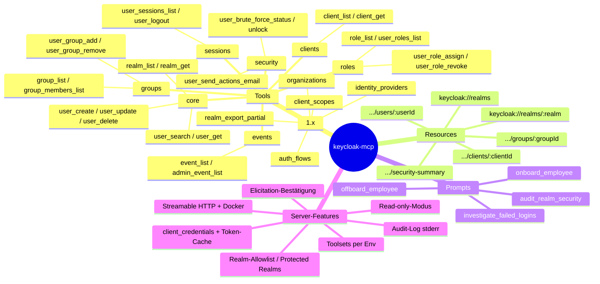

# 04 – Feature-Gap-Analyse: Was kann der MCP-Server zusätzlich anbieten?

> Stand der Recherche: 2026-10-24. Fokus dieses Dokuments ist der **Funktionsumfang** (Tools, Resources, Prompts, Server-Features) auf dem Weg von v0.0.2 zu einer stabilen 1.0. Sicherheit, Architektur und Build werden nur dort gestreift, wo sie den Funktionsschnitt beeinflussen.

## 1. Zusammenfassung

- **Ist:** 4 Tools (`create-user`, `delete-user`, `list-realms`, `list-users`), nur stdio, keine Resources/Prompts, keine Annotations, kein Output-Schema, keine Paginierung, Login per Password-Grant vor *jedem* Tool-Call. Basis: `@modelcontextprotocol/sdk` 0.5.0 und `@keycloak/keycloak-admin-client` ^22.
- **Markt:** Inzwischen gibt es mindestens 15 andere Keycloak-MCP-Server. Mehrere davon (TypeScript: `mrz1880/mcp-keycloak-admin`, `mgcrea/mcp-keycloak`, `dockndevai/mcp-keycloak`) liefern schon Read-only-Modus, Realm-Allowlist, Bestätigung destruktiver Aktionen und Service-Account-Auth. Mit diesen Features allein kann sich das Projekt also nicht mehr abheben. Sie sind Pflicht für 1.0.
- **Empfehlung 1.0:** Etwa 24 kuratierte Tools in 7 Toolsets, durchgehend mit `title`, Annotations, `outputSchema`/`structuredContent` und Paginierung. Dazu wenige Resource Templates, 4 Prompts, Read-only-Modus, Toolset-Filter, Realm-Allowlist, Elicitation-Bestätigung, `client_credentials`-Auth sowie Streamable HTTP mit Docker-Image.
- **Abheben** kann sich das Projekt mit **workflow-orientierten Prompts** (Onboarding, Offboarding, Security-Audit, Failed-Login-Analyse), mit **knappen, kontextsparenden Antworten** und mit einem **sauberen Safety-Modell**, das sich an den MCP-Annotations orientiert.

## 2. Verifizierte Rahmenbedingungen

### 2.1 MCP-Spezifikation und TypeScript-SDK

| Fakt | Wert | Quelle |
|---|---|---|
| Neueste Protokollversion | **2026-07-28** | [modelcontextprotocol.io/specification/latest](https://modelcontextprotocol.io/specification/latest), [Changelog](https://modelcontextprotocol.io/specification/2026-07-28/changelog) |
| TS-SDK aktuell | **1.32.2** (npm `latest`, 2026-10-23) | `npm view @modelcontextprotocol/sdk` |
| Von SDK 1.32.2 gesprochene Protokollversion | **2025-11-25** (`LATEST_PROTOCOL_VERSION`); unterstützt außerdem 2025-06-18, 2025-03-26, 2024-11-05, 2024-10-07 | `dist/esm/types.js` im npm-Tarball |
| Keycloak Admin Client aktuell | **26.8.1** (2026-10-13), passend zum Keycloak-Server-Release 26.8.1 | `npm view`, GitHub Releases keycloak/keycloak |

> **Korrektur nach Konsolidierung (siehe [02-architecture-and-dependencies.md](02-architecture-and-dependencies.md)):** Neben `@modelcontextprotocol/sdk` 1.32.2, das nur noch als Maintenance-Linie läuft, gibt es seit dem 2026-07-27 das **TS-SDK v2** als eigenes Paket `@modelcontextprotocol/server` (aktuell 2.4.0, `zod ^4.2.0`, Node ≥ 20). Es spricht **Protokoll 2026-07-28** und bedient über `serveStdio` auch Clients mit 2025er-Protokoll. Die Roadmap ([../roadmap-1.0.md](../roadmap-1.0.md)) legt fest: **1.0 baut direkt auf SDK v2 auf.** Was unten zu 1.32.2 steht, bleibt als Fallback gültig. Die Funktionen, die dieses Dokument für „2.0, sobald das SDK es kann“ einplant, sind damit früher verfügbar. Dazu gehören stateless-Betrieb, `server/discover` und MRTR-Elicitation.

**Ursprüngliche Konsequenz (Stand SDK 1.32.x):** 1.0 baut auf SDK 1.32.x und damit auf **Protokoll 2025-11-25** auf. Die Änderungen von 2026-07-28 kann der Server erst übernehmen, wenn das SDK sie unterstützt. Gemeint sind vor allem: stateless ohne `initialize`, `server/discover`, Multi-Round-Trip-Requests statt server-initiierter `elicitation/create`, `subscriptions/listen` und Deprecation von Logging. Das Design sollte diese Änderungen trotzdem jetzt schon berücksichtigen (siehe 2.2).

Für den Funktionsumfang relevante, im SDK 1.32.2 verifizierte Bausteine:

| Feature | Spec 2025-11-25 | SDK 1.32.2 | Nutzen für Keycloak-MCP |
|---|---|---|---|
| Tool `title`, `annotations` (`readOnlyHint`, `destructiveHint`, `idempotentHint`, `openWorldHint`) | ja | `registerTool(name, {title, description, inputSchema, outputSchema, annotations}, cb)` | Clients können Lese-Tools ohne Rückfrage zulassen und destruktive markieren |
| `outputSchema` + `structuredContent` | ja; Server MUSS dem Schema entsprechen, SOLL zusätzlich serialisiertes JSON als Text liefern | ja | Maschinenlesbare Ergebnisse (User-IDs, Paging-Info) |
| `icons` an Tools/Resources/Prompts | ja (neu in 2025-11-25) | ja | Kosmetik, LATER |
| Tool-Namensregeln | 1–128 Zeichen, `[A-Za-z0-9_.-]`, case-sensitive, eindeutig (SHOULD) | `validateToolName` mit Regex `^[A-Za-z0-9._-]{1,128}$` | siehe Namensschema, Abschnitt 4.1 |
| Resources und Resource Templates | ja | `registerResource(name, new ResourceTemplate(uri, {list, complete}), meta, cb)` | `keycloak://realms/{realm}/users/{id}` |
| Prompts | ja | `registerPrompt` + `completable()` für Argumente | Workflow-Prompts |
| Completions | ja | über `complete`-Callbacks in ResourceTemplate bzw. `completable()` | Auto-Vervollständigung von Realm-, Client- und Gruppennamen |
| `listChanged` | ja | `sendToolListChanged()` usw., `RegisteredTool.enable()/disable()` | nur eingeschränkt sinnvoll (siehe 2.2) |
| Paginierung (`cursor`/`nextCursor`) für `*/list` | ja | ja | erst bei großer Resource-Liste relevant. Für Tool-Ergebnisse eigene `first`/`max`-Parameter |
| Elicitation – Form-Mode | ja, flache Schemas aus Primitiven (string/number/boolean/enum) | `server.elicitInput(...)` | Bestätigung destruktiver Aktionen |
| Elicitation – URL-Mode | ja (neu in 2025-11-25); **Pflicht** für sensible Daten wie Passwörter und Secrets, Form-Mode dafür verboten | ja | wichtig für die Abgrenzung: Passwörter **nicht** per Form-Elicitation abfragen |
| Logging (`notifications/message`) | ja | `sendLoggingMessage` | **in 2026-07-28 deprecated**. Stattdessen stderr oder OpenTelemetry |
| Progress-Notifications | ja | ja | Bulk-Operationen (1.x) |
| Tasks (asynchron) | experimentell in 2025-11-25 | `server.experimental.tasks` | in 2026-07-28 als Extension ausgelagert und umgebaut, daher LATER |
| Streamable HTTP | ja | `StreamableHTTPServerTransport` / `WebStandardStreamableHTTPServerTransport` | Remote-Betrieb, Docker |
| HTTP+SSE (alt) | deprecated | noch vorhanden | **nicht** mehr implementieren |

### 2.2 Was Protokoll 2026-07-28 für das Design heute bedeutet

Aus dem [Changelog](https://modelcontextprotocol.io/specification/2026-07-28/changelog):

1. **Listen variieren nicht mehr pro Verbindung** (SEP-2567). Dynamische Toolsets, die sich pro Session per Meta-Tool ein- und ausschalten (`enable_toolset` + `listChanged`), sind damit ein Auslaufmodell. **Toolsets deshalb statisch per Konfiguration (Env) schneiden.**
2. **Elicitation läuft über Multi-Round-Trip-Requests** (`InputRequiredResult`) statt über server-initiierte Requests. Die Bestätigungslogik gehört daher hinter eine eigene Abstraktion (`confirmDestructive()`), damit der Wechsel später ohne Tool-Änderungen möglich ist.
3. **Logging ist deprecated.** Kein Aufwand in `logging/setLevel` oder `notifications/message` stecken. Audit- und Diagnose-Logs gehen strukturiert nach stderr, später optional als OpenTelemetry.
4. **Tools sollen deterministisch sortiert ausgeliefert werden** (Prompt-Caching), und `tools/list` bekommt `ttlMs`/`cacheScope`. Eine stabile Registrierungsreihenfolge kostet nichts.
5. `inputSchema`/`outputSchema` dürfen künftig beliebiges JSON Schema 2020-12 nutzen. Zod-Schemas bleiben kompatibel.

### 2.3 Keycloak Admin REST API / `@keycloak/keycloak-admin-client` 26.8.1

Im npm-Tarball 26.8.1 verifizierte Resource-Klassen und relevante Methoden:

| Domäne | Admin-Client-Resource | Relevante Methoden (Auswahl) |
|---|---|---|
| Users | `users` | `find` (search/exact/q/first/max/briefRepresentation), `count`, `findOne`, `create`, `update`, `del`, `resetPassword`, `executeActionsEmail`, `sendVerifyEmail`, `listGroups`/`addToGroup`/`delFromGroup`, `listRoleMappings`, `add/del/listRealmRoleMappings`, `add/del/listClientRoleMappings`, `listCompositeRealmRoleMappings`, `listSessions`, `listOfflineSessions`, `logout`, `getCredentials`, `deleteCredential`, `removeTotp`, `listFederatedIdentities`, `listConsents`/`revokeConsent`, `impersonation`, `getProfile`/`getProfileMetadata` (User Profile), `listVerifiableCredentials` (OID4VC) |
| Groups | `groups` | `find`, `count`, `findOne`, `create`, `update`, `del`, `createChildGroup`, `listSubGroups`, `listMembers`, Realm- und Client-Role-Mappings |
| Roles (Realm) | `roles` | `find`, `create`, `findOneByName`, `updateByName`, `delByName`, `findUsersWithRole`, Composite-Roles |
| Clients | `clients` | `find`, `findOne`, `create`, `update`, `del`, `createRole`/`listRoles`/`findRole`/`delRole`, `findUsersWithRole`, `getServiceAccountUser`, **`getClientSecret`/`generateNewClientSecret`/`invalidateSecret`**, Default/Optional Client Scopes, Protocol Mappers, Scope Mappings, `evaluateGenerateAccessToken`/`IdToken`/`UserInfo`, `listSessions`/`getSessionCount`, Authorization Services (Resources, Policies, Permissions, Scopes), Keys/Zertifikate |
| Client Scopes | `clientScopes` | CRUD, Realm-Default-Scopes, Protocol Mappers, Scope Mappings |
| Realms | `realms` | `find`, `findOne`, `create`, `update`, `del`, `export` (Partial Export), `partialImport`, `findEvents`, `findAdminEvents`, `getConfigEvents`/`updateConfigEvents`, `clearEvents`/`clearAdminEvents`, `getClientSessionStats`, `logoutAll`, `deleteSession`, `getKeys`, Default Groups, Localization, `testSMTPConnection`/`testLDAPConnection` |
| Brute Force | `attackDetection` | `findOne` (Status je User), `del` (User entsperren), `delAll` (alle entsperren) |
| Identity Providers | `identityProviders` | CRUD, Mapper, `importFromUrl`, `reloadKeys` |
| Authentication | `authenticationManagement` | Flows (get/create/copy/update/delete), Executions, Required Actions, Authenticator-Config |
| Organizations | `organizations` | `find`, `count`, `findOne`, `create`, `updateById`, `delById`, `listMembers`, `addMember`/`delMember`, `updateMembershipType`, `memberOrganizations`, `invite`/`inviteExistingUser`, IdP-Links, Einladungen, Org-Groups. Seit **Keycloak 26.0.0 „fully supported“** ([Release-Blog](https://www.keycloak.org/2024/10/keycloak-2600-released)) |
| Server | `serverInfo`, `whoAmI` | Version, Features, Provider. Effektive Rechte des Admin-Tokens |
| Weitere | `components` (User Federation/LDAP), `userStorageProvider` (Sync), `clientPolicies`, `cache`, `workflows`, `ssf` (Shared Signals), `clientsV2` (hinter `enableExperimentalApis`) | erst für 2.0 oder später, teils experimentell |

**Auth-Grants:** Der Admin-Client unterstützt neben `password` auch `client_credentials` (`clientSecret`) und `refresh_token`. Die aktuelle Implementierung authentifiziert sich vor **jedem** Call neu per Password-Grant. Zielbild sind Token-Cache und Refresh.

## 3. Ist-Umfang vs. Soll

| Bereich | Ist (v0.0.2) | Soll (1.0) |
|---|---|---|
| Tools | 4, ohne Annotations und ohne Output-Schema | ca. 24 kuratierte Tools, alle mit `title`, Annotations, `outputSchema` |
| Domänen | Realms (nur list), Users (create/delete/list) | Realms, Users, Groups, Roles, Clients (read), Sessions, Events, Brute Force |
| Suche/Paginierung | keine; `users.find()` liefert Keycloak-Default (max. 100), kein Filter | `search`, `exact`, `q` (Attribute), `first`/`max` mit Obergrenze, `briefRepresentation` |
| Ergebnisformat | Freitext | `structuredContent` + kompakte Text-Zusammenfassung |
| Resources | keine | Resource Templates für Realm, User, Group, Client, Security-Summary |
| Prompts | keine | 4 Workflow-Prompts |
| Completions | keine | Realm-, Client- und Gruppennamen |
| Safety | keine (auch `delete-user` ohne Rückfrage) | Read-only-Modus, Realm-Allowlist, geschützte Realms, Elicitation-Bestätigung, Audit-Log |
| Tool-Auswahl | alle immer aktiv | Toolsets per Env |
| Auth | Password-Grant, Default `admin/admin`, Login pro Call | `client_credentials` empfohlen, Password-Grant nur Dev, Token-Cache |
| Transport | stdio | stdio + Streamable HTTP, Docker-Image |
| Fehler | `throw` → Protokollfehler (außer Zod) | Keycloak-HTTP-Fehler (403/404/409) → `isError: true` mit handlungsleitender Meldung |

### Feature-Domänen (Soll-Bild)

## 4. Tool-Katalog

### 4.1 Namensschema: `<domäne>_<verb>[_<objekt>]` in snake_case

Vorschlag: **`user_create`** statt `create-user` (Ist) oder `user-create`.

Begründung:

1. **Domäne zuerst:** Tools derselben Domäne stehen in Client-UIs und alphabetisch sortierten Listen beieinander (`user_*`, `group_*`). Toolsets lassen sich außerdem über das Präfix filtern (`KEYCLOAK_MCP_DISABLED_TOOLS=user_delete`, Toolset `users` = `user_*`).
2. **snake_case statt kebab-case:** Beide sind spec-konform (`[A-Za-z0-9_.-]`). Bindestriche sind in fast keiner Programmiersprache als Bezeichner gültig. Clients, die Tools als Funktionen in generiertem Code abbilden (Code-Mode, programmatisches Tool-Calling), müssen `create-user` umbenennen, `user_create` nicht. snake_case ist zudem im MCP-Ökosystem verbreitet (z. B. Referenz-Server, die meisten Keycloak-Konkurrenten wie `mgcrea`, `shigechika`, `erikhoward`).
3. **Keine Punkte:** `user.create` wäre erlaubt. Viele Clients setzen aber Präfixe wie `mcp__keycloak__…`, und manche LLM-APIs erlauben in Funktionsnamen nur `[A-Za-z0-9_-]`.
4. **Kurz halten:** Clients präfixen mit dem Servernamen. Tool-Namen daher maximal ca. 30 Zeichen.
5. **Bruch in 1.0 bewusst vollziehen:** Die 4 Altnamen nicht als Aliase weiterführen, weil Aliase die Toolzahl erhöhen und das LLM verwirren. Stattdessen eine Migrationstabelle im CHANGELOG: `create-user`→`user_create`, `delete-user`→`user_delete`, `list-users`→`user_search`, `list-realms`→`realm_list`.

Prompts verwenden dasselbe Schema (`onboard_employee`), Resource-URIs das Schema `keycloak://realms/{realm}/<plural>/{id}`.

### 4.2 Gemeinsame Konventionen für alle Tools

- **`realm`-Parameter** ist an jedem realm-bezogenen Tool optional, Default `KEYCLOAK_MCP_DEFAULT_REALM`. Er wird gegen die Allowlist geprüft.
- **Identifikation:** Tools akzeptieren `userId` **oder** `username` und lösen intern per `exact=true` auf. Dasselbe gilt für Clients: `clientId` (fachlich, z. B. `my-app`) statt interner UUID. Das vermeidet die häufigste LLM-Fehlerquelle (`clientId` vs. `id`).
- **Listen:** `first` (Default 0), `max` (Default 20, Obergrenze 100), Rückgabe mit `items`, `count` und `nextFirst` (oder `null`). Listen liefern eine **Kurzprojektion** (id, username, email, enabled …), `*_get` liefert die volle Repräsentation, aber redigiert.
- **Redaktion:** Felder wie `secret`, `credentials`, `clientSecret`, IdP-`config.clientSecret` oder SMTP-`password` werden serverseitig immer entfernt bzw. maskiert, auch in `*_get`.
- **Annotations:** `openWorldHint: false` für alle Tools, weil Keycloak eine geschlossene Domäne ist. Ausnahme sind Tools, die E-Mails an Dritte auslösen (`openWorldHint: true`). Spec-Defaults beachten: Ohne Angabe gelten `readOnlyHint=false` und `destructiveHint=true`. Deshalb **immer explizit setzen.**
- **Destruktiv = Elicitation:** Alle Tools mit `destructiveHint: true` und `readOnlyHint: false` laufen durch `confirmDestructive()` (siehe 6.4).

### 4.3 Priorisierter Katalog

Legende: **RO** = `readOnlyHint: true` · **W** = schreibend, nicht destruktiv (additiv) · **D** = `destructiveHint: true` · **I** = `idempotentHint: true` · **OW** = `openWorldHint: true`
Priorität: **MUST** = 1.0 · **SHOULD** = 1.x · **LATER** = 2.0+ · **OPT-IN** = nur hinter explizitem Flag

#### MUST für 1.0 (24 Tools, 7 Toolsets)

| # | Tool | Toolset | Beschreibung | Hints | Admin-Client |
|---|---|---|---|---|---|
| 1 | `realm_list` | core | Realms auflisten (nur Name, Anzeigename, enabled). Gefiltert durch die Allowlist | RO, I | `realms.find` |
| 2 | `realm_get` | core | Realm-Kurzprofil: Login-Settings, Passwort-Policy, Brute-Force-Konfiguration, Events an/aus, Tokenlaufzeiten (ohne SMTP-Passwort und Keys) | RO, I | `realms.findOne` |
| 3 | `user_search` | core | Benutzer suchen: `search` (Freitext), `username`/`email` mit `exact`, `q` (Attribute), `enabled`, Paginierung, `count` | RO, I | `users.find`, `users.count` |
| 4 | `user_get` | core | Ein Benutzer vollständig, optional `include: ["groups","roles","requiredActions","federatedIdentities"]` | RO, I | `users.findOne`, `listGroups`, `listRoleMappings` |
| 5 | `user_create` | core | Benutzer anlegen (username, email, Vor-/Nachname, enabled, `emailVerified`, Attribute, `requiredActions`, optional Gruppen). **Kein Passwort-Parameter** | W | `users.create` |
| 6 | `user_update` | core | Profilfelder, `enabled` (sperren/entsperren), Attribute und Required Actions ändern. Nur übergebene Felder werden verändert (Merge statt Replace) | W, I | `users.update` |
| 7 | `user_delete` | core | Benutzer löschen. **Elicitation-Bestätigung**, Hinweis auf die Alternative `user_update enabled=false` | D, I | `users.del` |
| 8 | `user_send_actions_email` | core | E-Mail mit Required Actions senden (`UPDATE_PASSWORD`, `VERIFY_EMAIL`, `CONFIGURE_TOTP` …), optional `lifespan`, `clientId`, `redirectUri`. Ersetzt Passwort-Setzen über das LLM | W, OW | `users.executeActionsEmail` |
| 9 | `group_list` | groups | Gruppen suchen bzw. als Baum auflisten (`search`, `briefRepresentation`, Subgruppen) | RO, I | `groups.find`, `listSubGroups` |
| 10 | `group_members_list` | groups | Mitglieder einer Gruppe (per ID oder Pfad), paginiert | RO, I | `groups.listMembers`, `realms.getGroupByPath` |
| 11 | `user_group_add` | groups | Benutzer zu Gruppe hinzufügen (Gruppe per ID oder Pfad) | W, I | `users.addToGroup` |
| 12 | `user_group_remove` | groups | Benutzer aus Gruppe entfernen | D, I | `users.delFromGroup` |
| 13 | `role_list` | roles | Realm-Rollen oder (mit `clientId`) Client-Rollen auflisten, Suche | RO, I | `roles.find`, `clients.listRoles` |
| 14 | `user_roles_list` | roles | Rollen eines Users: direkt vs. effektiv (`effective: true` → Composite), Realm und Client getrennt | RO, I | `listRoleMappings`, `listComposite*RoleMappings` |
| 15 | `user_role_assign` | roles | Realm- oder Client-Rolle(n) per Name zuweisen (Auflösung Name→Repräsentation intern) | W, I | `addRealmRoleMappings`, `addClientRoleMappings` |
| 16 | `user_role_revoke` | roles | Realm- oder Client-Rolle(n) entziehen | D, I | `delRealmRoleMappings`, `delClientRoleMappings` |
| 17 | `client_list` | clients | Clients auflisten: clientId, Name, Protokoll, public/confidential, enabled, Flows (Standard/Direct Access/Service Account). **Keine Secrets** | RO, I | `clients.find` |
| 18 | `client_get` | clients | Client-Details: Redirect-URIs, Web-Origins, Flows, Default/Optional Scopes, Rollen. **Secret immer redigiert** | RO, I | `clients.findOne`, `listDefaultClientScopes` |
| 19 | `user_sessions_list` | sessions | Aktive (optional Offline-)Sessions eines Users: IP, Start, letzter Zugriff, Clients | RO, I | `users.listSessions`, `listOfflineSessions` |
| 20 | `user_logout` | sessions | Alle Sessions eines Users beenden (z. B. bei Kompromittierung oder Offboarding) | D, I | `users.logout` |
| 21 | `event_list` | events | Login-Events filtern: `type` (LOGIN_ERROR …), `user`, `client`, `ipAddress`, `dateFrom`/`dateTo`, paginiert. Meldet klar, wenn Events im Realm deaktiviert sind | RO, I | `realms.findEvents`, `getConfigEvents` |
| 22 | `admin_event_list` | events | Admin-Events filtern (`operationTypes`, `resourceTypes`, `resourcePath`, `authUser`, Zeitraum), optional ohne Representation | RO, I | `realms.findAdminEvents` |
| 23 | `user_brute_force_status` | security | Brute-Force-Status eines Users: gesperrt?, Fehlversuche, letzte IP | RO, I | `attackDetection.findOne` |
| 24 | `user_brute_force_unlock` | security | Temporäre Brute-Force-Sperre eines Users aufheben | W, I | `attackDetection.del` |

Davon sind 13 Tools read-only, 7 schreibend und 4 destruktiv. Im **Read-only-Modus bleiben 13 Tools** übrig. Mit dem Default-Toolset `core,groups,roles` sind es 16 Tools.

> Bewusst **nicht** in 1.0: Gruppen- und Rollen-CRUD, Client-Schreiboperationen, Passwort-Reset. Grund ist, dass 1.0 die häufigsten Helpdesk- und Audit-Fälle abdecken soll, ohne die Konfiguration des Realms zu verändern.

#### SHOULD (1.x)

| Tool | Toolset | Beschreibung | Hints | Anmerkung |
|---|---|---|---|---|
| `user_count` | core | Anzahl User (mit Filter) | RO, I | ggf. in `user_search` integriert (`countOnly`) |
| `user_credentials_list` | security | Credential-**Typen** eines Users (password, otp, webauthn), ohne Secret-Daten | RO, I | `users.getCredentials`, Felder filtern |
| `user_credential_delete` | security | Credential entfernen, z. B. verlorenes OTP-Gerät | D, I | `users.deleteCredential` / `removeTotp` |
| `user_reset_password` | security | Temporäres Passwort setzen (`temporary: true` erzwungen) | D, I | **OPT-IN** (`KEYCLOAK_MCP_ALLOW_PASSWORD_RESET`). Das Passwort läuft durch den LLM-Kontext, daher `user_send_actions_email` bevorzugen. Nie per Form-Elicitation abfragen (Spec-Verbot) |
| `user_federated_identity_list` | core | Verknüpfte IdP-Accounts | RO, I | `listFederatedIdentities` |
| `user_consents_list` / `user_consent_revoke` | sessions | Client-Consents einsehen bzw. widerrufen | RO / D | |
| `group_create` / `group_update` / `group_delete` | groups | Gruppen-CRUD inkl. Subgruppen | W / W,I / D | `group_delete` mit Elicitation |
| `group_role_assign` / `group_role_revoke` / `group_roles_list` | roles | Rollen an Gruppen (empfohlenes RBAC-Muster) | W,I / D / RO | |
| `role_create` / `role_update` / `role_delete` | roles | Realm- und Client-Rollen-CRUD, Composites | W / W,I / D | |
| `role_users_list` | roles | „Wer hat Rolle X?“ (direkt zugewiesen) | RO, I | `roles.findUsersWithRole`, `clients.findUsersWithRole` |
| `client_create` | clients | Client anlegen (OIDC public/confidential, Redirect-URIs). **Secret wird nicht ausgegeben** | W | Vorgaben: keine `*`-Redirects, PKCE an |
| `client_update` | clients | Redirect-URIs, Web-Origins, Flows ändern | W, I | Warnung bei Wildcards |
| `client_sessions_list` | sessions | Sessions bzw. Session-Count je Client | RO, I | `clients.listSessions`, `realms.getClientSessionStats` |
| `client_scope_list` / `client_scope_get` | clients | Client Scopes inkl. Protocol Mapper (read) | RO, I | |
| `client_token_preview` | clients | Beispiel-Access-Token/ID-Token/UserInfo für User+Client generieren („Warum fehlt Claim X?“) | RO, I | `clients.evaluateGenerateAccessToken` u. a. Hoher Debug-Nutzen |
| `event_config_get` / `event_config_update` | events | Event-Logging-Konfiguration lesen bzw. aktivieren | RO / W,I | |
| `identity_provider_list` / `identity_provider_get` | idp | IdPs und Mapper (read, Secrets redigiert) | RO, I | |
| `auth_flow_list` / `auth_flow_get` | auth | Flows und Executions (read), Required Actions | RO, I | Basis für Security-Audit |
| `organization_list` / `organization_get` / `organization_members_list` | organizations | Organizations (KC ≥ 26) | RO, I | Feature-Detection über `serverInfo` |
| `organization_member_add` / `organization_member_remove` / `organization_invite` | organizations | Mitglieder verwalten bzw. einladen | W,I / D / W,OW | |
| `realm_export_partial` | core | Partial Export (Clients, Gruppen, Rollen) als Resource-Link | RO, I | Zusätzlich serverseitig redigieren. Großes Ergebnis, daher als Resource ausliefern |
| `server_info_get` | core | Keycloak-Version, aktivierte Features, effektive Rechte des MCP-Tokens | RO, I | `serverInfo.find`, `whoAmI`. Hilft bei 403-Diagnose |

#### LATER (2.0+)

| Bereich | Tools (Skizze) | Grund für Aufschub |
|---|---|---|
| Realm-Konfiguration schreiben | `realm_update` (Passwort-Policy, Brute-Force, Token-Laufzeiten), `realm_create` | hoher Impact; braucht Diff-Vorschau und Dry-Run |
| Authentication Flows schreiben | `auth_flow_copy`, `auth_flow_execution_update` | Fehlkonfiguration kann alle Logins sperren |
| Identity Provider schreiben | `identity_provider_create/update` | enthält Secrets; braucht URL-Elicitation |
| Protocol Mapper CRUD | `client_mapper_*`, `client_scope_mapper_*` | Nische; schwer korrekt zu parametrisieren |
| Authorization Services | Resources/Policies/Permissions | sehr großer API-Teil, eigenes Toolset |
| User Federation | LDAP-Sync, `testLDAPConnection` | Infrastrukturnah |
| Partial Import | `realm_import_partial` | Massenänderung |
| Bulk-Operationen | `user_bulk_create` (CSV) mit Progress-Notifications bzw. Tasks-Extension | warten, bis Tasks in 2026-07-28 und im SDK stabil sind |
| Neue KC-Features | `workflows`, `ssf` (Shared Signals), OID4VC (`listVerifiableCredentials`), Admin API v2 (`clientsV2`, experimentell) | API noch in Bewegung |

#### OPT-IN bzw. bewusst NICHT angeboten

Siehe Abschnitt 7.

## 5. Resources und Prompts

### 5.1 Resources (application-controlled)

Resources ergänzen die Tools. Sie ersetzen sie nicht, weil viele Clients Resources schwächer unterstützen als Tools. Tools geben bei Bedarf `resource_link`s auf diese URIs zurück, z. B. `user_create` → `keycloak://realms/acme/users/<id>`.

| URI / Template | Inhalt | Completion |
|---|---|---|
| `keycloak://realms` | Liste der (erlaubten) Realms | – |
| `keycloak://realms/{realm}` | Realm-Kurzprofil (wie `realm_get`) | `realm` |
| `keycloak://realms/{realm}/users/{userId}` | User inkl. Gruppen und effektiver Rollen (JSON) | `realm` |
| `keycloak://realms/{realm}/groups/{groupId}` | Gruppe, Pfad, Rollen, Mitgliederzahl | `realm` |
| `keycloak://realms/{realm}/clients/{clientId}` | Client-Konfiguration (redigiert); `clientId` fachlich | `realm`, `clientId` |
| `keycloak://realms/{realm}/roles/{roleName}` | Realm-Rolle inkl. Composites | `realm`, `roleName` |
| `keycloak://realms/{realm}/security-summary` | aggregiert: Passwort-Policy, Brute-Force-Settings, OTP-Policy, Events an/aus, Flows mit/ohne MFA, Public Clients mit Direct Access Grants, Wildcard-Redirects | `realm` |
| `keycloak://realms/{realm}/exports/partial` (1.x) | Partial Export (redigiert) | `realm` |

`list`-Callbacks der Templates nur dort implementieren, wo die Menge klein ist (Realms, Clients). Benutzer **nicht** auflisten, weil das in großen Realms nicht skaliert.

### 5.2 Prompts (user-controlled, Slash-Commands)

| Prompt | Argumente | Ablauf, den der Prompt dem Modell vorgibt | Benötigte Tools |
|---|---|---|---|
| `onboard_employee` | `realm`*, `email`*, `firstName`*, `lastName`*, `department` (Completion über Gruppen), `roles` | Existenz prüfen (`user_search exact`) → `user_create` → Gruppe(n) zuordnen → Rollen zuweisen → `user_send_actions_email [UPDATE_PASSWORD, VERIFY_EMAIL]` → Zusammenfassung | core, groups, roles |
| `offboard_employee` | `realm`*, `username`* | User finden → Sessions anzeigen → `user_logout` → `user_update enabled=false` → Gruppen- und Rollenübersicht für Review. **Kein Löschen**, nur auf ausdrücklichen Wunsch | core, sessions, groups, roles |
| `audit_realm_security` | `realm`* | `security-summary` lesen → Passwort-Policy, Brute-Force, MFA-Flows, Event-Logging bewerten → Clients auf Wildcard-Redirects, Public+Direct-Access und Service Accounts mit `realm-admin` prüfen → Admin-Events der letzten 7 Tage → priorisierte Befundliste | core, clients, events, security (+ auth in 1.x) |
| `investigate_failed_logins` | `realm`*, `username`, `since` (Default 24h) | `event_list type=LOGIN_ERROR` → nach User/IP/Client gruppieren → Brute-Force-Status betroffener User → Hinweise auf Password-Spraying (viele User von einer IP) → Empfehlungen (Unlock, Logout, Passwort-Reset per E-Mail) | events, security, sessions |
| `review_user_access` (1.x) | `realm`*, `username`* | effektive Rollen und Gruppen, Client-Zugriffe, Consents, letzte Logins → Least-Privilege-Hinweise | roles, groups, sessions, events |
| `review_client_config` (1.x) | `realm`*, `clientId`* | Redirect-URIs, Flows, Scopes, Token-Preview | clients |

Prompt-Argumente bekommen Completions über `completable()`: `realm` aus der Allowlist, `department` aus Gruppen, `clientId` aus Clients.

## 6. Server-Features

### 6.1 Read-only-Modus
- `KEYCLOAK_MCP_READ_ONLY=true` registriert schreibende und destruktive Tools **gar nicht**. Sie werden also nicht nur abgelehnt, das LLM sieht sie überhaupt nicht.
- Für 1.0 empfohlen: **Default `false`**, damit die bestehende Nutzerbasis kompatibel bleibt, und deutlicher Hinweis im README. Alternative (wie `mgcrea`): Default read-only, Writes per Opt-in. Das ist im Detail eine Produktentscheidung, für einen Admin-Server ist das aber vertretbar.

### 6.2 Toolsets und Tool-Filter
Jedes zusätzliche Tool kostet Kontext-Tokens und verschlechtert die Tool-Auswahl des Modells. Deshalb:
- `KEYCLOAK_MCP_TOOLSETS=core,groups,roles` (Default), `all` für alles. Verfügbare Toolsets 1.0: `core`, `groups`, `roles`, `clients`, `sessions`, `events`, `security`. 1.x kommen `organizations`, `idp`, `auth` dazu.
- `KEYCLOAK_MCP_DISABLED_TOOLS=user_delete,...` für Feinsteuerung.
- Statisch beim Start. Keine dynamischen Toolsets pro Session, weil das mit Protokoll 2026-07-28 nicht mehr vorgesehen ist (2.2).
- Tool-Beschreibungen kurz und präzise halten (1–3 Sätze plus Keycloak-Fallstricke wie „`clientId` ist der fachliche Name, nicht die UUID“).

### 6.3 Realm-Allowlist und geschützte Realms
- `KEYCLOAK_MCP_REALMS=acme,partner`: Alle Tools lehnen andere Realms ab, `realm_list` filtert entsprechend.
- `KEYCLOAK_MCP_PROTECTED_REALMS=master` (Default): Dort sind nur Lese-Tools erlaubt.
- `KEYCLOAK_MCP_DEFAULT_REALM`: Damit muss das LLM den Realm nicht raten.

### 6.4 Bestätigung via Elicitation
- `confirmDestructive({tool, realm, target, summary})`: Unterstützt der Client Elicitation (`capabilities.elicitation.form`), wird ein Form-Request mit `confirm: boolean` geschickt und optional Ziel-Username oder Realm zur Gegenprüfung eingeblendet. Nur `action: "accept"` mit `confirm: true` führt aus. `decline`/`cancel` liefern `isError: false` mit einem Hinweis „abgebrochen“.
- **Fallback** ohne Elicitation-Support: Das Tool verlangt den Parameter `confirm: true`. Ohne ihn liefert es eine Vorschau („würde User X in Realm Y löschen“) und führt nicht aus. Das ist zugleich ein **Dry-Run**.
- Abschaltbar für Automationen über `KEYCLOAK_MCP_REQUIRE_CONFIRMATION=false`.
- Wichtig: **Keine Passwörter oder Secrets per Form-Elicitation abfragen** (Spec: MUST NOT). Dafür wäre URL-Mode nötig, was ein Web-Frontend voraussetzt (2.0).
- Die Abstraktion vorbereiten auf Multi-Round-Trip-Requests aus 2026-07-28.

### 6.5 Authentifizierung gegenüber Keycloak
- **Empfohlen:** `client_credentials` mit dedizierter Service-Account-Client-Konfiguration (`KEYCLOAK_CLIENT_ID`, `KEYCLOAK_CLIENT_SECRET`, `KEYCLOAK_AUTH_REALM`). Least-Privilege-Rollen aus `realm-management` dokumentieren: read-only z. B. `view-users`, `query-groups`, `view-realm`, `view-clients`, `view-events`; schreibend zusätzlich `manage-users`.
- Password-Grant (`admin-cli`) nur noch für lokale Entwicklung. **Keine Default-Credentials** `admin/admin` mehr.
- Token-Cache mit Refresh vor Ablauf statt Login pro Call. Bei 401 einmal neu anmelden.
- Optional `KEYCLOAK_CA_CERT` für interne PKI.

### 6.6 Transport: Streamable HTTP und Docker
- `KEYCLOAK_MCP_TRANSPORT=stdio|http`, `PORT`, Endpoint `/mcp`. **Kein** HTTP+SSE (deprecated).
- HTTP-Modus **nur mit Absicherung**: mindestens Bearer-Token-Prüfung. Zielbild ist MCP-Authorization (OAuth 2.1), mit Keycloak selbst als Authorization Server. Das offizielle MCP-Authorization-Tutorial verwendet Keycloak als Beispiel-AS ([Tutorial](https://modelcontextprotocol.io/docs/2025-11-25/tutorials/security/authorization)). Langfristig (2.0) möglich: **Per-User-Identität** (Token des angemeldeten Admins statt Service Account), wie es `drtinkerer/keycloak-mcp-server` und der Cloud-IAM-Server zeigen. Dann gelten die Keycloak-Rechte des Menschen, und das Audit nennt den echten User.
- Docker-Image (`ghcr.io/<owner>/keycloak-mcp`): Multi-Arch, non-root, nur `dist/`. Healthcheck-Endpoint im HTTP-Modus.

### 6.7 Antwortqualität und Kontext-Ökonomie
- `outputSchema` + `structuredContent` für alle Tools, dazu eine **kurze** Textfassung (Spec-Empfehlung: serialisiertes JSON als Text, ggf. gekürzt).
- Listen paginiert und projiziert (siehe 4.2). Große Daten (Exports) als Resource bzw. `resource_link` statt inline.
- Fehler-Mapping: 403 → „Service Account fehlt Rolle `manage-users` in `realm-management`“. 404 → „User `x` nicht gefunden, nutze `user_search`“. 409 → „Username/E-Mail existiert bereits“. Alles als `isError: true`, damit das Modell sich selbst korrigieren kann.

### 6.8 Audit und Betrieb
- Jeder schreibende oder destruktive Call wird als strukturierte JSON-Zeile nach **stderr** geloggt (Tool, Realm, Ziel, Ergebnis, Dauer, ohne Secrets). Keycloak-Admin-Events bleiben die führende Audit-Quelle.
- Kein MCP-Logging (`notifications/message`) mehr einbauen, weil es deprecated ist. OpenTelemetry ist ein späteres Thema.

## 7. Abgrenzung: was bewusst NICHT oder nur per Opt-in angeboten wird

| Fähigkeit | Entscheidung | Begründung |
|---|---|---|
| Client-Secret ausgeben (`getClientSecret`) | **NICHT** | Secrets im LLM-Kontext und in Client-Transkripten sind ein Exfiltrationsrisiko. Verweis auf die Admin-Console |
| Client-Secret rotieren (`generateNewClientSecret`, `invalidateSecret`) | **NICHT in 1.x**, frühestens 2.0 mit URL-Elicitation | Ohne Ausgabe des neuen Secrets bricht die Rotation die Anwendung. Mit Ausgabe gilt Punkt oben |
| IdP-, SMTP- oder LDAP-Secrets lesen | **NICHT**, Ausgaben immer redigiert | wie oben |
| Realm löschen (`realms.del`) | **NICHT** | irreversibel, Totalschaden |
| Realm anlegen, Partial Import | LATER, nur **OPT-IN** | Massenwirkung |
| User-Impersonation (`users.impersonation`) | **NICHT** | erzeugt Session als fremder User, Missbrauchspotenzial |
| Events löschen (`clearEvents`, `clearAdminEvents`) | **NICHT** | Audit-Manipulation |
| Alle Brute-Force-Sperren aufheben (`attackDetection.delAll`) | **OPT-IN** | realmweite Wirkung |
| Alle Sessions im Realm beenden (`realms.logoutAll`) | **OPT-IN** (`KEYCLOAK_MCP_ALLOW_REALM_WIDE`) + Elicitation | realmweite Wirkung |
| Passwort direkt setzen | **OPT-IN**, nur `temporary: true` | Passwort im LLM-Kontext. `user_send_actions_email` ist der Standardweg |
| Schreibzugriff auf `master` | **Default gesperrt** (Protected Realms) | Kompromittierung aller Realms möglich |
| Generischer Roh-Request („escape hatch“, wie bei `mgcrea`) | **NICHT in 1.0**, ggf. 1.x als OPT-IN und nur GET | umgeht alle Guardrails und Redaktionen |
| Authentication-Flows, Realm-Policies schreiben | LATER | Lockout-Risiko |

## 8. Wettbewerb

Recherche über npm (`npm search keycloak mcp`), GitHub-Suche, die offizielle MCP Registry (`registry.modelcontextprotocol.io`) und Smithery. Stars und Aktivität Stand 2026-10-24. Zum Vergleich: dieses Repo hat 46 Stars, letzter Push 2025-02-09.

| Projekt | Sprache / Paket | Umfang laut README | Safety-Features | Transport / Auth | Stars · letzter Push |
|---|---|---|---|---|---|
| [sshaaf/keycloak-mcp-server](https://github.com/sshaaf/keycloak-mcp-server) | Java (Quarkus, GraalVM native) | Users, Realms, Clients, Roles, Groups, IdPs, Authentication; Suche im Keycloak-Discourse | User-JWT statt Service Account | SSE/HTTP, Container (Quay), OpenShift | 48 · 2026-08 |
| [HaithamOumerzoug/keycloak-mcp](https://github.com/HaithamOumerzoug/keycloak-mcp) | TS · npm `keycloak-mcp` 1.2.5 | 9 Tools (User create/delete/list, Realms, Clients, Groups, Client-Roles, Rollen- und Gruppenzuweisung) | – | stdio, Smithery | 13 · 2025-12 |
| [M0-AR/keycloak-mcp-server](https://github.com/M0-AR/keycloak-mcp-server) | JS · npm `keycloak-mcp-server` 2.0.0 | „80+ Tools“: Users, Realms, Clients, Roles, Groups, Organizations, IdPs, Client Scopes, Sessions/Events | – | stdio, Admin-Passwort | 6 · 2025-07 |
| [idoyudha/mcp-keycloak](https://github.com/idoyudha/mcp-keycloak) | Python | Users, Clients, Roles, Groups, Realm, Authentication | – | stdio + Streamable HTTP, Smithery | 4 · 2026-10 |
| [Octodet/keycloak-mcp](https://github.com/Octodet/keycloak-mcp) | JS · npm `@octodet/keycloak-mcp` 1.0.6 | 6 Tools (User CRUD-light, Realms, Client-Roles) | – | stdio | 3 · 2025-06 |
| [mrz1880/mcp-keycloak-admin](https://github.com/mrz1880/mcp-keycloak-admin) | TS · npx `mcp-keycloak-admin`, MCP Registry | Users, Roles, Clients, Groups, IdP, Events | `READ_ONLY`, `ALLOWED_REALMS`, **Elicitation-Bestätigung + `confirm`-Fallback**, Annotations | stdio; Service Account oder Password | 3 · 2026-10 |
| [paoloamato2/keycloak-mcp-server](https://github.com/paoloamato2/keycloak-mcp-server) | Python (uvx) | „alle 299 Admin-REST-Endpunkte“ (generiert) | – | stdio + SSE; Password oder Client Credentials | 3 · 2026-04 |
| [mgcrea/mcp-keycloak](https://github.com/mgcrea/mcp-keycloak) | TS · npm `@mgcrea/mcp-keycloak` | Realms, Users, Groups, Roles, Clients, Sessions, Events, Client Scopes, Mapper, IdPs, Auth Flows | **Read-only als Default** (Write-Tools nicht registriert), `confirm: true` für destruktive Tools, Listen-Zusammenfassung, Escape-Hatch | stdio, Docker (ghcr); Client Credentials empfohlen, Token-Cache | 0 · 2026-10 |
| [dockndevai/mcp-keycloak](https://github.com/dockndevai/mcp-keycloak) | TS, MCP Registry | Realms, Users, Clients, Roles, multi-realm | Modi read-only/read-write/admin, Realm-Allowlist, Protected Realms, Delete-Gating, Dry-Run, JSON-Audit-Log | stdio; Service Account oder Password | 1 · 2026-10 |
| [erikhoward/mcp-keycloak](https://github.com/erikhoward/mcp-keycloak) | Go | Realms, Clients, Users, Groups, Realm-Roles | `KEYCLOAK_READ_ONLY`, Secret-Redaktion | stdio, Docker; Password oder Service Account | 0 · 2026-09 |
| [shigechika/keycloak-mcp](https://github.com/shigechika/keycloak-mcp) | Python, MCP Registry | **Troubleshooting/Security-Analytik**: Login-Stats, Failures nach IP, Password-Spray-Check, Login-Loops, TOTP-Adoption, Brute-Force-Status, Config-Change-Snapshots, Bulk-Passwort-Reset | read-only-lastig | stdio; Service Account | 0 · 2026-10 |
| [MnemoShare/mnemoshare-keycloak-mcp](https://github.com/MnemoShare/mnemoshare-keycloak-mcp) | Go (Single Binary) | „134 Tools in 13 Domänen“ | – | stdio + HTTP; Password oder Client Credentials | 0 · 2026-09 |
| [drtinkerer/keycloak-mcp-server](https://github.com/drtinkerer/keycloak-mcp-server) | Python (FastMCP) | 20 read-only Tools | **Per-User-OAuth** (jeder Call als angemeldeter User), Ausgabe begrenzt, Secrets entfernt | HTTP/Streamable HTTP + stdio, OpenShift | 0 · 2026-10 |
| [Cloud-IAM Keycloak MCP](https://documentation.cloud-iam.com/how-to-guides/keycloak-mcp.html) | gehostet (kein öffentliches Repo verlinkt) | 20 read-only Tools (Realms, Users, Clients, Roles, Groups, IdPs, Components, Events) | nur Lesen | HTTP auf dem Deployment; OAuth 2.1/PKCE mit Keycloak-Login; ab KC 26.6 | n/a |
| [skycloak/keycloak-mcp (Smithery)](https://smithery.ai/server/skycloak/keycloak-mcp) | gehostet | Betrieb von *managed* Keycloak (Cluster provisionieren und skalieren) | – | – | andere Zielgruppe |

Weitere kleinere Treffer ohne nennenswerte Verbreitung, teils experimentell: `HexEcho/keycloak-mcp`, `ethan-k/keycloak-mcp`, `ZakariaDani/keycloak-mcp`, `TETRA-2023/keycloak-mcp`, `Faust-Systems/keycloak-mcp`, `futuretea/keycloak-mcp-server`, `hakkisagdic/keycloak-mcp-server`, `Ronnasayd/keycloak-mcp-server`, `if414013/rKCmcp` (Rust).

**Einordnung:**
- **Breite** ist kein Alleinstellungsmerkmal. Generierte Server decken alles ab (299 Endpunkte, 134 Tools), leiden aber unter dem Tool-Overload-Problem.
- **Safety-Features** (Read-only, Allowlist, Bestätigung) sind bei den aktiven TS-Konkurrenten Standard. Für 1.0 ist das Pflicht, kein Bonus.
- **Lücken, die das Projekt besetzen kann:**
  1. Workflow-Prompts (Onboarding, Offboarding, Audit, Failed Logins). Kein gefundener Konkurrent bewirbt MCP-Prompts als Kernfeature.
  2. Resources mit Completions.
  3. Konsequente `outputSchema`/`structuredContent`-Nutzung.
  4. Kuratierter Kern mit Toolsets statt Vollabdeckung.
  5. Streamable HTTP + Docker + perspektivisch Per-User-OAuth. Das Projekt kann sich hier auf Keycloak als natürlichen Authorization Server stützen.
- **Vorteil des Projekts:** etablierter npm-Name, Smithery-Eintrag, 46 Stars. Der Rückstand bei der Aktualität (letzter Push Februar 2025) ist das größte Risiko.

## 9. Vorschlag Feature-Schnitt

| Release | Inhalt | Ziel |
|---|---|---|
| **1.0** | SDK 1.32.x, Admin-Client 26.x · **24 MUST-Tools** (4.3) mit `title`, Annotations, `outputSchema`, Paginierung, Redaktion · neues Namensschema mit Migrationstabelle · Toolsets `core/groups/roles/clients/sessions/events/security` · Read-only-Modus · Realm-Allowlist + Protected `master` · Elicitation-Bestätigung mit `confirm`-Fallback (Dry-Run) · `client_credentials` + Token-Cache, keine Default-Credentials · Fehler-Mapping · stderr-Audit-Log · Resources: `realms`, `realms/{realm}`, `users/{userId}`, `security-summary` · Prompts: `onboard_employee`, `offboard_employee`, `audit_realm_security`, `investigate_failed_logins` · Completions für `realm` · **Streamable HTTP + Docker-Image** (mit Bearer-Token-Absicherung) | Stabiler, sicherer Kern für Helpdesk- und Audit-Use-Cases. API (Tool-Namen und -Schemas) ab hier semver-stabil |
| **1.x** | SHOULD-Tools: Gruppen- und Rollen-CRUD, Gruppen-Rollen, `role_users_list`, Client create/update, Client Scopes (read), `client_token_preview`, Credentials, Consents, Event-Config, IdP (read), Auth Flows (read), **Organizations**, `realm_export_partial`, `server_info_get` · weitere Resources (groups, clients, roles, exports) · Prompts `review_user_access`, `review_client_config` · Opt-in: Passwort-Reset (temporär), Realm-weiter Logout, GET-Escape-Hatch · Feature-Detection nach Keycloak-Version | Abdeckung der Admin-Alltagsaufgaben, additiv ohne Breaking Changes |
| **2.0** | Umstieg auf **Protokoll 2026-07-28** (sobald das SDK es kann): stateless, `server/discover`, MRTR-Elicitation, `subscriptions/listen` · **Per-User-OAuth im HTTP-Modus** (MCP-Authorization mit Keycloak als AS, Token-Weiterverwendung nur regelkonform und ohne Token-Passthrough) · URL-Mode-Elicitation für Secret-Operationen (Client-Secret-Rotation, IdP-Secrets) · Realm-/Flow-/IdP-Konfiguration schreiben mit Diff-Vorschau · Bulk-Operationen über die Tasks-Extension · Authorization Services, Protocol Mapper, Workflows/SSF/OID4VC je nach Reife | Vom Admin-Assistenten zur Plattform für Remote-Betrieb und Konfigurationsmanagement |

## 10. Quellen

- MCP-Spezifikation (latest = 2026-07-28): https://modelcontextprotocol.io/specification/latest · Changelog: https://modelcontextprotocol.io/specification/2026-07-28/changelog
- MCP 2025-11-25 Tools: https://modelcontextprotocol.io/specification/2025-11-25/server/tools · Elicitation: https://modelcontextprotocol.io/specification/2025-11-25/client/elicitation
- MCP Authorization-Tutorial (Keycloak als AS): https://modelcontextprotocol.io/docs/2025-11-25/tutorials/security/authorization
- `@modelcontextprotocol/sdk` 1.32.2 (npm-Tarball inspiziert: `types.js`, `server/mcp.d.ts`, `shared/toolNameValidation.js`)
- `@keycloak/keycloak-admin-client` 26.8.1 (npm-Tarball inspiziert: `lib/resources/*.d.ts`)
- Keycloak 26.0.0 Release (Organizations fully supported): https://www.keycloak.org/2024/10/keycloak-2600-released
- MCP Registry: https://registry.modelcontextprotocol.io/v0/servers?search=keycloak
- Wettbewerber: siehe Links in Abschnitt 8
