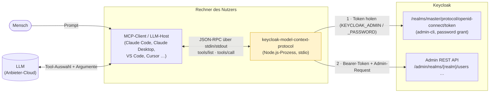
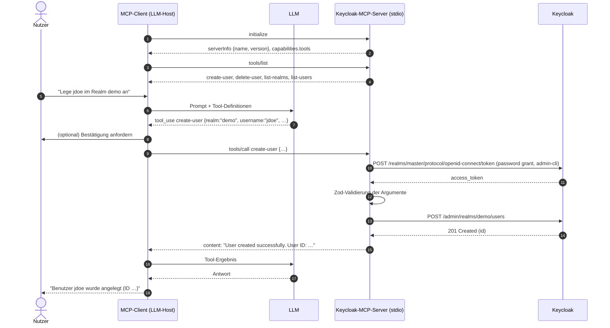
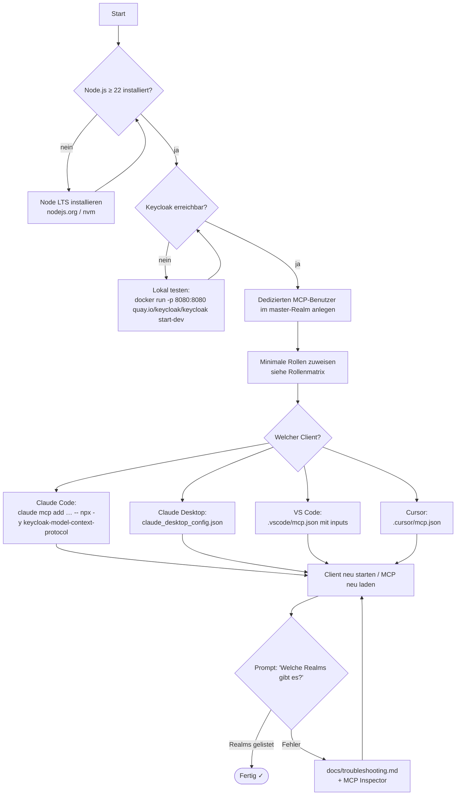
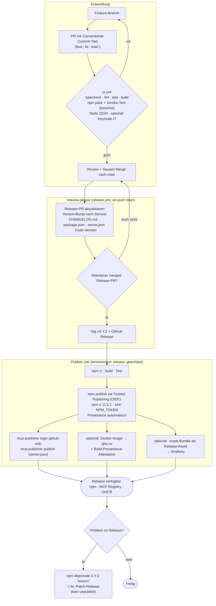

# 05 – Dokumentation, Developer Experience, Packaging & Release-Prozess

> Analyse-Stand: 2026-10-24 · Basis: `main` @ `2e8bc85` · npm `keycloak-model-context-protocol@0.0.2` (veröffentlicht 2025-01-08)
> Schwerpunkt: README und Doku, Developer Experience (DX), npm-Packaging, Registry-Einträge (MCP Registry, Smithery), Release- und Versionierungsprozess auf dem Weg zu 1.0.

## Zusammenfassung

Das Repo ist ein 204-Zeilen-Prototyp mit einer README, einer `package.json` und einem kombinierten CI/Publish-Workflow. Für eine stabile 1.0 fehlt vor allem das, was Nutzer und Mitwirkende außerhalb des Codes brauchen.

1. **Der empfohlene Installationsweg funktioniert nicht.** `src/index.ts` hat keinen Shebang. Dadurch interpretiert die Shell das npm-`bin` als Shell-Skript. `npx -y keycloak-model-context-protocol@0.0.2` bricht auf macOS mit `import: command not found` ab. Das ist lokal reproduziert, und Issue [#5](https://github.com/ChristophEnglisch/keycloak-model-context-protocol/issues/5) ist seit März 2025 offen. Mit `#!/usr/bin/env node` als erster Zeile läuft das Paket über `npx`; auch das ist verifiziert.
2. **Es gibt keine LICENSE-Datei**, weder im Repo noch im npm-Tarball. `package.json` deklariert MIT, GitHub erkennt aber keine Lizenz (`license: null`).
3. **Die README bewirbt `admin`/`admin`** als Konfigurationsbeispiel, und der Code fällt stillschweigend auf genau diese Werte zurück. Es fehlen eine Security-Sektion, ein Hinweis auf die nötigen Keycloak-Rollen, Troubleshooting, Diagramme, Beispiel-Prompts und Anleitungen für andere Clients als Claude Desktop.
4. **Packaging und Registries sind unvollständig.** `repository`, `homepage`, `bugs`, `keywords`, `engines` und `mcpName` fehlen. Der Server ist nicht in der offiziellen MCP Registry, wo vier andere Keycloak-Server gelistet sind. Der Smithery-Badge liefert HTTP 500, und es gibt keine `smithery.yaml` und kein Dockerfile (PR #3 wurde ungemergt geschlossen).
5. **Es gibt keinen Release-Prozess im eigentlichen Sinn.** Die Releases laufen manuell über GitHub-Release plus langlebiges `NPM_TOKEN`, ohne Provenance und ohne Tests oder Lint im Workflow. Es gibt kein CHANGELOG, keine Conventional Commits und keine Semver- oder Deprecation-Policy. Unklar ist auch, was bei einem MCP-Server die „Public API“ ist.

Die meisten Befunde lassen sich mit Aufwand S beheben. Die 1.0-Blocker sind überwiegend Doku- und Konfigurationsarbeit und keine Code-Arbeit.

## Verifikationsprotokoll (was wurde tatsächlich geprüft)

| Prüfung | Ergebnis |
|---|---|
| `npm run build` (in Scratch-Kopie, Node v26.12.0 / npm 11.20.0) | Der Build ist erfolgreich. `dist/index.js` beginnt mit `import { Server } …`, **es gibt keinen Shebang**, der Dateimodus ist `755`. |
| Veröffentlichtes Tarball `0.0.2` (`npm pack keycloak-model-context-protocol@0.0.2`) | Es enthält nur `dist/index.js`, `package.json` und `README.md`. **Es gibt keinen Shebang und keine LICENSE.** |
| `./dist/index.js` direkt ausgeführt | `line 1: import: command not found` |
| `npx -y keycloak-model-context-protocol@0.0.2` | Es bricht mit `import: command not found` und `syntax error near unexpected token '('` ab. |
| `node dist/index.js` | Es funktioniert: `Keycloak MCP Server running on stdio` |
| Shebang testweise ergänzt → build → `npm pack` → `npx --package=<tgz>` | Es funktioniert. `tsc` übernimmt den Shebang unverändert nach `dist/`. |
| `npx @modelcontextprotocol/inspector --cli node dist/index.js --method tools/list` | Es funktioniert und liefert die vier Tools. Das eignet sich als Smoke-Test für Doku und CI. |
| `npm view … dist.attestations` | Die Ausgabe ist leer, **0.0.2 hat also keine Provenance**. |
| GitHub-API Repo-Metadaten | `license: null`, `homepage: ""`, 46 Stars, die Topics sind gepflegt. Die Tags `v0.0.1` und `v0.0.2` sind vorhanden. |
| `curl https://smithery.ai/badge/keycloak-model-context-protocol` | **HTTP 500** |
| MCP Registry `GET /v0.1/servers?search=keycloak` | Gelistet sind `io.github.dockndevai/mcp-keycloak`, `io.github.mrz1880/mcp-keycloak-admin`, `io.github.shigechika/keycloak-mcp` und `io.github.heintonny/keycloak-mcp.test`. **Dieses Projekt ist nicht gelistet.** |

## Befundtabelle

| ID | Titel | Schweregrad | Aufwand | Blocker 1.0 |
|---|---|---|---|---|
| DOC-01 | Fehlender Shebang macht `npx`/`bin` unbenutzbar | Kritisch | S | ja |
| DOC-02 | Keine LICENSE-Datei (Repo + npm-Tarball) | Hoch | S | ja |
| DOC-03 | README bewirbt `admin`/`admin`, keine Security-Sektion | Hoch | S | ja |
| DOC-04 | Benötigte Keycloak-Rechte und Auth-Modell undokumentiert | Hoch | S | ja |
| DOC-05 | Veraltete bzw. falsche README-Inhalte (Platzhalter, Node 18, defekte Befehle) | Mittel | S | ja |
| DOC-06 | Nur Claude Desktop dokumentiert (kein Claude Code, Cursor, VS Code …) | Mittel | S | ja |
| DOC-07 | Keine Troubleshooting-Sektion | Mittel | S | ja |
| DOC-08 | Keine Architektur-/Flow-Diagramme, keine Beispiel-Prompts | Niedrig | S | nein |
| DOC-09 | Smithery-Integration defekt (Badge 500, keine Konfig im Repo) | Mittel | S | ja |
| DOC-10 | `package.json`-Metadaten unvollständig | Mittel | S | ja |
| DOC-11 | Version und Servername im Code hart verdrahtet und inkonsistent | Mittel | S | ja |
| DOC-12 | Nicht in der offiziellen MCP Registry (`mcpName`/`server.json` fehlen) | Mittel | S | nein (dringend empfohlen) |
| DOC-13 | Release-Workflow: langlebiges Token, keine Provenance, keine Qualitäts-Gates | Hoch | M | ja |
| DOC-14 | Kein Versionierungs-, Changelog- und Deprecation-Prozess | Hoch | M | ja |
| DOC-15 | Keine `SECURITY.md` | Mittel | S | ja |
| DOC-16 | Keine CONTRIBUTING, CODE_OF_CONDUCT und Issue-/PR-Templates | Niedrig | S | nein |
| DOC-17 | Keine Dependency-Automation (Dependabot/Renovate) | Mittel | S | nein |
| DOC-18 | Keine DX-Basics (`.nvmrc`, `.editorconfig`, lint/test/typecheck-Scripts) | Niedrig | S | nein |
| DOC-19 | Build-Lifecycle (`prepare` ohne `clean`, kein Tarball-Check) | Niedrig | S | nein |
| DOC-20 | Tool-Referenz manuell gepflegt, Tool-Parameter ohne `description` | Mittel | M | nein |
| DOC-21 | `.gitignore` minimal (kein `.env`, `*.tgz` …) | Niedrig | S | nein |
| DOC-22 | Kein Container-Image (GHCR) / kein MCPB-Bundle | Niedrig | M | nein |

---

## Befunde im Detail

### DOC-01 – Fehlender Shebang macht `npx`/`bin` unbenutzbar

**Schweregrad:** Kritisch · **Aufwand:** S · **Blocker 1.0:** ja

**Beschreibung.** `package.json` registriert `dist/index.js` als `bin`. npm verlinkt die Datei nach `node_modules/.bin/keycloak-model-context-protocol`. Ohne `#!/usr/bin/env node` startet das Betriebssystem die Datei mit `/bin/sh`, das an der ersten `import`-Zeile scheitert. Das Problem ist reproduziert mit dem veröffentlichten 0.0.2 per `npx` und mit dem lokalen Build per Direktaufruf (siehe Verifikationsprotokoll). Betroffen ist **jeder in der README empfohlene Weg**: `npx`, globale Installation, Claude-Desktop-Konfiguration und MCP Inspector. In Issue [#5](https://github.com/ChristophEnglisch/keycloak-model-context-protocol/issues/5) beschreiben Nutzer Workarounds wie `bash -ic "node $(npm root -g)/…/dist/index.js"`.

**Fundstellen:** [src/index.ts:1](https://github.com/ChristophEnglisch/keycloak-model-context-protocol/blob/2e8bc85/src/index.ts#L1), [package.json:8-10](https://github.com/ChristophEnglisch/keycloak-model-context-protocol/blob/2e8bc85/package.json#L8-L10), [README.md:24-33](https://github.com/ChristophEnglisch/keycloak-model-context-protocol/blob/2e8bc85/README.md#L24-L33), [README.md:51-65](https://github.com/ChristophEnglisch/keycloak-model-context-protocol/blob/2e8bc85/README.md#L51-L65), [README.md:123](https://github.com/ChristophEnglisch/keycloak-model-context-protocol/blob/2e8bc85/README.md#L123)

**Empfehlung.**
- Setze `#!/usr/bin/env node` als erste Zeile in `src/index.ts`. `tsc` übernimmt ihn, das ist verifiziert. `shx chmod +x` kann bleiben.
- Ergänze einen CI-Smoke-Test, der das **gepackte** Artefakt startet, damit das nicht wieder passiert, zum Beispiel:
  `npm pack && npx -y --package=./keycloak-model-context-protocol-*.tgz @modelcontextprotocol/inspector --cli keycloak-model-context-protocol --method tools/list`. Einfacher geht es mit einem Node-Skript, das das `.tgz` installiert und `tools/list` per stdio aufruft.
- Veröffentliche zeitnah ein Patch-Release (0.0.3 bzw. 0.1.0) und schließe danach Issue #5.

### DOC-02 – Keine LICENSE-Datei

**Schweregrad:** Hoch · **Aufwand:** S · **Blocker 1.0:** ja

**Beschreibung.** `package.json` deklariert `"license": "MIT"`, aber das Repo enthält keine `LICENSE`. `git ls-files` listet nur 7 Dateien. Die GitHub-API meldet `license: null`, und das npm-Tarball 0.0.2 enthält keine Lizenzdatei. Die MIT-Lizenz verlangt, dass Copyright- und Lizenzhinweis mit dem Code weitergegeben werden. Ohne diese Datei ist die Lizenzlage für Unternehmensnutzer unklar, und Compliance-Scanner wie FOSSA oder ORT melden das Paket.

**Fundstellen:** [package.json:5](https://github.com/ChristophEnglisch/keycloak-model-context-protocol/blob/2e8bc85/package.json#L5); `LICENSE` existiert nicht.

**Empfehlung.** Lege eine `LICENSE` mit dem MIT-Standardtext an (`Copyright (c) 2025 Christoph Englisch`). npm packt `LICENSE`, `README` und `package.json` automatisch mit ein, auch wenn sie nicht in `files` stehen. Ergänze einen License-Badge in der README.

### DOC-03 – README bewirbt `admin`/`admin`, keine Security-Sektion

**Schweregrad:** Hoch · **Aufwand:** S · **Blocker 1.0:** ja

**Beschreibung.**
- Beide Konfigurationsbeispiele setzen `KEYCLOAK_ADMIN=admin` und `KEYCLOAK_ADMIN_PASSWORD=admin`. Der Code nutzt dieselben Werte als **stillen Fallback**, wenn die Variablen fehlen, und ebenso `http://localhost:8080` für die URL.
- Die README sagt nicht, dass der Server **Klartext-Credentials eines Master-Realm-Admins** in einer Client-Konfigurationsdatei erwartet. Sie sagt auch nicht, dass jedes LLM mit Zugriff auf den Server Nutzer löschen kann (`delete-user`) und dass es keine Bestätigungs- oder Read-only-Option gibt.
- Namenskollision: `KEYCLOAK_ADMIN` und `KEYCLOAK_ADMIN_PASSWORD` sind auch die (älteren) Bootstrap-Variablen des Keycloak-Containers. Keycloak 26 nutzt dafür `--bootstrap-admin-username` bzw. `KC_BOOTSTRAP_ADMIN_*`. Die offizielle Doku beschreibt dieses Bootstrap-Konto als **temporär**, es „should exist only for the duration necessary…“ ([keycloak.org – Bootstrap admin](https://www.keycloak.org/server/bootstrap-admin-recovery)). Die README verleitet dazu, genau dieses Bootstrap-Konto dauerhaft an ein LLM zu geben.

**Fundstellen:** [README.md:57-61](https://github.com/ChristophEnglisch/keycloak-model-context-protocol/blob/2e8bc85/README.md#L57-L61), [README.md:74-78](https://github.com/ChristophEnglisch/keycloak-model-context-protocol/blob/2e8bc85/README.md#L74-L78), [src/index.ts:21](https://github.com/ChristophEnglisch/keycloak-model-context-protocol/blob/2e8bc85/src/index.ts#L21), [src/index.ts:101-106](https://github.com/ChristophEnglisch/keycloak-model-context-protocol/blob/2e8bc85/src/index.ts#L101-L106)

**Empfehlung.**
- Ersetze in den Beispielen alle Werte durch Platzhalter (`<mcp-service-user>`, `${KEYCLOAK_ADMIN_PASSWORD}`) bzw. durch Client-seitige Secret-Mechanismen: VS Code `inputs` mit `password: true`, Claude Code `${VAR}`-Expansion, Cursor `${env:VAR}`/`envFile` (siehe Snippets unten).
- Füge eine eigene Sektion **Security** hinzu. Sie soll beschreiben: Least Privilege (eigener Service-User, keine Master-Admins), destruktive Tools, Betrieb nur gegen Test-Realms bis zur Reife, wo Credentials liegen und Prompt Injection über Nutzerdaten (z. B. Vornamen). Verlinke `SECURITY.md` (DOC-15).
- Entfernt der Code die Defaults (siehe Code-/Security-Analyse), muss die Doku das als **Breaking Change** markieren (DOC-14). Ebenso, wenn die Env-Variablen umbenannt werden, z. B. in ein eigenes Präfix wie `KEYCLOAK_MCP_*`. Das sollte **vor** 1.0 entschieden werden, weil die Env-Namen Teil der Public API sind.

### DOC-04 – Benötigte Keycloak-Rechte und Auth-Modell undokumentiert

**Schweregrad:** Hoch · **Aufwand:** S · **Blocker 1.0:** ja

**Beschreibung.** Der Code authentifiziert sich immer gegen den Realm `master`, mit Client `admin-cli` und `grantType: 'password'`, und zwar vor **jedem** Tool-Call. Die README verschweigt alle drei Punkte:
- Der Benutzer muss im **master**-Realm existieren.
- Direct Access Grants müssen für `admin-cli` aktiv sein (Keycloak-Standard).
- Welche Rollen die einzelnen Tools brauchen, steht nirgends. Die vier Tools brauchen lesende bzw. schreibende Benutzerrechte und Realm-Sichtbarkeit.
- Was bei 2FA/OTP am Admin-Konto passiert, steht ebenfalls nicht da. Der Password-Grant schlägt dann fehl.

Issue [#2](https://github.com/ChristophEnglisch/keycloak-model-context-protocol/issues/2) zeigt, dass Nutzer das Verbindungs- und Auth-Modell nicht verstehen.

**Fundstellen:** [src/index.ts:20-23](https://github.com/ChristophEnglisch/keycloak-model-context-protocol/blob/2e8bc85/src/index.ts#L20-L23), [src/index.ts:101-106](https://github.com/ChristophEnglisch/keycloak-model-context-protocol/blob/2e8bc85/src/index.ts#L101-L106), [README.md:140-143](https://github.com/ChristophEnglisch/keycloak-model-context-protocol/blob/2e8bc85/README.md#L140-L143)

**Empfehlung.** Lege `docs/configuration.md` bzw. eine README-Sektion „Keycloak vorbereiten“ an mit:
- einer Schritt-für-Schritt-Anleitung (Admin Console oder `kcadm.sh`) für einen dedizierten MCP-Benutzer,
- einer **Tool → benötigte Rolle-Matrix**. Als Startpunkt dienen die Client-Rollen des `realm-management`-Clients: `view-users`/`query-users` für `list-users`, `manage-users` für `create-user`/`delete-user`, `view-realm` für `list-realms`. Die Matrix muss per Integrationstest gegen die unterstützte Keycloak-Version verifiziert werden.
- der Aussage, welche Keycloak-Versionen unterstützt bzw. getestet sind,
- einem Ausblick bzw. Verweis auf Client-Credentials/Service-Accounts, falls der Code das künftig unterstützt (siehe Issue #9).

### DOC-05 – Veraltete bzw. falsche README-Inhalte

**Schweregrad:** Mittel · **Aufwand:** S · **Blocker 1.0:** ja

**Beschreibung.**
- `git clone <repository-url>` ist ein Platzhalter ([README.md:40](https://github.com/ChristophEnglisch/keycloak-model-context-protocol/blob/2e8bc85/README.md#L40)).
- „Node.js 18 or higher“ ([README.md:142](https://github.com/ChristophEnglisch/keycloak-model-context-protocol/blob/2e8bc85/README.md#L142)) ist veraltet. Node 18 ist seit 2025-03-27 EOL, Node 20 seit 2026-03-24. Aktuell unterstützt sind v22 und v24 (LTS) sowie v26 (Current) ([nodejs.org](https://nodejs.org/en/about/previous-releases)). CI baut mit Node 22, und `@types/node` ist `^22`, was nicht zur Aussage „18+“ passt. `engines` fehlt (DOC-10).
- Der als „Recommended“ markierte `npx`-Weg und der Inspector-Befehl unter „Testing“ funktionieren wegen DOC-01 nicht ([README.md:24-33](https://github.com/ChristophEnglisch/keycloak-model-context-protocol/blob/2e8bc85/README.md#L24-L33), [README.md:120-124](https://github.com/ChristophEnglisch/keycloak-model-context-protocol/blob/2e8bc85/README.md#L120-L124)).
- Die Sektion „Prerequisites“ steht am Ende, nach Deployment.
- Die Sektion „Deployment“ ([README.md:126-138](https://github.com/ChristophEnglisch/keycloak-model-context-protocol/blob/2e8bc85/README.md#L126-L138)) ist Maintainer-Doku und gehört nicht in die Nutzer-README. Sie beschreibt außerdem den veralteten Token-Weg (DOC-13).
- Es gibt keine Badges für npm-Version, CI-Status und Lizenz. Der einzige Badge (Smithery) ist defekt (DOC-09).

**Empfehlung.** Strukturiere die README nach der unten vorgeschlagenen Gliederung neu. Konkret: echte Clone-URL, „Node.js ≥ 22 (LTS)“, Maintainer-Inhalte nach `CONTRIBUTING.md` bzw. `docs/releasing.md`, Badges für npm, CI und Lizenz.

### DOC-06 – Nur Claude Desktop dokumentiert

**Schweregrad:** Mittel · **Aufwand:** S · **Blocker 1.0:** ja

**Beschreibung.** Die Konfiguration ist nur als Claude-Desktop-JSON beschrieben ([README.md:46-82](https://github.com/ChristophEnglisch/keycloak-model-context-protocol/blob/2e8bc85/README.md#L46-L82)). Es fehlen Claude Code (`claude mcp add`), Cursor (`.cursor/mcp.json`), VS Code (`.vscode/mcp.json`, Top-Level-Key `servers` statt `mcpServers`), Windsurf und generische MCP-Clients. Die Formate unterscheiden sich in relevanten Details (Key-Name, Secret-Handling, Variablen-Syntax), deshalb ist Copy-and-paste zwischen ihnen fehleranfällig.

**Empfehlung.** Lege `docs/clients.md` mit verifizierten Snippets an, in der README genügen Kurzfassungen. Diese Formate sind gegen die aktuelle Hersteller-Doku geprüft:

```bash
# Claude Code (Quelle: code.claude.com/docs/en/mcp)
claude mcp add --transport stdio \
  --env KEYCLOAK_URL=https://keycloak.example.com \
  --env KEYCLOAK_ADMIN=mcp-service-user \
  --env KEYCLOAK_ADMIN_PASSWORD='${KEYCLOAK_ADMIN_PASSWORD}' \
  keycloak -- npx -y keycloak-model-context-protocol
# Teamweit: --scope project → schreibt .mcp.json (unterstützt ${VAR} und ${VAR:-default})
```

```jsonc
// VS Code .vscode/mcp.json (Quelle: code.visualstudio.com/docs/agents/reference/mcp-configuration)
{
  "inputs": [
    { "type": "promptString", "id": "kc-password", "description": "Keycloak MCP user password", "password": true }
  ],
  "servers": {
    "keycloak": {
      "type": "stdio",
      "command": "npx",
      "args": ["-y", "keycloak-model-context-protocol"],
      "env": {
        "KEYCLOAK_URL": "https://keycloak.example.com",
        "KEYCLOAK_ADMIN": "mcp-service-user",
        "KEYCLOAK_ADMIN_PASSWORD": "${input:kc-password}"
      }
    }
  }
}
```

```jsonc
// Cursor .cursor/mcp.json bzw. ~/.cursor/mcp.json (Quelle: cursor.com/docs/context/mcp)
{
  "mcpServers": {
    "keycloak": {
      "type": "stdio",
      "command": "npx",
      "args": ["-y", "keycloak-model-context-protocol"],
      "env": {
        "KEYCLOAK_URL": "https://keycloak.example.com",
        "KEYCLOAK_ADMIN": "${env:KEYCLOAK_ADMIN}",
        "KEYCLOAK_ADMIN_PASSWORD": "${env:KEYCLOAK_ADMIN_PASSWORD}"
      }
    }
  }
}
```

### DOC-07 – Keine Troubleshooting-Sektion

**Schweregrad:** Mittel · **Aufwand:** S · **Blocker 1.0:** ja

**Beschreibung.** Die Issues #2 („Keycloak on Localhost“) und #5 („NPM Dist Doesn't Run“) sind typische Support-Fragen, die eine Troubleshooting-Seite abfangen würde. Fehlermeldungen von Keycloak (401/403, `invalid_grant`, Netzwerkfehler) reicht der Code ungefiltert durch ([src/index.ts:187-198](https://github.com/ChristophEnglisch/keycloak-model-context-protocol/blob/2e8bc85/src/index.ts#L187-L198)). Ohne Doku kann der Nutzer sie nicht zuordnen.

**Empfehlung.** Lege `docs/troubleshooting.md` an, mit mindestens:
- **Server startet nicht / `import: command not found`:** Version mit DOC-01-Fix nutzen, ersatzweise `node …/dist/index.js`.
- **Keycloak nicht erreichbar:** Der MCP-Server läuft **lokal als Kindprozess des Clients**. Er erreicht, was der Rechner erreicht. Docker-Netzwerke, `host.docker.internal`, Proxy und TLS (`NODE_EXTRA_CA_CERTS` bei eigener CA) gehören in diese Anleitung.
- **401/`invalid_grant`:** falscher Realm (Benutzer muss im `master` liegen), Direct Access Grants deaktiviert, OTP am Konto, Passwort abgelaufen bzw. „Update Password“-Required-Action.
- **403:** fehlende Rollen, mit Verweis auf die Rollenmatrix aus DOC-04.
- **Logs finden:** stderr-Ausgabe; bei Claude Desktop die MCP-Logdateien, bei Claude Code `claude mcp list` bzw. `/mcp`.
- **Debuggen:** `npx @modelcontextprotocol/inspector` (UI) bzw. `--cli … --method tools/list`, das ist verifiziert.

### DOC-08 – Keine Architektur-/Flow-Diagramme, keine Beispiel-Prompts

**Schweregrad:** Niedrig · **Aufwand:** S · **Blocker 1.0:** nein

**Beschreibung.** Die README erklärt nicht, wie die Komponenten zusammenspielen: LLM-Client, lokaler stdio-Prozess, Keycloak Admin REST API. Sie zeigt auch nicht, was man den Assistenten fragen kann. Gerade bei einem Admin-Tool hilft beides, Vertrauen aufzubauen und Fehlbedienung zu vermeiden.

**Empfehlung.** Übernimm die Mermaid-Diagramme aus dem Abschnitt [Vorgeschlagene README-Gliederung für 1.0](#vorgeschlagene-readme-gliederung-für-10). Ergänze 4–6 Beispiel-Prompts, bewusst inklusive eines destruktiven mit Hinweis, zum Beispiel:
- „Welche Realms gibt es auf meinem Keycloak?“
- „Liste alle Benutzer im Realm `demo` auf.“
- „Lege im Realm `demo` den Benutzer `jdoe` (John Doe, jdoe@example.com) an.“
- „Lösche den Benutzer mit der ID `…` aus `demo`.“ ⚠️ irreversibel

### DOC-09 – Smithery-Integration defekt

**Schweregrad:** Mittel · **Aufwand:** S · **Blocker 1.0:** ja (Badge und Anleitung müssen funktionieren oder entfernt werden)

**Beschreibung.**
- Der Badge `https://smithery.ai/badge/keycloak-model-context-protocol` liefert **HTTP 500** ([README.md:3](https://github.com/ChristophEnglisch/keycloak-model-context-protocol/blob/2e8bc85/README.md#L3)). PR [#11](https://github.com/ChristophEnglisch/keycloak-model-context-protocol/pull/11), offen seit 2026-09-05, schlägt vor, ihn zu ersetzen.
- Im Repo gibt es **keine `smithery.yaml` und kein `Dockerfile`**. PR [#3](https://github.com/ChristophEnglisch/keycloak-model-context-protocol/pull/3) von Smithery hätte beides ergänzt, wurde aber am 2025-02-09 ungemergt geschlossen.
- Die Smithery-Serverseite existiert, zeigt aber keine Inhalte (Tools, Repository, Lizenz leer). Sie enthält den Hinweis „Smithery's MCP Proxy and managed identity shut down on October 31.“
- Laut aktueller Smithery-Doku ([smithery.ai/docs/build/publish](https://smithery.ai/docs/build/publish)) gibt es heute zwei Wege: URL-Publishing für Streamable-HTTP-Server und **MCPB-Bundles für lokale stdio-Server** (`smithery mcp publish ./server.mcpb -n org/server`). `smithery.yaml` wird dort nicht mehr erwähnt.
- Ob `npx -y @smithery/cli install keycloak-model-context-protocol --client claude` ([README.md:16-22](https://github.com/ChristophEnglisch/keycloak-model-context-protocol/blob/2e8bc85/README.md#L16-L22)) heute noch funktioniert, wurde **nicht** verifiziert. Wegen DOC-01 würde ein so installierter `npx`-Start ohnehin scheitern.

**Empfehlung.** Entscheide vor 1.0: Entweder (a) den Badge und den Smithery-Abschnitt entfernen und PR #11 schließen oder umsetzen, oder (b) Smithery aktiv per MCPB-Bundle bespielen (siehe DOC-22) und den Abschnitt danach neu schreiben und testen. Vorrang hat die offizielle MCP Registry (DOC-12).

### DOC-10 – `package.json`-Metadaten unvollständig

**Schweregrad:** Mittel · **Aufwand:** S · **Blocker 1.0:** ja

**Beschreibung.**
- Es fehlen `repository`, `homepage`, `bugs` und `keywords`. Deshalb verlinkt die npm-Seite weder Repo noch Issues, und das Paket ist auf npm schlecht auffindbar.
- `engines` fehlt.
- `mcpName` fehlt, ist aber Voraussetzung für die MCP Registry (DOC-12).
- `exports` fehlt. Bei einem reinen CLI-Paket ist das kein Funktionsfehler. Ein explizites `exports` dokumentiert aber, dass es **keine** programmatische JS-API gibt, und grenzt damit die Semver-Oberfläche ab (DOC-14).
- Es gibt keine Scripts für `test`, `lint`, `typecheck` oder `clean`.

**Fundstellen:** [package.json:1-29](https://github.com/ChristophEnglisch/keycloak-model-context-protocol/blob/2e8bc85/package.json#L1-L29)

**Empfehlung (Zielbild, Werte prüfen):**

```jsonc
{
  "name": "keycloak-model-context-protocol",
  "version": "1.0.0",
  "description": "MCP server for Keycloak administration (users, realms) via the Keycloak Admin REST API",
  "mcpName": "io.github.christophenglisch/keycloak-model-context-protocol",
  "license": "MIT",
  "author": "Christoph Englisch",
  "homepage": "https://github.com/ChristophEnglisch/keycloak-model-context-protocol#readme",
  "repository": { "type": "git", "url": "git+https://github.com/ChristophEnglisch/keycloak-model-context-protocol.git" },
  "bugs": { "url": "https://github.com/ChristophEnglisch/keycloak-model-context-protocol/issues" },
  "keywords": ["mcp", "model-context-protocol", "mcp-server", "keycloak", "iam", "identity", "admin", "claude", "llm"],
  "type": "module",
  "bin": { "keycloak-model-context-protocol": "./dist/index.js" },
  "exports": { "./package.json": "./package.json" },
  "files": ["dist"],
  "engines": { "node": ">=22" },
  "publishConfig": { "access": "public", "provenance": true },
  "scripts": {
    "clean": "shx rm -rf dist",
    "build": "npm run clean && tsc && shx chmod +x dist/*.js",
    "typecheck": "tsc --noEmit",
    "lint": "eslint .",
    "test": "vitest run",
    "prepack": "npm run build"
  }
}
```

Hinweis zu `mcpName`: Der Wert muss bei GitHub-Authentifizierung mit `io.github.<github-user>/` beginnen und exakt dem `name` in `server.json` entsprechen ([MCP Registry Quickstart](https://github.com/modelcontextprotocol/registry/blob/main/docs/modelcontextprotocol-io/quickstart.mdx)). Ob die Registry die Groß-/Kleinschreibung des GitHub-Users normalisiert, wurde nicht geprüft. Die Kleinschreibung entspricht dem Schema der gelisteten Einträge.

### DOC-11 – Version und Servername im Code hart verdrahtet und inkonsistent

**Schweregrad:** Mittel · **Aufwand:** S · **Blocker 1.0:** ja

**Beschreibung.** Der Server meldet sich im MCP-`initialize` mit `name: "keycloak-admin"` und `version: "0.0.1"`. Das Paket ist aber `keycloak-model-context-protocol@0.0.2`. Die Version wird bei jedem Release vergessen, und Clients bzw. Support-Anfragen zeigen eine falsche Version.

**Fundstellen:** [src/index.ts:7-17](https://github.com/ChristophEnglisch/keycloak-model-context-protocol/blob/2e8bc85/src/index.ts#L7-L17), [package.json:3](https://github.com/ChristophEnglisch/keycloak-model-context-protocol/blob/2e8bc85/package.json#L3)

**Empfehlung.** Lies die Version zur Laufzeit aus `package.json`, entweder mit `createRequire(import.meta.url)('../package.json').version` oder per JSON-Import (`resolveJsonModule` ist in [tsconfig.json](https://github.com/ChristophEnglisch/keycloak-model-context-protocol/blob/2e8bc85/tsconfig.json) bereits aktiv). Alternativ ersetzt release-please sie über einen `x-release-please-version`-Marker. Lege den Servernamen bewusst fest und dokumentiere ihn, er ist für Nutzer sichtbar. Ergänze `--version`/`--help`-Flags für die CLI-DX.

### DOC-12 – Nicht in der offiziellen MCP Registry

**Schweregrad:** Mittel · **Aufwand:** S · **Blocker 1.0:** nein (dringend empfohlen)

**Beschreibung.** Die offizielle Registry (`registry.modelcontextprotocol.io`) listet vier Keycloak-Server, dieses Projekt aber nicht (siehe Verifikationsprotokoll). Clients und Aggregatoren beziehen ihre Kataloge zunehmend aus dieser Registry. Es fehlen `mcpName` (DOC-10) und `server.json`.

**Empfehlung.** Lege `server.json` im Repo-Root an. Das Format folgt dem aktuellen Quickstart, Schema `2025-12-11`, die Schema-URL ist erreichbar (HTTP 200). Die Env-Namen entsprechen dem heutigen Stand und sind bei Umbenennung anzupassen:

```json
{
  "$schema": "https://static.modelcontextprotocol.io/schemas/2025-12-11/server.schema.json",
  "name": "io.github.christophenglisch/keycloak-model-context-protocol",
  "description": "Manage Keycloak users and realms via the Keycloak Admin REST API.",
  "repository": { "url": "https://github.com/ChristophEnglisch/keycloak-model-context-protocol", "source": "github" },
  "version": "1.0.0",
  "packages": [
    {
      "registryType": "npm",
      "identifier": "keycloak-model-context-protocol",
      "version": "1.0.0",
      "transport": { "type": "stdio" },
      "environmentVariables": [
        { "name": "KEYCLOAK_URL", "description": "Base URL of the Keycloak server", "isRequired": true, "format": "string" },
        { "name": "KEYCLOAK_ADMIN", "description": "Username of a dedicated admin user in the master realm", "isRequired": true, "format": "string" },
        { "name": "KEYCLOAK_ADMIN_PASSWORD", "description": "Password of that user", "isRequired": true, "format": "string", "isSecret": true }
      ]
    }
  ]
}
```

`description` ist auf 100 Zeichen begrenzt. Veröffentlicht wird automatisiert im Release-Workflow mit `mcp-publisher login github-oidc` und `mcp-publisher publish` (siehe Release-Flowchart). Die Versionen in `server.json` müssen mit `package.json` synchron bleiben, zum Beispiel per release-please `extra-files` oder `jq` im Workflow.

### DOC-13 – Release-Workflow: langlebiges Token, keine Provenance, keine Qualitäts-Gates

**Schweregrad:** Hoch · **Aufwand:** M · **Blocker 1.0:** ja

**Beschreibung.**
- Ein Workflow namens „NPM Publish“ deckt CI (Push auf `main`, PRs) und Publish (`release: published`) ab. Ein CI-Badge würde deshalb „NPM Publish“ heißen.
- Der Build-Job macht nur `npm ci && npm run build`. Es gibt kein Typecheck-, Lint- oder Testjob, keine Node-Matrix, kein `npm pack`-Smoke-Test (der DOC-01 aufgedeckt hätte) und kein `npm audit`.
- Veröffentlicht wird mit `NODE_AUTH_TOKEN: ${{ secrets.NPM_TOKEN }}`, also mit einem langlebigen Token. Die README fordert ausdrücklich dazu auf, eines anzulegen ([README.md:132-138](https://github.com/ChristophEnglisch/keycloak-model-context-protocol/blob/2e8bc85/README.md#L132-L138)).
- `id-token: write` und `environment: release` sind bereits gesetzt. Damit ist die Grundlage für OIDC da, wird aber nicht genutzt. **0.0.2 hat keine Provenance-Attestierung.**
- `setup-node` mit `node-version: 22` bringt npm 10 mit. **npm Trusted Publishing erfordert npm CLI ≥ 11.5.1 und Node ≥ 22.14.0** ([docs.npmjs.com/trusted-publishers](https://docs.npmjs.com/trusted-publishers)). Die Umstellung braucht also ein npm-Upgrade im Job bzw. Node 24.
- Der Publish-Job baut erneut, statt das in CI getestete Artefakt zu verwenden.

**Fundstellen:** [.github/workflows/npm-publish.yml:1-42](https://github.com/ChristophEnglisch/keycloak-model-context-protocol/blob/2e8bc85/.github/workflows/npm-publish.yml#L1-L42), insbesondere [:34](https://github.com/ChristophEnglisch/keycloak-model-context-protocol/blob/2e8bc85/.github/workflows/npm-publish.yml#L34) und [:39-42](https://github.com/ChristophEnglisch/keycloak-model-context-protocol/blob/2e8bc85/.github/workflows/npm-publish.yml#L39-L42)

**Empfehlung.**
1. Teile den Workflow in `ci.yml` (PR/Push: typecheck, lint, test, build, `npm pack` plus Smoke-Test, Matrix Node 22/24, optional Keycloak-Integrationstest per Service-Container) und `release.yml` (release-please, Publish).
2. **npm Trusted Publishing (OIDC):** Konfiguriere auf npmjs.com einen Trusted Publisher (Repo, Workflow-Datei `release.yml`, Environment `release`). Danach `npm install -g npm@^11.5.1` bzw. Node 24 im Job, `npm publish` **ohne** `NODE_AUTH_TOKEN`. Laut npm-Doku entsteht die Provenance bei öffentlichem Repo und Paket dann automatisch. Ein explizites `--provenance` bzw. `publishConfig.provenance` schadet nicht. Stelle anschließend unter *Settings → Publishing access* auf „Require two-factor authentication and disallow tokens“, lösche das `NPM_TOKEN`-Secret und entferne den README-Abschnitt.
3. Schütze das GitHub-Environment `release` (Required Reviewers, nur Tags `v*`).
4. Pinne die Actions auf Commit-SHA (Supply Chain), z. B. per Dependabot `github-actions`.

### DOC-14 – Kein Versionierungs-, Changelog- und Deprecation-Prozess

**Schweregrad:** Hoch · **Aufwand:** M · **Blocker 1.0:** ja

**Beschreibung.** Es gibt kein `CHANGELOG.md`. Die GitHub-Releases v0.0.1 und v0.0.2 wurden manuell erstellt. Die Commit-Historie folgt keiner Konvention, zum Beispiel `feature/deployment-pipeline` und `first commit` neben `refactor: …`. Es ist nicht definiert, was bei diesem Projekt ein Breaking Change ist. Bei einem MCP-Server ist das nicht offensichtlich, weil die eigentliche API für ein **LLM** gedacht ist und nicht für Code.

**Empfehlung.**
- **Conventional Commits** (`feat:`, `fix:`, `feat!:` / `BREAKING CHANGE:`), durchgesetzt per PR-Titel-Check (z. B. `amannn/action-semantic-pull-request`) und Squash-Merge.
- **release-please** (Google) statt Changesets. Für ein Single-Package-Repo mit einem Maintainer passt das besser: Es erzeugt aus Conventional Commits einen Release-PR mit `CHANGELOG.md`, Versionsbump in `package.json`, `server.json` (über `extra-files`) und Code-Konstante. Nach dem Merge entstehen Tag und GitHub-Release, und der Publish-Job läuft. Changesets lohnt sich eher bei Monorepos oder wenn Contributors Release Notes selbst formulieren sollen.
- Die **Semver- und Deprecation-Policy** ist schriftlich in `docs/versioning.md` festzuhalten (siehe Vorschlag unten).

### DOC-15 – Keine `SECURITY.md`

**Schweregrad:** Mittel · **Aufwand:** S · **Blocker 1.0:** ja

**Beschreibung.** Der Server verwaltet Identitäten und hält Admin-Credentials. Trotzdem gibt es keinen dokumentierten Weg für vertrauliche Schwachstellenmeldungen, und GitHub Private Vulnerability Reporting ist nicht nachweislich aktiviert.

**Empfehlung.** Lege `SECURITY.md` an mit unterstützten Versionen (z. B. „latest minor of the current major“), Meldeweg (GitHub Security Advisories / Private Vulnerability Reporting aktivieren), Reaktionszeit und Scope. Dazu gehören auch Hinweise, welche Szenarien kein Bug sind, sondern Konfigurationsverantwortung (z. B. Master-Admin-Credentials). Verlinke die Datei in der README-Security-Sektion.

### DOC-16 – Keine CONTRIBUTING, CODE_OF_CONDUCT und Issue-/PR-Templates

**Schweregrad:** Niedrig · **Aufwand:** S · **Blocker 1.0:** nein

**Beschreibung.** Es gibt externe Beiträge (PRs #1, #3, #4, #6, #7, #8, #11), aber keine Leitplanken: Setup, Teststrategie, Commit-Konvention, DCO/CLA, Templates.

**Empfehlung.** `CONTRIBUTING.md` (Dev-Setup mit lokalem Keycloak via `docker run quay.io/keycloak/keycloak start-dev`, Inspector, Commit-Konvention, Release-Ablauf), `CODE_OF_CONDUCT.md` (Contributor Covenant), `.github/ISSUE_TEMPLATE/{bug_report,feature_request}.yml` mit Pflichtfeldern für Versionen (Paket, Node, Keycloak, Client), `.github/pull_request_template.md`. Optional sind GitHub Discussions für Support-Fragen (`has_discussions: false`).

### DOC-17 – Keine Dependency-Automation

**Schweregrad:** Mittel · **Aufwand:** S · **Blocker 1.0:** nein

**Beschreibung.** Es gibt weder `.github/dependabot.yml` noch Renovate. Die Abhängigkeiten sind deutlich veraltet: `@modelcontextprotocol/sdk` ist hart auf `0.5.0` gepinnt, aktuell ist `1.32.2`. `@keycloak/keycloak-admin-client` steht auf `^22.0.5`, aktuell ist `26.8.1`. Die fachliche Bewertung der Upgrades steht in der Dependency-Analyse.

**Fundstellen:** [package.json:19-28](https://github.com/ChristophEnglisch/keycloak-model-context-protocol/blob/2e8bc85/package.json#L19-L28)

**Empfehlung.** Dependabot für `npm` und `github-actions`, wöchentlich, mit gruppierten Minor- und Patch-Updates. Renovate ist die Alternative, wenn Auto-Merge für devDependencies gewünscht ist. Majors des Keycloak-Admin-Clients sollten bewusst und mit Integrationstest gegen die Ziel-Keycloak-Versionen erfolgen.

### DOC-18 – Keine DX-Basics

**Schweregrad:** Niedrig · **Aufwand:** S · **Blocker 1.0:** nein

**Beschreibung.** Es gibt kein `.nvmrc`/`.node-version`, kein `.editorconfig`, keinen Linter oder Formatter, keine Tests und als Scripts nur `build`, `prepare` und `watch`. Für den Dev-Loop dokumentiert die README nur `npm run watch` ([README.md:112-116](https://github.com/ChristophEnglisch/keycloak-model-context-protocol/blob/2e8bc85/README.md#L112-L116)). Wie man den Watch-Build im Client oder Inspector ausprobiert, fehlt.

**Empfehlung.** `.nvmrc` mit `24` (bzw. `22`), passend zu CI und `engines`. Dazu `.editorconfig`, ESLint (typescript-eslint) plus Prettier oder Biome, Vitest. Als Script `npm run inspect` = `npx @modelcontextprotocol/inspector node dist/index.js`. Optional `docker-compose.yml` mit Keycloak und Test-Realm-Import für reproduzierbare lokale Tests.

### DOC-19 – Build-Lifecycle

**Schweregrad:** Niedrig · **Aufwand:** S · **Blocker 1.0:** nein

**Beschreibung.** `prepare` baut bei jedem `npm install`/`npm ci` im Repo und vor `npm publish`. Für Installation direkt aus Git ist das praktisch. Es baut aber ohne `clean`, sodass verwaiste Dateien in `dist/` (z. B. nach Umbenennungen) im Tarball landen können. Ein Tarball-Inhaltscheck fehlt. `files: ["dist"]` ist korrekt und schlank (Tarball 0.0.2: 3 Dateien, 9,4 kB).

**Fundstellen:** [package.json:11-18](https://github.com/ChristophEnglisch/keycloak-model-context-protocol/blob/2e8bc85/package.json#L11-L18)

**Empfehlung.** `prepack` (läuft bei `npm pack` und `npm publish`) mit `clean` plus `build`. `prepare` nur behalten, wenn Git-Installationen unterstützt werden sollen. In CI `npm pack --dry-run` gegen eine erwartete Dateiliste prüfen, optional mit `publint` bzw. `@arethetypeswrong/cli`.

### DOC-20 – Tool-Referenz manuell gepflegt, Parameter ohne `description`

**Schweregrad:** Mittel · **Aufwand:** M · **Blocker 1.0:** nein

**Beschreibung.** Die Tool-Definitionen sind dreifach gepflegt: als handgeschriebenes JSON-Schema, als Zod-Schema und in der README. Derzeit stimmen sie überein ([src/index.ts:26-96](https://github.com/ChristophEnglisch/keycloak-model-context-protocol/blob/2e8bc85/src/index.ts#L26-L96), [README.md:84-110](https://github.com/ChristophEnglisch/keycloak-model-context-protocol/blob/2e8bc85/README.md#L84-L110)). Die `inputSchema`-Properties haben aber **keine `description`**. Das LLM sieht also nur `realm: string`, `userId: string` und muss zum Beispiel raten, dass `userId` die Keycloak-UUID ist und nicht der Username. Für ein LLM-Interface ist das schlechte DX. Außerdem fehlen Tool-Annotations wie `destructiveHint`, mit denen Clients bei `delete-user` warnen könnten. Ob die verwendete SDK-Version 0.5.0 sie unterstützt, wurde nicht geprüft.

**Empfehlung.** Definiere die Tools aus einer Quelle (Zod plus `.describe()`, mit `registerTool` des aktuellen SDK bzw. `zod-to-json-schema`). Generiere `docs/tools-reference.md` per Skript aus `tools/list`. Der verifizierte Inspector-CLI-Aufruf liefert das JSON. Ein CI-Check (`git diff --exit-code`) hält die Referenz aktuell.

### DOC-21 – `.gitignore` minimal

**Schweregrad:** Niedrig · **Aufwand:** S · **Blocker 1.0:** nein

**Beschreibung.** Die Datei enthält nur `.idea/`, `node_modules/` und `dist/`. Gerade bei einem Projekt, dessen Doku zu `.env`- bzw. `envFile`-Nutzung raten sollte, fehlen `.env*`, `*.tgz` (Ergebnis von `npm pack`), `coverage/`, `.DS_Store` und `.vscode/` bzw. `.cursor/` (falls dort Secrets landen).

**Fundstellen:** [.gitignore](https://github.com/ChristophEnglisch/keycloak-model-context-protocol/blob/2e8bc85/.gitignore)

**Empfehlung.** Ergänze die genannten Muster. Lege eine `.env.example` mit Platzhaltern an, die von der Configuration-Doku referenziert wird.

### DOC-22 – Kein Container-Image (GHCR) / kein MCPB-Bundle

**Schweregrad:** Niedrig · **Aufwand:** M · **Blocker 1.0:** nein

**Beschreibung.** Der Server ist nur über npm verfügbar. Nutzer ohne Node-Toolchain oder mit Container-basierten MCP-Setups (Docker MCP Toolkit, Kubernetes, Smithery/MCPB) haben keinen Weg. Das Dockerfile aus PR #3 wurde nicht übernommen.

**Empfehlung (nach 1.0 bzw. optional):**
- Multi-stage Dockerfile (`node:24-alpine`, non-root, nur `dist` und Prod-Deps), Build und Push nach `ghcr.io/christophenglisch/keycloak-model-context-protocol` im Release-Workflow mit `docker/build-push-action` und `actions/attest-build-provenance`. In `server.json` kann ein zweites Package `registryType: "oci"` ergänzt werden.
- Ein MCPB-Bundle (`.mcpb`) für Ein-Klick-Installation in Claude Desktop und Smithery (DOC-09) wird als Release-Asset angehängt.

---

## Vorschlag: Semver- und Deprecation-Policy für 1.0

### Was ist die „Public API“ dieses MCP-Servers?

| Oberfläche | Beispiele heute | Breaking (Major) | Minor | Patch |
|---|---|---|---|---|
| **Tool-Namen** | `create-user`, `delete-user`, `list-realms`, `list-users` | Umbenennen oder Entfernen | neues Tool | – |
| **Tool-Parameter** (Name, Typ, required) | `realm`, `userId`, `email` | Parameter umbenennen bzw. entfernen, optional → required, Typ verengen | neuer **optionaler** Parameter | Beschreibungstexte |
| **Tool-Semantik** | `delete-user` löscht hart | Verhalten ändern (z. B. Default-Paginierung, die Ergebnisse abschneidet) | neue Optionen mit rückwärtskompatiblem Default | Bugfix |
| **Tool-Output** | Freitext `"User created successfully. User ID: …"` | erst ab Einführung von `structuredContent`/`outputSchema` vertraglich | neue Felder | – |
| **Env-Variablen** | `KEYCLOAK_URL`, `KEYCLOAK_ADMIN`, `KEYCLOAK_ADMIN_PASSWORD` | Umbenennen, Entfernen, Default ändern | neue optionale Variable | – |
| **CLI** | `bin`-Name `keycloak-model-context-protocol`, (künftig) Flags | Umbenennen bzw. Flags entfernen | neue Flags | – |
| **Laufzeit-Support** | Node ≥ 22, Keycloak-Versionen, MCP-Protokollversion | Support-Ende einer Node-LTS bzw. Keycloak-Major | neue unterstützte Version | – |
| **Kein Public API** | interne Module, Log-Texte auf stderr | – | – | – |

Freitext-Outputs sollten ausdrücklich als „nicht vertraglich“ deklariert werden, bis strukturierte Outputs eingeführt sind. LLMs sind tolerant, Skripte, die Outputs parsen, nicht.

### Deprecation-Policy (Vorschlag)

1. Kündige die Deprecation in einem **Minor-Release** an: im CHANGELOG (Abschnitt „Deprecated“), in der Tool-`description` (`[DEPRECATED – use X]`), damit auch das LLM es sieht, und als einmalige Warnung auf stderr beim Start bzw. bei Nutzung.
2. Bei Env-Variablen: Der neue Name wird eingeführt, der alte bleibt als **Alias** erhalten, mit Warnung.
3. Entfernt wird frühestens im **nächsten Major**, mindestens 3 Monate nach der Ankündigung.
4. Node-Support folgt dem Node-Release-Plan: Das Support-Ende einer EOL-Version ist ein Major-Bump.

---

## Vorschlag: Doku-Struktur unter `docs/`

```text
docs/
├── getting-started.md        # 5-Minuten-Weg: Keycloak (docker start-dev) → Service-User → Client-Config → erster Prompt
├── configuration.md          # alle Env-Variablen (Tabelle: Name, Pflicht, Default, Secret?), Keycloak-Vorbereitung, Rollenmatrix
├── clients.md                # Claude Desktop, Claude Code, VS Code, Cursor, Windsurf, generisch – je verifiziertes Snippet
├── tools-reference.md        # GENERIERT aus tools/list (Name, Beschreibung, Parameter, Rechte, destruktiv?)
├── security.md               # Threat Model kurz, Least Privilege, Prompt Injection, Credential-Handling, destruktive Tools
├── troubleshooting.md        # Fehlerbilder → Ursache → Lösung (siehe DOC-07)
├── architecture.md           # Mermaid: Komponenten, Sequenz, Auth-Flow; Designentscheidungen
├── versioning.md             # Semver-/Deprecation-Policy, Support-Matrix (Node, Keycloak, MCP-Protokoll)
├── releasing.md              # Maintainer: release-please, Trusted Publishing, MCP-Registry, Notfall-Unpublish/Deprecate
├── adr/
│   ├── 0001-record-architecture-decisions.md
│   ├── 0002-stdio-transport-first.md
│   ├── 0003-auth-model-password-grant-vs-client-credentials.md
│   ├── 0004-public-api-definition-and-semver.md
│   └── 0005-release-automation-release-please-oidc.md
└── analysis/                 # (diese Analyse-Dokumente)
```

Die README bleibt kurz (Was, Quickstart, ein Config-Beispiel, Tool-Übersicht, Links) und verweist für Details auf `docs/`. Eine Doku-Site (VitePress/Docusaurus) ist für 1.0 nicht nötig, weil GitHub Mermaid nativ rendert.

---

## Vorgeschlagene README-Gliederung für 1.0

1. **Titel + Einzeiler + Badges.** npm version (`https://img.shields.io/npm/v/keycloak-model-context-protocol`), CI (`…/actions/workflows/ci.yml/badge.svg`), License MIT, optional Node-Version (`img.shields.io/node/v/…`). Der defekte Smithery-Badge entfällt.
2. **⚠️ Security-Hinweis in 2–3 Sätzen.** Admin-Rechte, destruktive Tools, dedizierter Service-User, Link auf `docs/security.md`.
3. **Features / Tools auf einen Blick.** Tabelle: Tool, Zweck, benötigte Rolle, destruktiv ja/nein.
4. **Architektur in einem Bild** (Diagramm A).
5. **Quickstart** (Diagramm C als Setup-Flow):
   1. Voraussetzungen: Node ≥ 22, Keycloak-Version X+, MCP-Client
   2. Keycloak-Service-User anlegen (Kurzfassung, Link auf `configuration.md`)
   3. Client konfigurieren: Tabs bzw. Details-Blöcke für Claude Code, Claude Desktop, VS Code, Cursor
   4. Verifizieren: „Welche Realms gibt es?“, alternativ Inspector
6. **Konfiguration.** Env-Variablen-Tabelle (Name, Pflicht, Default, Secret).
7. **Beispiel-Prompts** (DOC-08).
8. **Wie ein Tool-Call abläuft** (Diagramm B, alternativ nur in `architecture.md`).
9. **Troubleshooting (Top 5)** mit Link auf `docs/troubleshooting.md`.
10. **Kompatibilität und Versionierung.** Support-Matrix, Link auf `versioning.md` und `CHANGELOG.md`.
11. **Entwicklung.** Kurz, Link auf `CONTRIBUTING.md`.
12. **Security-Meldungen** mit Link auf `SECURITY.md`. **Lizenz** (MIT).

### Diagramm A – Architektur-Übersicht



*Kernaussagen fürs Diagramm:* Der Server läuft **lokal** als Kindprozess des Clients. Credentials verlassen den Rechner nur in Richtung Keycloak. Das LLM sieht Tool-Ergebnisse, also z. B. Benutzerlisten, aber keine Credentials. Diese Aussage muss die Security-Analyse bestätigen.

### Diagramm B – Sequenz eines Tool-Calls (heutiges Verhalten)



Hinweis: Laut [src/index.ts:101-108](https://github.com/ChristophEnglisch/keycloak-model-context-protocol/blob/2e8bc85/src/index.ts#L101-L108) holt der Server **vor jedem Call** ein neues Token, und zwar vor der Argumentvalidierung. Das Diagramm bildet das ab. Ändert sich das Verhalten, muss das Diagramm angepasst werden.

### Diagramm C – Setup-Flow (Quickstart)



---

## Empfohlener Release-Prozess (Zielbild)



**Einmalige Vorarbeiten:** Trusted Publisher auf npmjs.com konfigurieren (Repo, `release.yml`, Environment `release`), danach Tokens für das Paket verbieten und das `NPM_TOKEN`-Secret löschen. Weiter: GitHub-Environment `release` schützen, `release-please-config.json` und `.release-please-manifest.json` anlegen (Startversion `0.0.2`), Dependabot aktivieren und Private Vulnerability Reporting einschalten.

**Vorgeschlagener Pfad zu 1.0:**
1. `0.0.3`/`0.1.0`: DOC-01, DOC-02 und DOC-11 als Hotfix, plus der README-Sofortfix (DOC-03, DOC-05, Badge).
2. `0.x`-Serie: neuer Release-Prozess (DOC-13, DOC-14), SDK-Upgrade, Breaking Changes bündeln (Env-Namen, Defaults entfernen, Tool-Parameter-Beschreibungen).
3. `1.0.0`: Public API eingefroren, Doku nach obiger Struktur vollständig, MCP-Registry-Eintrag, SECURITY.md.

---

## Quellen (extern, abgerufen 2026-10-24)

- npm Trusted Publishing: <https://docs.npmjs.com/trusted-publishers>
- Node.js Release-Status: <https://nodejs.org/en/about/previous-releases>
- MCP Registry Quickstart (`mcpName`, `server.json`, `mcp-publisher`): <https://github.com/modelcontextprotocol/registry/blob/main/docs/modelcontextprotocol-io/quickstart.mdx>
- MCP Registry GitHub Actions (OIDC): <https://github.com/modelcontextprotocol/registry/blob/main/docs/modelcontextprotocol-io/github-actions.mdx>
- MCP Registry API: <https://registry.modelcontextprotocol.io/v0.1/servers?search=keycloak>
- Smithery Publish-Doku: <https://smithery.ai/docs/build/publish>
- Claude Code MCP: <https://code.claude.com/docs/en/mcp>
- VS Code MCP-Konfiguration: <https://code.visualstudio.com/docs/agents/reference/mcp-configuration>
- Cursor MCP: <https://cursor.com/docs/context/mcp>
- Keycloak Bootstrap-Admin: <https://www.keycloak.org/server/bootstrap-admin-recovery>
