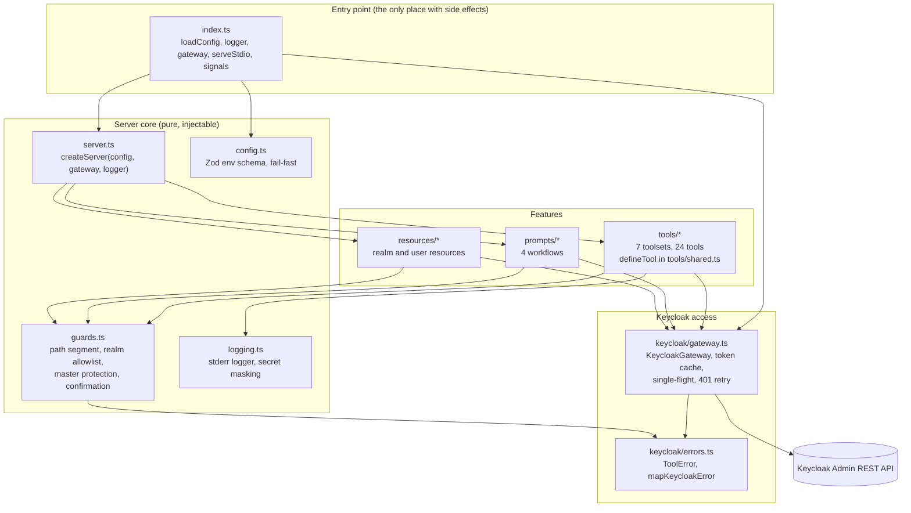
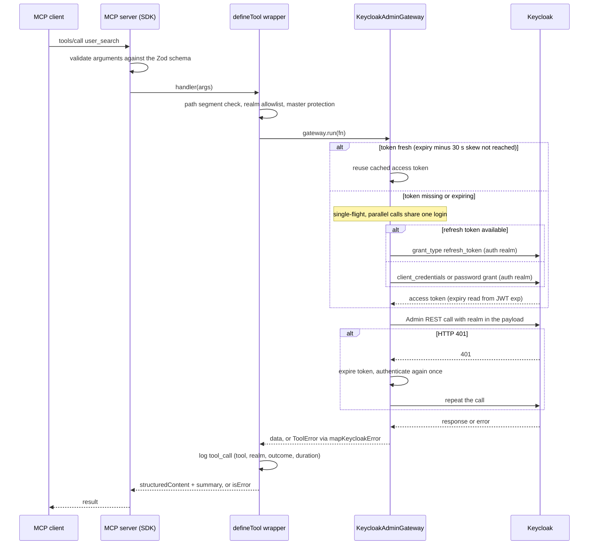

# Architecture

This page explains how the server is built, how a request flows through it, why some decisions were made and how to extend it. It describes version 1.0. The security view is in [security](security.md).

## Modules



| Module | Responsibility |
|---|---|
| `src/index.ts` | Shebang entry point. Loads the config, creates logger and gateway, starts `serveStdio`, handles `SIGINT` and `SIGTERM`. A `ConfigError` prints a readable message to stderr and exits with code 1. |
| `src/server.ts` | `createServer({ config, gateway, logger })` builds the `McpServer` and registers tools, prompts and resources. No I/O, so tests can start it in memory. |
| `src/config.ts` | Parses the environment with Zod. No defaults for credentials. Resolves the grant type, toolsets and flags, collects deprecation warnings. |
| `src/guards.ts` | Pure policy functions: `assertPathSegment`, `assertRealmAllowed`, `isRealmAllowed`, `requireConfirmation`. |
| `src/logging.ts` | Level-based logger to stderr. Masks configured secrets and redacts sensitive field names. |
| `src/tools/shared.ts` | `defineTool`, the shared schema fields (`realmField`, pagination), `toPage`, result helpers. |
| `src/tools/*.ts` | One file per domain. `tools/index.ts` holds the `TOOLSETS` registry and `selectTools`. |
| `src/prompts/*`, `src/resources/*` | Workflow prompts and read-only resources, built on the same guards and gateway. |
| `src/keycloak/gateway.ts` | The only way to reach Keycloak. Owns the admin client and the token lifecycle. |
| `src/keycloak/errors.ts` | `ToolError` (message safe to show) and `mapKeycloakError` (HTTP status and network errors to clean messages). |

Dependencies point inward: features depend on the `KeycloakGateway` interface, never on the concrete admin client, which is why tests can replace Keycloak with a fake.

## Request lifecycle



Key properties:

- **The auth realm never changes.** The admin client is created with `realmName = KEYCLOAK_AUTH_REALM`. The target realm is passed in each request, for example `kc.users.find({ realm })`.
- **Token cache.** The expiry comes from the JWT `exp` claim (fallback 60 s). The token is refreshed 30 s before it expires.
- **Single-flight.** `ensureToken` stores the in-flight login promise, so concurrent tool calls cause exactly one login or refresh.
- **One retry on 401.** If Keycloak rejects a token that looked fresh (revoked, clock skew), the gateway re-authenticates once and repeats the call. A second failure is reported.
- **Errors are values.** Everything that goes wrong in a handler becomes a `ToolError` and then an `isError: true` result with a clean message. Protocol errors are left to invalid parameters.

## Design decisions

### No `setConfig` on the admin client

The admin client has a global `setConfig({ realmName })`. Version 0.0.2 used it to select the target realm, which also changed the realm used for the next login and let parallel calls act in the wrong realm. In 1.0 the client is configured once and the realm is always part of the call. The gateway interface makes this the only possible usage, and `tests/unit/realm-isolation.test.ts` guards it.

### `confirm` parameter instead of elicitation

Destructive and sensitive tools take a `confirm` flag; without it they return a preview and change nothing. The preview is computed on every call, also with `confirm: true`, so it can refuse a call and is repeated in the result. MCP elicitation (the server asks the user through the client) was considered but not used:

- Elicitation is deprecated in protocol version 2026-07-28, and many clients do not implement it yet.
- A plain parameter works with every client and every transport, can be tested without a client simulator and gives the model a clear recovery path (ask the user, call again).
- The honest limitation: `confirm` is a flag set by the model, not proof that a human clicked. Clients that gate calls on the `destructiveHint` annotation add that proof. See [known limitations](security.md#known-limitations).

### Static toolsets

Which tools exist is decided once at startup from `KEYCLOAK_MCP_TOOLSETS` and `KEYCLOAK_MCP_READ_ONLY`. There is no runtime toggling and no `tools/list_changed` handling:

- A tool that is not registered cannot be called, which is a stronger guarantee than a check inside the handler.
- Fewer tools in the context window improve tool selection by the model. The default exposes 16 of 24 tools.
- Static lists are predictable for operators and for the generated [tools reference](tools-reference.md).

### Other decisions

- **Structured output.** Every tool has an `outputSchema`. The model gets `structuredContent`; `content` holds only a neutral summary, never free text from Keycloak.
- **Cross-cutting behaviour lives in one place.** Guards, annotations, error mapping and audit logging are applied by `defineTool`, so a new tool inherits them.
- **Pagination without count calls.** List tools query `max + 1` rows and set `hasMore` from the extra row.
- **Safe projections.** Each tool maps Keycloak representations to an allowlist of fields. Secrets and attributes cannot appear by accident.
- **Streamable HTTP is out of scope for 1.0.** It needs its own authentication concept and is planned for 1.1.

## Adding a tool

1. **Pick the domain file** in `src/tools/` (or create one and add it to `TOOLSETS` in `src/tools/index.ts`).
2. **Define the tool with `defineTool`:**

   ```ts
   const groupCount = defineTool({
     name: "group_count",              // <domain>_<verb>, snake_case
     title: "Count groups",
     description: "Count the groups of a realm. Say what it does and what it does not return.",
     kind: "read",                     // "read" | "write" | "sensitive" | "destructive"
     input: z.object({
       realm: realmField,              // always an explicit realm
       // every field needs .describe(...)
     }),
     output: z.object({
       realm: z.string().describe("Realm that was queried."),
       count: z.number().int().describe("Number of top-level groups."),
     }),
     async handler({ realm }, { gateway }) {
       const count = await gateway.run((kc) => kc.groups.count({ realm }));
       return { data: { realm, count: count.count }, summary: `Realm '${realm}' has ${count.count} group(s).` };
     },
   });
   ```

   Rules enforced by `defineTool` and the tests:
   - Sensitive and destructive tools must provide `preview()` and must not declare `confirm` themselves. Use `sensitive` for every write that changes identity, credentials, rights or protection mechanisms. Quote Keycloak free text in previews with `quoted()`.
   - Every input field needs a description; every tool needs `title`, `description` and `outputSchema`.
   - Fields that become URL path segments should be named `realm`, `id`, `userId` or `groupId` so the path guard applies, or must be validated with `assertPathSegment`.
   - Return only allowlisted fields, never secrets, and keep Keycloak free text out of `summary`.
3. **Register it** in the exported array of the file (for example `groupTools`).
4. **Write unit tests** in `tests/unit/`. The harness starts the real `createServer` with a fake gateway and connects an SDK client over an in-memory transport:

   ```ts
   const h = await startHarness({ toolsets: new Set(["groups"]) });
   h.kc.groups.count.mockResolvedValue({ count: 3 });
   const result = await h.call("group_count", { realm: "shop" });
   expect(result.structuredContent).toEqual({ realm: "shop", count: 3 });
   ```

   `createFakeKc()` returns a `Proxy`: `kc.<resource>.<method>` is a `vi.fn()` created on first access, so no fake needs updating when a tool uses a new admin-client method. Also extend `tests/unit/tools-list.test.ts` and `tests/unit/tools-registry.test.ts` when the tool list changes.
5. **Regenerate the reference:** `npm run docs:tools`. `npm run docs:check` exits with code 1 when `docs/tools-reference.md` is stale; run it before opening a pull request (it is not part of `ci.yml` yet).
6. **Check the quality gates:** `npm run lint`, `npm run typecheck`, `npm test`. Use a `feat:` commit title (see [CONTRIBUTING.md](../CONTRIBUTING.md)).

## Test strategy in short

| Level | Command | What it covers |
|---|---|---|
| Unit and protocol | `npm test` | Config, guards, errors, gateway (token cache, single-flight, 401 retry), every tool and prompt and resource through a real MCP client over an in-memory transport, with a fake admin client. Fast, no Docker. |
| Integration | `npm run test:integration` | The same tools against a real Keycloak started by Testcontainers (or `IT_KEYCLOAK_URL` for a running instance, see `docker-compose.yml`). Auth flows, role matrix, realm isolation, stdio. Skipped without Docker. |
| Smoke | `npm run test:smoke` | Packs the project like `npm publish`, installs the tarball in a temporary directory and drives the installed binary over stdio. |

`npm run test:all` runs all three.
