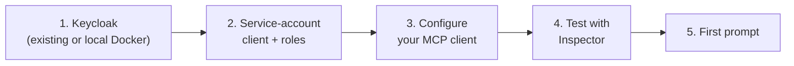

# Getting started

This guide takes you from nothing to a working Keycloak MCP server, step by step: a local Keycloak (optional), a least-privilege service-account client, the client configuration, a test with the MCP Inspector, and your first prompt.



## Prerequisites

- **Node.js 22 or newer** (`node --version`).
- A **Keycloak server** your machine can reach. The server is tested against Keycloak 24.0, 25.0, 26.0 and 26.8.
- An **MCP client** ([docs/clients.md](clients.md)).
- Optional, for the local setup: Docker with Compose, and a clone of this repository.

## 1. Get a Keycloak to talk to

### Option A: use your own Keycloak

Note its base URL (for example `https://keycloak.example.com`). If Keycloak runs behind a path prefix, include it (`https://host/auth`). Skip to [step 2](#2-create-a-service-account-client).

### Option B: local Keycloak with Docker Compose

The repository ships a throw-away Keycloak with two realms imported (`it-realm` and `it-realm-b`):

```bash
git clone https://github.com/ChristophEnglisch/keycloak-model-context-protocol.git
cd keycloak-model-context-protocol
docker compose up -d        # first start imports the realms, about 30 seconds
docker compose ps           # wait until the keycloak service is "healthy"
```

- Admin console: <http://localhost:8080>, login `admin` / `admin` (dev-only credentials, data is not persisted).
- `it-realm` contains users `alice`, `bob`, `carol`, groups `engineering` and `ops`, and the clients `it-app` and `it-service`.
- Pick another Keycloak version with `KEYCLOAK_VERSION=26.0 docker compose up -d`. Stop with `docker compose down`.

**Shortcut:** the pre-imported client `it-service` in `it-realm` is already a service account with read roles (`view-users`, `query-users`, `view-realm`, `view-clients`, `query-groups`). Its secret is `it-service-secret`. This is a dev-only fixture; you can use it for a first try (`KEYCLOAK_AUTH_REALM=it-realm`, `KEYCLOAK_CLIENT_ID=it-service`) and skip to [step 3](#3-configure-your-mcp-client). To learn the setup you will need for a real server, continue with step 2.

## 2. Create a service-account client

The server logs in with the OAuth2 `client_credentials` grant. The client's *service account* is a technical user, and the roles you give it decide exactly what the assistant can do. Create the client **in the realm you want to administer**, and set `KEYCLOAK_AUTH_REALM` to that realm.

> [!NOTE]
> A service account of realm `demo` can administer realm `demo` only, which is what you want for least privilege. To manage several realms or the `master` realm itself, use an account in the `master` realm with the matching `<realm>-realm` client roles (or the `admin` realm role). See [configuration](configuration.md#managing-more-than-one-realm).

Choose the roles from the [recommended profiles](configuration.md#recommended-role-profiles). For a first trial, a read-only set is enough: `view-users`, `query-users`, `query-groups`, `view-realm`.

### Admin Console

The labels below follow Keycloak 26.

1. Open the Admin Console and select the target realm (for example `demo`) in the realm drop-down.
2. **Clients** > **Create client**.
   - *Client type*: `OpenID Connect`
   - *Client ID*: `mcp-admin`
   - **Next**
3. *Capability config*:
   - *Client authentication*: **On**
   - *Authorization*: Off
   - *Authentication flow*: tick **only** *Service accounts roles*. Untick *Standard flow* and *Direct access grants*.
   - **Next**, then **Save** (no URLs are needed).
4. Open the client's **Credentials** tab and copy the **Client secret**.
5. Open the **Service accounts roles** tab > **Assign role**.
   - In the filter drop-down choose **Filter by clients**.
   - Search for the roles, for example `view-users`, tick them (they belong to the client `realm-management`) and **Assign**.
6. Optional but recommended: on the **Credentials** tab, rotate the secret whenever it may have leaked, and keep it out of version control.

### kcadm.sh

`kcadm.sh` ships with Keycloak (`bin/kcadm.sh`). With the Docker setup from above, run it in the container, for example `docker compose exec keycloak /opt/keycloak/bin/kcadm.sh ...`.

```bash
KCADM="docker compose exec keycloak /opt/keycloak/bin/kcadm.sh"   # or: /opt/keycloak/bin/kcadm.sh
REALM=demo                                                        # use it-realm for the local setup

# 1. Log in as an administrator (once per session)
$KCADM config credentials --server http://localhost:8080 --realm master \
  --user admin --password admin

# 2. Create the client: confidential, service account only
CID=$($KCADM create clients -r "$REALM" -i \
  -s clientId=mcp-admin \
  -s protocol=openid-connect \
  -s publicClient=false \
  -s serviceAccountsEnabled=true \
  -s standardFlowEnabled=false \
  -s directAccessGrantsEnabled=false)

# 3. Assign realm-management roles to its service account
$KCADM add-roles -r "$REALM" \
  --uusername service-account-mcp-admin \
  --cclientid realm-management \
  --rolename view-users --rolename query-users \
  --rolename query-groups --rolename view-realm

# 4. Read the generated secret
$KCADM get "clients/$CID/client-secret" -r "$REALM"
```

The last command prints `{"type":"secret","value":"..."}`. Store the value in a password manager or a secret store.

To check which roles the service account has:

```bash
$KCADM get-roles -r "$REALM" --uusername service-account-mcp-admin --cclientid realm-management
```

## 3. Configure your MCP client

Export the connection data in your shell so the secret does not end up in a config file:

```bash
export KEYCLOAK_URL=http://localhost:8080      # or your server
export KEYCLOAK_AUTH_REALM=demo                # the realm of the client
export KEYCLOAK_CLIENT_ID=mcp-admin
export KEYCLOAK_CLIENT_SECRET='<client-secret>'
```

Then register the server. Claude Code:

```bash
claude mcp add --transport stdio \
  --env KEYCLOAK_URL="$KEYCLOAK_URL" \
  --env KEYCLOAK_AUTH_REALM="$KEYCLOAK_AUTH_REALM" \
  --env KEYCLOAK_CLIENT_ID="$KEYCLOAK_CLIENT_ID" \
  --env KEYCLOAK_CLIENT_SECRET="$KEYCLOAK_CLIENT_SECRET" \
  keycloak -- npx -y keycloak-model-context-protocol
```

For Claude Desktop, VS Code, Cursor and generic clients see [clients.md](clients.md). Tune behaviour (toolsets, read-only mode, realm allowlist) in [configuration.md](configuration.md). Recommended for the first run:

```text
KEYCLOAK_MCP_READ_ONLY=true
KEYCLOAK_MCP_REALMS=demo
```

> [!TIP]
> To run from a local clone instead of npm: `npm install && npm run build`, then use `node /absolute/path/to/dist/index.js` as the command.

## 4. Test with the MCP Inspector

The [MCP Inspector](https://github.com/modelcontextprotocol/inspector) lets you call tools by hand, without an AI client, and shows the exact error messages.

```bash
npx -y @modelcontextprotocol/inspector \
  -e KEYCLOAK_URL="$KEYCLOAK_URL" \
  -e KEYCLOAK_AUTH_REALM="$KEYCLOAK_AUTH_REALM" \
  -e KEYCLOAK_CLIENT_ID="$KEYCLOAK_CLIENT_ID" \
  -e KEYCLOAK_CLIENT_SECRET="$KEYCLOAK_CLIENT_SECRET" \
  -- npx -y keycloak-model-context-protocol
```

Open the printed URL, then:

1. **Tools** > **List Tools**. You should see the tools of the default toolsets (`core`, `groups`, `roles`; 16 tools, or only the read tools with `KEYCLOAK_MCP_READ_ONLY=true`).
2. Run `realm_list`. The first call performs the login; a result with your realm confirms credentials and roles.
3. Run `user_search` with `realm` set to your realm.
4. Optionally open **Prompts** (4 entries) and **Resources** (for example `keycloak://realms`).

Server logs go to **stderr**, which the Inspector shows in its notifications pane. For more detail add `-e KEYCLOAK_MCP_LOG_LEVEL=debug`.

If the server exits right away or a call fails, check the message against [troubleshooting.md](troubleshooting.md). Typical causes are a wrong `KEYCLOAK_AUTH_REALM` (the realm of the client, not necessarily the one you query) and missing roles (HTTP 403).

## 5. Your first prompt

Restart your MCP client if needed, make sure the `keycloak` server is listed as connected, and ask:

> List the realms you can access, then show me the first 10 users of realm `demo`.

Next steps:

- Try a guided workflow: choose the `audit_realm_security` or `investigate_failed_logins` prompt from your client's prompt picker. They need the `clients` and `events` toolsets (`KEYCLOAK_MCP_TOOLSETS=core,groups,roles,clients,events` or `all`) and the roles `view-clients` and `view-events`.
- Allow changes: remove `KEYCLOAK_MCP_READ_ONLY`, assign `manage-users` (and `view-realm`) to the service account, and ask the assistant to create a user. Try deleting a test user and watch the confirmation step.
- Read [security.md](security.md) before pointing the server at a production Keycloak.
