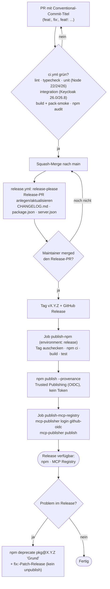

# Release-Prozess

Releases laufen vollautomatisch über [release-please](https://github.com/googleapis/release-please-action) und npm Trusted Publishing (OIDC). Es gibt kein `NPM_TOKEN` mehr. Jede veröffentlichte Version trägt eine Provenance-Attestierung.

Beteiligte Dateien:

| Datei | Zweck |
|---|---|
| `.github/workflows/ci.yml` | Qualitätsprüfung bei Push auf `main` und bei Pull Requests |
| `.github/workflows/release.yml` | release-please, npm-Publish, MCP-Registry-Publish |
| `release-please-config.json` | Release-Konfiguration (Changelog-Sektionen, `extra-files`, `release-as`) |
| `.release-please-manifest.json` | Aktuell veröffentlichte Version (Startwert `0.0.2`) |
| `server.json` | Metadaten für die offizielle MCP Registry (Version wird von release-please mitgezogen) |

## Ablauf

Hinweise:

- release-please arbeitet mit einem kurzlebigen Token der **GitHub App „Release App“** (Einrichtung, Schritt 3), nicht mit dem `GITHUB_TOKEN`. Deshalb läuft `ci.yml` auch auf dem Release-PR, und die Repo-Einstellung „Allow GitHub Actions to create and approve pull requests“ bleibt aus. Mit dem `GITHUB_TOKEN` würde GitHub für den Release-PR keine Workflows starten, und das Häkchen würde jedem Workflow erlauben, PRs freizugeben.
- Der MCP-Registry-Job läuft nur, wenn der npm-Publish erfolgreich war. Schlägt er fehl, kann er unabhängig wiederholt werden (Re-run des Jobs), die npm-Version bleibt bestehen.

## Einmalige Einrichtung (durch den Repo-Owner)

1. **npm Trusted Publisher konfigurieren.** Auf npmjs.com: Paket `keycloak-model-context-protocol` → *Settings* → *Trusted Publisher* → *GitHub Actions*. Einzutragen:
   - Organization/User: `ChristophEnglisch`
   - Repository: `keycloak-model-context-protocol`
   - Workflow filename: `release.yml`
   - Environment name: `release`
2. **GitHub-Environment `release` anlegen** (*Settings → Environments*). Empfohlen: Required reviewers (der Owner), Deployment branches/tags auf `main` bzw. `v*` beschränken. Beide Publish-Jobs verwenden dieses Environment, jeder Publish wartet also auf eine Freigabe.
3. **GitHub App für release-please anlegen.** release-please braucht ein Token, das PRs, Tags und Releases anlegen darf. Statt des `GITHUB_TOKEN` (und des Häkchens „Allow GitHub Actions to create and approve pull requests“) nutzt der Workflow eine eigene GitHub App, die nur für dieses Repo installiert ist.
   1. Auf GitHub: *Settings (des Accounts) → Developer settings → GitHub Apps → New GitHub App*.
      - **GitHub App name:** frei wählbar, z. B. `keycloak-mcp-release` (muss GitHub-weit eindeutig sein).
      - **Homepage URL:** `https://github.com/ChristophEnglisch/keycloak-model-context-protocol`
      - **Webhook:** *Active* abwählen (kein Webhook nötig).
      - **Repository permissions:** *Contents: Read and write*, *Pull requests: Read and write*, *Issues: Read and write* (für die Labels `autorelease: pending/tagged`). *Metadata: Read-only* setzt GitHub automatisch. Sonst nichts.
      - **Where can this GitHub App be installed?** *Only on this account*.
      - *Create GitHub App*.
   2. Auf der Seite der App die **Client ID** notieren (beginnt mit `Iv`) und unter *Private keys* → *Generate a private key* eine `.pem`-Datei erzeugen.
   3. Links *Install App* → beim eigenen Account *Install* → *Only select repositories* → `keycloak-model-context-protocol`.
   4. Im Repo unter *Settings → Secrets and variables → Actions*:
      - Tab *Variables*: `RELEASE_APP_CLIENT_ID` = Client ID
      - Tab *Secrets*: `RELEASE_APP_PRIVATE_KEY` = gesamter Inhalt der `.pem`-Datei (inklusive `-----BEGIN …` und `-----END …`). Die `.pem`-Datei danach lokal löschen.
   5. *Settings → Actions → General → Workflow permissions*: **„Read repository contents and packages permissions“** und das Häkchen **„Allow GitHub Actions to create and approve pull requests“ aus**. Falls es vorher eingeschaltet wurde, wieder ausschalten.

   Fehlt Variable oder Secret, bricht der Job `release-please` mit „Release app not configured“ ab.
4. **Token-Publishing sperren.** Erst nachdem der erste Trusted-Publishing-Release (1.0.0) erfolgreich war: npmjs.com → Paket → *Settings → Publishing access* → „Require two-factor authentication and disallow tokens“. Danach alle bestehenden Automation-Tokens des Pakets widerrufen.
5. **Altes Secret löschen:** GitHub → *Settings → Secrets and variables → Actions* → `NPM_TOKEN` entfernen.
6. **Private Vulnerability Reporting aktivieren:** *Settings → Code security → Private vulnerability reporting* einschalten (Voraussetzung für den Meldeweg in `SECURITY.md`).
7. **MCP Registry:** Das Feld `mcpName` in `package.json` muss `io.github.christophenglisch/keycloak-model-context-protocol` lauten und dem `name` in `server.json` entsprechen. Der Login erfolgt per GitHub-OIDC, es ist kein Secret nötig. Der Namespace `io.github.<user>/` wird gegen den GitHub-Besitzer des Repos geprüft. Falls die Registry die Groß-/Kleinschreibung (`ChristophEnglisch`) beanstandet, den Namen in `server.json` und `mcpName` entsprechend anpassen. Das lässt sich ohne Veröffentlichung nicht vorab prüfen.
8. **Nur Squash-Merge erlauben:** *Settings → General → Pull Requests*: „Allow squash merging“ an, „Default commit message“ auf *Pull request title*, „Allow merge commits“ und „Allow rebase merging“ aus. Dann wird der PR-Titel (Conventional Commit) zur Commit-Message auf `main`, und es entstehen keine Merge-Commits, die release-please nicht lesen kann.
9. Optional: Branch Protection für `main` mit den Checks aus `ci.yml` (`lint-typecheck`, `unit`, `integration`, `build-smoke`, `audit`) als Pflicht. Die Integration-Zeilen für Keycloak 24.0 und 25.0 sind bewusst `continue-on-error` und sollten **nicht** als Pflicht-Check gesetzt werden.

## 1.0.0 schneiden

Der erste Release soll exakt `1.0.0` heißen, unabhängig von den bisherigen Commits. Dafür stand in `release-please-config.json` unter `packages["."]` der Schlüssel `"release-as": "1.0.0"`. Tag und GitHub Release `v1.0.0` existieren inzwischen, der Schlüssel ist wieder entfernt.

1. Sicherstellen, dass alle Änderungen für 1.0 auf `main` gemergt sind und `ci.yml` grün ist (die Commits müssen Conventional-Commit-Titel haben, sonst fehlen sie im Changelog).
2. Warten, bis release-please den PR „chore(main): release 1.0.0“ anlegt. Changelog, `package.json` und `server.json` prüfen.
3. Release-PR mergen. Tag `v1.0.0` und GitHub Release entstehen, danach läuft `publish-npm` (ggf. nach Freigabe im Environment `release`) und anschließend `publish-mcp-registry`.
4. Prüfen: `npm view keycloak-model-context-protocol version dist.attestations` und die Suche in der MCP Registry.
5. **Wichtig: `"release-as": "1.0.0"` direkt nach dem Release wieder aus `release-please-config.json` entfernen** (eigener `chore:`-Commit auf `main`). JSON erlaubt keine Kommentare, daher steht die Warnung hier. Bleibt der Schlüssel stehen, schlägt release-please jedes Mal erneut `1.0.0` vor und weitere Releases scheitern. Außerdem das Manifest `.release-please-manifest.json` nicht von Hand ändern, release-please setzt es auf `1.0.0`.
6. Danach Schritt 4 der Einrichtung durchführen (Token-Publishing sperren, `NPM_TOKEN` löschen).

## Conventional Commits und Versionen

release-please leitet die nächste Version aus den Commit-Titeln seit dem letzten Release ab (bei Squash-Merge ist das der PR-Titel):

| Commit-Typ | Wirkung ab 1.0 | Changelog-Sektion |
|---|---|---|
| `fix:` | Patch (1.0.0 → 1.0.1) | Bug Fixes |
| `feat:` | Minor (1.0.0 → 1.1.0) | Features |
| `feat!:` / `fix!:` oder Footer `BREAKING CHANGE:` | Major (1.x → 2.0.0) | Hervorgehoben im Changelog |
| `perf:` | Patch | Performance Improvements |
| `docs:` | Patch | Documentation |
| `deps:` | Patch | Dependencies |
| `chore:`, `refactor:`, `test:`, `ci:`, `build:` | kein Release | im Changelog ausgeblendet |

Als Breaking Change gilt bei diesem Projekt alles, was bestehende MCP-Clients bzw. Konfigurationen bricht: Umbenennen oder Entfernen von Tools, Parametern, Env-Variablen oder Defaults sowie Änderungen am Format der `structuredContent`-Ausgabe. Neue Tools oder optionale Parameter sind `feat:`.

Hinweis: `chore:`/`ci:`-Commits allein lösen keinen Release-PR aus. Abhängigkeits-Updates, die das veröffentlichte Paket betreffen, sollten als `deps:` (oder `fix(deps):`) eingereicht werden. Die Dependabot-Konfiguration dafür ist nicht Teil dieser Datei.

## Fehlerbehebung

- **`Release app not configured`:** Variable `RELEASE_APP_CLIENT_ID` oder Secret `RELEASE_APP_PRIVATE_KEY` fehlt (Einrichtung, Schritt 3.4). Danach unter *Actions → Release* den Lauf mit *Re-run failed jobs* neu starten.
- **`create-github-app-token` meldet „Not Found“ oder „Integration not found“:** Die App ist nicht für dieses Repo installiert (Schritt 3.3), oder Client ID und Private Key gehören zu verschiedenen Apps.
- **`Resource not accessible by integration` beim Anlegen des PRs oder der Labels:** Der App fehlt eine Berechtigung (Schritt 3.1). Nach dem Ändern der Rechte muss die Installation die neuen Rechte bestätigen: *Settings → Applications → Installed GitHub Apps → Configure*.
- **`GitHub Actions is not permitted to create or approve pull requests`:** Tritt nur auf, wenn release-please doch mit dem `GITHUB_TOKEN` läuft (alter Stand des Workflows). Lösung ist die App aus Schritt 3, nicht das Häkchen. release-please verwendet einen schon angelegten Branch `release-please--branches--main--…` beim nächsten Lauf wieder.
- **`commit could not be parsed` im Log:** betrifft Merge-Commits wie „Merge pull request #12 …“ und alte Commits ohne Conventional-Commit-Titel. Das ist harmlos, sie fehlen nur im Changelog. Abhilfe: nur Squash-Merge erlauben (Einrichtung, Schritt 8).
- **Breaking-Change-Text im Changelog abgeschnitten:** Zeilen im Commit-Body, die mit `wort:` beginnen (z. B. `confirm: true`), hält der Parser für Git-Trailer und beendet dort den Text. Korrektur ohne neuen Commit: In die Beschreibung des gemergten PRs einen Block `BEGIN_COMMIT_OVERRIDE` … `END_COMMIT_OVERRIDE` mit der korrigierten Commit-Message einfügen; release-please nutzt ihn beim nächsten Lauf.
- **Lint schlägt nach dem Release-PR fehl:** `CHANGELOG.md`, `server.json` und `.release-please-manifest.json` schreibt release-please in eigenem Format. Sie sind deshalb in `biome.json` vom Formatter ausgenommen. Nicht wieder aufnehmen.
- **Kein Release-PR erscheint:** Seit dem letzten Release gab es keine Commits vom Typ `feat`, `fix`, `perf`, `docs` oder `deps`, oder Workflow-Berechtigungen fehlen (Einrichtung, Schritt 3).
- **`npm publish` meldet 404/E403 oder „Unable to authenticate“:** Der Trusted Publisher stimmt nicht exakt mit Repo, Workflow-Datei `release.yml` und Environment `release` überein (Einrichtung, Schritt 1). Der Workflow darf nicht umbenannt werden. npm verschluckt den fehlgeschlagenen OIDC-Austausch und veröffentlicht dann ohne Anmeldung, daher die irreführende 404. Den eigentlichen Grund zeigt das Job-Log in der Zeile `npm verbose oidc Failed token exchange request with body message: …`. Tag und GitHub Release bleiben bestehen. Zum erneuten Veröffentlichen *Actions → Release → Run workflow* auf `main` starten und den Tag angeben (z. B. `v1.0.0`). Ein „Re-run“ des alten Laufs nutzt dagegen den Workflow-Stand des Tags, also ohne spätere Korrekturen am Workflow.
- **npm-Version:** Trusted Publishing braucht npm ≥ 11.5.1. Node 24 liefert in aktuellen Patch-Releases npm 11.x mit. Der Workflow prüft die Version trotzdem und führt bei Bedarf `npm install -g npm@latest` aus.
- **Fehlerhaftes Release:** Nie `npm unpublish`. Stattdessen `npm deprecate keycloak-model-context-protocol@X.Y.Z "Grund"` und einen `fix:`-Patch-Release nachschieben.
