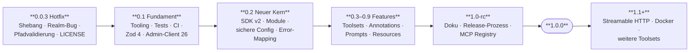

# Roadmap: von 0.0.2 zu einer stabilen 1.0

> Stand: 2026-10-24 · Basis: `main` @ `2e8bc85` · konsolidiert aus den fünf Analysen unter [analysis/](analysis/)

## Umsetzungsstand 1.0

> Stand: 2026-10-24 · Branch `feature/v1.0` · gegen den Code geprüft. Der Rest dieses Dokuments ist der ursprüngliche Plan und bleibt unverändert; die Checkboxen in den Phasen weiter unten wurden **nicht** nachgezogen, maßgeblich ist dieser Block.

Phase 0 (Hotfix 0.0.3) wurde **bewusst übersprungen**. Alle Punkte daraus sind in 1.0 enthalten, es gibt kein Release 0.0.3.

**Phase 0 (in 1.0 enthalten)**

- [x] Shebang in `src/index.ts` (DOC-01, ARCH-01)
- [x] Kein `setConfig({realmName})` mehr, Realm pro Request, Auth-Realm fest (SEC-02, ARCH-03)
- [x] Pfadsegment-Validierung für `realm`, `id`, `userId`, `groupId` (SEC-08). Teilweise: kein UUID-Format, Rollennamen nicht geprüft
- [x] Login im Gateway, Fehler als `isError` (ARCH-04, SEC-09)
- [x] Serverversion aus `package.json` (`src/version.ts`)
- [x] `LICENSE` (MIT)
- [ ] Issue #5 schließen (nach dem Release von 1.0.0)

**Phase 1: Fundament**

- [x] Vitest, Biome, Scripts `lint`, `typecheck`, `test`, `test:integration`, `test:smoke`, `prepublishOnly`
- [x] Unit- und Protokolltests, Regressionstest für den Realm-Bug (`tests/unit/realm-isolation.test.ts`)
- [x] Integrationstests mit Testcontainers geschrieben (`tests/integration/`)
- [x] Integrationstests gegen echten Keycloak 24.0, 25.0, 26.0 und 26.8 grün (je 126 Tests), inklusive SEC-08 und der Tool→Rollen-Matrix (22 von 24 Zeilen getestet)
- [x] Zod 4, Admin-Client 26.8, `npm audit --omit=dev` ohne Befund
- [x] CI-Workflow (`ci.yml`) mit Matrix Node 22/24/26 und Keycloak 26.0/26.8 sowie 24.0/25.0 als erlaubte Fehler
- [x] `docs:check` ist Teil des CI-Jobs Lint & typecheck
- [ ] CI ist noch nie auf GitHub gelaufen
- [x] Dependabot, `.nvmrc`, `.editorconfig`, erweiterte `.gitignore`

**Phase 2: Neuer Kern**

- [x] SDK v2 mit `McpServer`/`registerTool`, `outputSchema`, Annotations
- [x] Modulstruktur mit `createServer(deps)`, Seiteneffekte nur in `index.ts`
- [x] Config per Zod, fail-fast, keine Credential-Defaults
- [x] `client_credentials` mit Token-Cache, Single-Flight und 401-Retry; Password-Grant explizit
- [x] Read-only-Modus, Realm-Allowlist, Toolsets, `master`-Schreibschutz
- [x] Error-Mapping (401/403/404/409/400/5xx, Timeout, Netzwerk)
- [x] Timeouts (`KEYCLOAK_MCP_TIMEOUT_MS`), TLS-Hinweise (`NODE_EXTRA_CA_CERTS`), Audit-Log mit Secret-Maskierung
- [ ] `http://` zu Nicht-Localhost-Hosts wird nicht abgelehnt und nicht gewarnt (SEC-10)
- [x] Ausgaben minimiert: Allowlist-Felder, strukturierte Ausgabe, neutrale Summaries (SEC-07/15)

**Phase 3: Features**

- [x] 24 Tools in 7 Toolsets (`core`, `groups`, `roles`, `clients`, `sessions`, `events`, `security`)
- [x] Bestätigung destruktiver Aktionen über den `confirm`-Parameter mit Vorschau. Elicitation wird bewusst **nicht** verwendet (im Protokoll 2026-07-28 deprecated), siehe [architecture.md](architecture.md)
- [ ] Kein Dry-Run für Schreib-Tools, keine Schutzliste für Admin-User und Service-Accounts (SEC-06, teilweise)
- [x] 4 Prompts: `onboard_employee`, `offboard_employee`, `audit_realm_security`, `investigate_failed_logins`
- [x] Resources und Resource Templates mit Completion für `realm`
- [x] Bewusst nicht enthalten: Client-Secrets ausgeben, Realm löschen, Impersonation, Events löschen

**Phase 4: Release Candidate**

- [x] README und `docs/`: getting-started, configuration, clients, tools-reference (generiert), security, troubleshooting, architecture
- [ ] Keine ADRs angelegt
- [x] `CHANGELOG.md` mit Migrationstabelle, `SECURITY.md`, `CONTRIBUTING.md`, Issue- und PR-Templates
- [x] `package.json`-Metadaten, `server.json`, `mcpName`
- [x] release-please, Release-Workflow mit Trusted Publishing und Provenance (Konfiguration vorhanden)
- [ ] **Trusted Publisher muss auf npmjs.com eingerichtet werden**, danach Token-Publishing sperren und `NPM_TOKEN` löschen ([release-process.md](release-process.md)). Der Release-Workflow ist noch nie gelaufen
- [ ] GitHub-Environment `release` und Private Vulnerability Reporting aktivieren
- [x] Smithery-Verweise aus der README entfernt (DOC-09)
- [ ] Mindestens ein RC-Zyklus mit echten Nutzern. Noch nicht erfolgt

**Phase 5: Definition of Done**

- [ ] Testpyramide grün in CI (Unit lokal grün, Integration und CI offen, siehe oben)
- [x] `npm audit --omit=dev` ohne high/critical
- [x] Keine Credential-Defaults, klare Fehlermeldung ohne Config
- [x] Jedes Tool mit Annotations, `outputSchema`, Parameterbeschreibung und Eintrag in der Tool-Referenz
- [ ] Unterstützte Keycloak-Versionen sind dokumentiert, aber noch nicht in CI bestätigt
- [ ] Veröffentlicht mit Provenance, Eintrag in der MCP Registry

**Abweichungen von den Leitentscheidungen**

- **E5 (Env-Präfix):** Verbindungs- und Credential-Variablen heißen weiter `KEYCLOAK_URL`, `KEYCLOAK_AUTH_REALM`, `KEYCLOAK_CLIENT_ID`, `KEYCLOAK_CLIENT_SECRET`, `KEYCLOAK_USERNAME`, `KEYCLOAK_PASSWORD`. Nur Verhaltens-Schalter tragen das Präfix `KEYCLOAK_MCP_*`. `KEYCLOAK_ADMIN` und `KEYCLOAK_ADMIN_PASSWORD` bleiben als veraltete Aliase mit Warnung.
- **E6 (Elicitation):** Nur der `confirm`-Parameter, keine Elicitation.
- **E7 (Transport):** Streamable HTTP und Docker-Image sind wie geplant **1.1**.

Der Status der Sicherheitsbefunde steht in [security.md](security.md#findings-of-the-analysis-and-their-status-in-10): 7 behoben, 8 teilweise, 0 offen.

---

## Kurzfassung

Version 0.0.2 ist ein Prototyp mit 204 Zeilen in einer Datei, 4 Tools, ohne Tests und auf einem SDK-Stand von Ende 2024. Bevor neue Features sinnvoll sind, müssen vier Dinge passieren:

1. **Das Paket startet nicht.** `npx keycloak-model-context-protocol` bricht unter macOS und Linux mit `import: command not found` ab, weil der Shebang fehlt ([DOC-01](analysis/05-docs-dx-release.md), [ARCH-01](analysis/02-architecture-and-dependencies.md)). Issue #5 dazu ist seit März 2025 offen.
2. **Der Server kann im falschen Realm handeln.** `setConfig({realmName})` verstellt den globalen Client dauerhaft. Danach meldet sich der nächste Call am falschen Realm an, und parallele Calls können im falschen Realm löschen ([SEC-02](analysis/01-security.md), [ARCH-03](analysis/02-architecture-and-dependencies.md)).
3. **Die Rechte sind zu breit.** Der Server läuft als Master-Superuser per Password-Grant, fällt still auf `admin`/`admin` zurück und hat weder Read-only-Modus noch Allowlists noch einen Schutz vor destruktiven Aktionen ([SEC-01, -03, -05, -06](analysis/01-security.md)).
4. **Die Basis ist veraltet.** MCP-SDK 0.5.0 → aktuell v2 (`@modelcontextprotocol/server` 2.4.0), Admin-Client 22 → 26.8.1, Zod 3 → 4. `npm audit` meldet 6 Schwachstellen, davon 5 high ([ARCH-02, -06, -07](analysis/02-architecture-and-dependencies.md), [SEC-12](analysis/01-security.md)).

Danach wird das Projekt zu einem vollwertigen Keycloak-Admin-Assistenten: etwa 24 Tools in abschaltbaren Toolsets, Prompts für typische Abläufe (Onboarding, Offboarding, Security-Audit), Resources, strukturierte Ausgaben, eine vollständige Testpyramide und ein vertrauenswürdiger Release-Prozess ([04-feature-gap.md](analysis/04-feature-gap.md)).

## Leitentscheidungen für 1.0

Diese Punkte gehören zur **Public API** (Toolnamen, Parameter, Env-Variablen, CLI-Name, unterstützte Laufzeiten). Sie müssen vor 1.0 feststehen, danach gilt Semver.

| # | Entscheidung | Vorschlag | Begründung | Quelle |
|---|---|---|---|---|
| E1 | MCP-SDK | **v2** (`@modelcontextprotocol/server`), Fallback 1.32.x | v2 ist die stabile Linie mit Protokoll 2026-07-28, 1.32.x bekommt nur noch Maintenance-Fixes. `serveStdio` bedient auch 2025er-Clients. | ARCH-02 |
| E2 | Node-Version | `engines: ">=22"`, CI auf 22/24/26 | Node 18/20 sind EOL, SDK v2 verlangt ≥ 20 | ARCH-14, DOC-05 |
| E3 | Toolnamen | `<domäne>_<verb>` in snake_case (`user_create`, `realm_list`) | gültige Bezeichner in generiertem Code; Präfix erleichtert Toolset-Filter. **Breaking**, deshalb mit Migrationstabelle. | 04-feature-gap §4 |
| E4 | Auth | `client_credentials` (Service-Account) als Standard, Password-Grant nur noch explizit; keine Default-Credentials; Token-Cache | Least Privilege, MFA-kompatibel, weniger Token-Requests | SEC-01/03/04, ARCH-05 |
| E5 | Env-Variablen | eigenes Präfix `KEYCLOAK_MCP_*` (z. B. `_URL`, `_AUTH_REALM`, `_CLIENT_ID`, `_CLIENT_SECRET`, `_READ_ONLY`, `_REALMS`, `_TOOLSETS`); alte Namen in 1.0 mit Deprecation-Warnung | verhindert Kollision mit den Bootstrap-Variablen des Keycloak-Containers | DOC-03 |
| E6 | Sicherheitsmodell | Read-only-Modus, Realm-Allowlist (`master` nur lesend), Bestätigung destruktiver Aktionen (Elicitation, Fallback über `confirm`-Parameter) | gleichauf mit den aktiven Konkurrenzprojekten, die das bereits bieten | SEC-05/06, 04 §5 |
| E7 | Transport | 1.0: stdio stabil. Streamable HTTP + Docker-Image in **1.1** | hält 1.0 schlank; HTTP braucht ein eigenes Auth-Konzept (Bearer, später OAuth) | ARCH-19, 04 §5 |
| E8 | Release | release-please + Conventional Commits, npm Trusted Publishing (OIDC) mit Provenance | kein langlebiges Token, nachvollziehbare Changelogs | DOC-13/14, SEC-13 |

## Phasenplan

### Phase 0: Hotfix 0.0.3 (sofort, Aufwand S)

Ziel: Bestehende Nutzer können den Server überhaupt starten, und er handelt nie im falschen Realm.

- [ ] `#!/usr/bin/env node` als erste Zeile in `src/index.ts` (DOC-01, ARCH-01)
- [ ] `setConfig({realmName})` entfernen und `realm` nur noch pro Request übergeben. Der Token-Realm bleibt immer `master` (SEC-02, ARCH-03).
- [ ] `realm` und `userId` gegen Pfad-Manipulation validieren, z. B. kein `/`, kein `..` und UUID-Format für IDs (SEC-08)
- [ ] `auth()` in den `try`-Block, Fehler als `isError` statt als Protokollfehler zurückgeben (ARCH-04, SEC-09)
- [ ] Serverversion aus `package.json` lesen statt hart `"0.0.1"` (ARCH-15, DOC-11)
- [ ] `LICENSE` (MIT) anlegen (DOC-02)
- [ ] Release 0.0.3, Issue #5 schließen

### Phase 1: Fundament 0.1 (Aufwand M)

Ziel: Jede weitere Änderung ist durch Tests und CI abgesichert.

- [ ] Vitest, Biome (oder ESLint und Prettier), Scripts `lint`, `typecheck`, `test`, `test:integration`; `prepublishOnly` statt `prepare` (ARCH-13, DOC-18/19)
- [ ] Erste Tests: Unit-Tests der vier bestehenden Tools, In-Process-Protokolltest und **ein Regressionstest für den Realm-Bug** ([03-testing-strategy.md](analysis/03-testing-strategy.md))
- [ ] Integrationstest gegen einen echten Keycloak-Container (Testcontainers), dabei SEC-08 (`DELETE /admin/realms/a/`) und die Tool→Rollen-Matrix verifizieren
- [ ] Zod 4 (`error.errors` → `error.issues`), Admin-Client 26.8.1; `npm audit` sauber (ARCH-06/07/08, SEC-12)
- [ ] CI: lint → typecheck → unit → integration → build → `npm pack`-Smoke-Test; Matrix Node 22/24/26, Keycloak 26.0 und 26.8 als Pflicht, 24.0/25.0 als Job, der fehlschlagen darf. Werkzeuge: Vitest 5, `testcontainers` 12 mit `GenericContainer` (ein Modul `@testcontainers/keycloak` gibt es nicht), Inspector-CLI 2.x für den Smoke-Test.
- [ ] Renovate oder Dependabot (DOC-17), `.nvmrc`, `.editorconfig`, erweiterte `.gitignore` (DOC-18/21)

### Phase 2: Neuer Kern 0.2 (Aufwand L)

Ziel: Architektur und Sicherheitsmodell von 1.0 stehen, noch mit dem alten Tool-Umfang.

- [ ] Migration auf SDK v2 mit `McpServer` und `registerTool` (Zod-Schemas, `outputSchema`, `annotations`). Damit entfällt die doppelte Schema-Pflege (ARCH-02/09/11).
- [ ] Modulstruktur `config`, `keycloak/gateway`, `keycloak/auth`, `keycloak/errors`, `tools/*`, Server-Factory `createServer(deps)`; Seiteneffekte nur in `index.ts` (ARCH-12, [Zielarchitektur](analysis/02-architecture-and-dependencies.md))
- [ ] Config per Zod beim Start validieren, fail-fast, keine Defaults für Credentials (ARCH-05, SEC-01)
- [ ] `client_credentials` + Token-Cache/Refresh; Password-Grant nur explizit (SEC-03/04)
- [ ] Read-only-Modus, Realm-Allowlist, Tool-/Toolset-Filter (SEC-05)
- [ ] Error-Mapping: 401/403/404/409/Netzwerk → verständliche `isError`-Antworten ohne Interna (ARCH-04)
- [ ] TLS-/CA-Hinweise, Timeouts; Audit-Log der Tool-Aufrufe auf stderr mit Secret-Maskierung (SEC-10/11, ARCH-18)
- [ ] Ausgaben minimieren und gegen Prompt Injection kennzeichnen, z. B. Keycloak-Daten als strukturierte Daten und nicht als Fließtext (SEC-07/15)

### Phase 3: Features 0.3–0.9 (Aufwand L)

Ziel: Das MUST-Tool-Set aus [04-feature-gap.md](analysis/04-feature-gap.md), alle Tools mit `title`, Annotations, `outputSchema` und Paginierung.

| Toolset | Tools |
|---|---|
| `core` | `realm_list`, `realm_get`, `user_search`, `user_get`, `user_create`, `user_update`, `user_delete`, `user_send_actions_email` |
| `groups` | `group_list`, `group_members_list`, `user_group_add`, `user_group_remove` |
| `roles` | `role_list`, `user_roles_list`, `user_role_assign`, `user_role_revoke` |
| `clients` | `client_list`, `client_get` (**ohne** Secrets) |
| `sessions` | `user_sessions_list`, `user_logout` |
| `events` | `event_list`, `admin_event_list` |
| `security` | `user_brute_force_status`, `user_brute_force_unlock` |

Zusätzlich:
- [ ] Bestätigung destruktiver Aktionen über Elicitation, Fallback `confirm: true` bzw. Dry-Run (SEC-06)
- [ ] Prompts: `onboard_employee`, `offboard_employee`, `audit_realm_security`, `investigate_failed_logins`. Workflow-Prompts als Kernfeature bewirbt keines der 15 gefundenen Konkurrenzprojekte, hier kann sich das Projekt abheben.
- [ ] Resources/Resource Templates (`keycloak://realms/{realm}`, `…/users/{userId}`, `…/security-summary`), Completions für `realm`
- [ ] Bewusst **nicht** enthalten: Client-Secrets ausgeben, Realm löschen, Impersonation, Events löschen

### Phase 4: Release Candidate 1.0-rc (Aufwand M)

- [ ] README auf 1.0 umstellen; `docs/` mit `getting-started`, `configuration` (inkl. Rollenmatrix), `clients`, `tools-reference` (aus den Tool-Definitionen generiert), `security`, `troubleshooting`, `architecture`, ADRs (DOC-04/06/07/20, [Doku-Struktur](analysis/05-docs-dx-release.md))
- [ ] `CHANGELOG.md` mit Migrationstabelle alt → neu (Toolnamen, Env-Variablen), `SECURITY.md`, `CONTRIBUTING.md`, Issue-/PR-Templates (DOC-14/15/16)
- [ ] `package.json`-Metadaten (`repository`, `homepage`, `bugs`, `keywords`, `engines`, `exports`, `mcpName`), `server.json` für die offizielle MCP Registry (DOC-10/12)
- [ ] release-please, Trusted Publishing mit Provenance (npm ≥ 11.5.1 im Workflow), danach Token-Publishing für das Paket sperren (DOC-13, SEC-13)
- [ ] Smithery-Integration reparieren oder den Badge entfernen (DOC-09)
- [ ] Mindestens ein RC-Zyklus mit echten Nutzern

### Phase 5: 1.0.0 – Definition of Done

- [ ] Alle als **Blocker 1.0** markierten Befunde in den Analysen sind erledigt oder bewusst verschoben, mit Begründung im CHANGELOG
- [ ] Testpyramide grün in CI: Unit, Protokoll, Integration gegen mindestens zwei Keycloak-Versionen, Smoke-Test des gepackten Artefakts
- [ ] `npm audit --omit=dev` ohne high/critical
- [ ] Keine Credentials-Defaults; ohne gültige Config startet der Server nicht und nennt eine klare Fehlermeldung
- [ ] Jedes Tool hat Annotations, `outputSchema`, Beschreibung pro Parameter und einen Eintrag in der Tool-Referenz
- [ ] Unterstützte Keycloak- und Node-Versionen sind dokumentiert und in CI getestet
- [ ] Veröffentlicht mit Provenance; Eintrag in der MCP Registry

### Nach 1.0

- **1.1:** Streamable HTTP mit Bearer-Absicherung, Docker-Image auf GHCR, MCPB-Bundle (ARCH-19, DOC-22)
- **1.x:** weitere Toolsets (Client Scopes, Identity Providers, Organizations, Authentication Flows lesend), LLM-Evals für die Tool-Auswahl
- **2.0:** Per-User-OAuth im HTTP-Modus (Keycloak als Authorization Server), Konfiguration schreiben mit Diff-Vorschau, Bulk-Operationen über die Tasks-Extension

## Zuordnung Blocker → Phase

| Phase | Befunde |
|---|---|
| 0 | DOC-01, ARCH-01, SEC-02, ARCH-03, SEC-08, ARCH-04, ARCH-15, DOC-11, DOC-02 |
| 1 | ARCH-06, ARCH-07, ARCH-08, SEC-12, ARCH-13, ARCH-14, DOC-05 (Node-Teil) |
| 2 | ARCH-02, ARCH-05, ARCH-09, ARCH-10, ARCH-11, ARCH-12, SEC-01, SEC-03, SEC-04, SEC-05, SEC-07, SEC-10, SEC-11 |
| 3 | SEC-06 und Feature-Umfang aus 04-feature-gap |
| 4 | DOC-03, DOC-04, DOC-05, DOC-06, DOC-07, DOC-09, DOC-10, DOC-13, DOC-14, DOC-15, SEC-13, SEC-14 |
