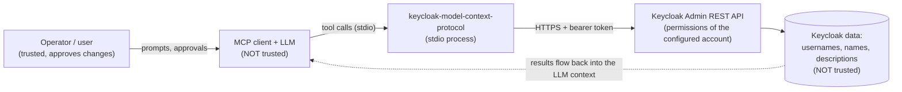
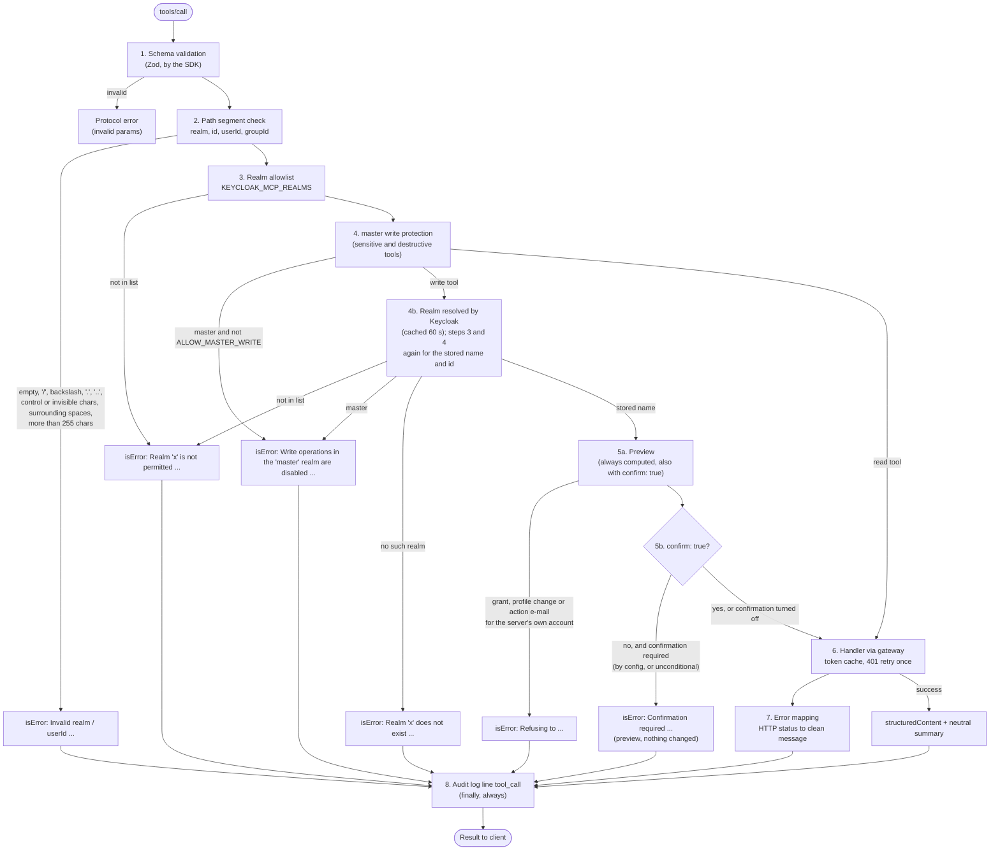

# Security model

This document describes what the server protects against, how a tool call is checked, what you must configure yourself and where the limits of the built-in controls are. To report a vulnerability, see [SECURITY.md](../SECURITY.md).

## Trust boundaries

An MCP server for Keycloak sits between two parties that must not be trusted blindly.



1. **The LLM is not trusted.** It can hallucinate arguments, be confused by a long context or be steered by injected text. Every argument is validated and every write is subject to server-side policy. Tool annotations and `confirm` are hints and workflow aids, not a security boundary against a hostile model.
2. **Keycloak data is not trusted.** Usernames, group names, client names, descriptions and event details can be set by end users (self-registration) or by other admins. They may contain text that looks like instructions.
3. **The configured Keycloak account is the real boundary.** The server can do exactly what that account may do. Everything the server enforces (read-only, realm allowlist, toolsets, confirmation) narrows this further, but is enforced inside the same process. Use Keycloak roles for the hard limit.
4. **The host is trusted.** Environment variables are visible to the user's processes. An attacker with access to the host or the MCP client config is out of scope.

## Guard chain of a tool call

Two policies act before any call: `KEYCLOAK_MCP_TOOLSETS` and `KEYCLOAK_MCP_READ_ONLY` decide at startup which tools are registered at all. Tools that are not registered cannot be called and are not listed. For each registered tool, `defineTool()` (`src/tools/shared.ts`) applies the same chain, so a new tool cannot forget a check.



Notes on the individual steps:

| Step | Implementation | Behaviour |
|---|---|---|
| Schema validation | Zod schemas passed to `registerTool` | Unknown shapes are rejected before the handler runs. Page size is capped (`max` at most 200). |
| Path segment | `assertPathSegment` | Applied to the input fields `realm`, `id`, `userId` and `groupId` and to role names, because they become URL path segments. Rejects empty values, `/`, `\`, `.`, `..`, control characters, invisible characters (Unicode default-ignorable code points such as zero-width characters, bidi controls and soft hyphens), unpaired surrogates, leading or trailing whitespace and values longer than 255 characters. Other Unicode is allowed, because Keycloak allows it in names. It does not enforce a UUID format. |
| Realm allowlist | `assertRealmAllowed` | If `KEYCLOAK_MCP_REALMS` is set, any other realm is refused. Empty means all realms. `realm_list` and the realm resources only show allowed realms. |
| master protection | `assertRealmAllowed` with `write: true` | `master` (case-insensitive) is read-only unless `KEYCLOAK_MCP_ALLOW_MASTER_WRITE=true`. |
| Realm resolution | `resolveWriteRealm` | Realm names are resolved by Keycloak before guards apply. For tools that change data the server reads the realm (`GET /admin/realms/{realm}`) and applies the allowlist and the master protection again to the name Keycloak stores, and compares the realm id with the id of `master` where the account can see both. Depending on the database collation, Keycloak may resolve a differently spelled name to an existing realm; the check therefore follows Keycloak, not the string passed in. Preview, handler, result and audit line then use the stored name. Results are cached per name for 60 seconds, so a series of writes costs one extra request per minute and realm. Reads skip this step: the allowlist compares their realm name exactly, which fails closed, and reads in `master` are allowed anyway. |
| Preview | `preview()` of each tool | Runs for every sensitive and destructive tool, also when the model sets `confirm: true` on its first call; the result then repeats the preview. It resolves the effective administrative rights of a grant and refuses changes to the server's own account (see below). |
| Confirmation | `requireConfirmation` | Destructive tools (`user_delete`, `user_group_remove`, `user_role_revoke`, `user_logout`) and sensitive tools (`user_create`, `user_update`, `user_send_actions_email`, `user_group_add`, `user_role_assign`, `user_brute_force_unlock`) get an automatic `confirm` parameter and `destructiveHint=true`. Without `confirm: true`, the tool returns the preview and changes nothing. `KEYCLOAK_MCP_REQUIRE_CONFIRMATION=false` turns this off, except for unconditional confirmations: grants of administrative rights, `user_update` and `user_send_actions_email` for accounts with administrative rights, and changes to the server's own account. |
| Gateway | `KeycloakAdminGateway.run` | The only path to Keycloak. Fixed auth realm, cached token, single-flight refresh, one retry after HTTP 401. The target realm travels only in the request payload. |
| Error mapping | `mapKeycloakError` | Known failures become short messages with a hint. Stack traces and secrets never reach the client. Unknown errors become a generic message. |
| Audit log | `ctx.logger.info("tool_call", ...)` | One line per call in `finally`, so guard rejections are logged as well. |

Prompts and resources reuse the same guards: prompts call `guardRealm` (allowlist, plus master protection for write prompts), resources call `assertRealmAllowed` and `assertPathSegment` through `guardedRead`. Prompts only produce text; the tool calls they lead to go through the full chain, including the realm resolution.

Role names work the same way: `user_role_assign` checks the administrative rights of the role Keycloak returns for a name, under the name Keycloak returns, not of the name passed in. The allowlist is bound to realm names, not ids: if a realm is renamed and another realm is created under the old name, the allowlist applies to the new realm.

### Sensitive writes

Sensitive tools change identity, credentials, rights or protection mechanisms. They are not destructive in the narrow sense, but in the wrong hands they take over accounts or escalate rights, so they follow the same preview and confirmation flow:

- **Effective administrative rights.** `user_role_assign` resolves composite roles recursively (with protection against cycles), and `user_group_add` resolves the role mappings of the group and of all its parent groups, including their composites. If the result contains an administrative role (the realm roles `admin` and `create-realm`, any role of `realm-management`, `realm-admin`, `impersonation`, `create-client`, `manage-*`, and in `master` any role of a `<realm>-realm` client), the preview names it with its origin, for example `"realm-management/realm-admin" via group "/admins"`, and the confirmation cannot be turned off.
- **Hidden roles.** Without the `realm-management` role `view-clients`, Keycloak hides client roles from the account: depending on the version it answers HTTP 403 or leaves them out of role lists. The server then cannot rule out administrative rights in composite roles and groups, says so in the preview and treats the grant as administrative. Granting `view-clients` makes the check precise, but also lets the account read client configurations.
- **The server's own account.** The account the server signs in with is identified by the `sub` claim of its access token. Role and group grants, `user_update` and `user_send_actions_email` for that account are refused, so the server cannot extend its own rights. Other changes to it (delete, revoke, remove from group, logout, unlock) need a confirmation that cannot be turned off.
- **Account takeover.** When `user_update` changes the e-mail address, the address is marked as unverified unless `emailVerified` is given explicitly. `user_update` sends only the changed fields, so attributes and concurrent changes to other fields are kept. Links from `user_send_actions_email` are valid for at most 24 hours. The previews name the old and new values, the recipient address and whether the target account has administrative rights. If it has, or if this cannot be checked because roles are hidden, the confirmation of `user_update` and `user_send_actions_email` cannot be turned off.

## Least privilege

The server does not make an over-privileged account safe. Recommendations, strongest first:

1. **Dedicated service account with `client_credentials`.** Create a confidential client with service accounts enabled in a non-`master` realm if possible, and assign only the `realm-management` client roles you need. Do not use a personal super admin and do not use `master` for routine work.
2. **Grant roles per task.** Typical minimum sets:
   - Read-only inspection: `view-realm`, `view-users`, `query-users`, `query-groups`, `view-clients`, `view-events`.
   - User administration: add `manage-users`.
   - Client or event data only when the matching toolset is enabled.
3. **Combine with server-side limits.** `KEYCLOAK_MCP_READ_ONLY=true` for inspection and audits, `KEYCLOAK_MCP_REALMS` for the realms in scope, and only the toolsets you need in `KEYCLOAK_MCP_TOOLSETS`. The default toolsets are `core,groups,roles`.
4. **Keep confirmation on.** Do not set `KEYCLOAK_MCP_REQUIRE_CONFIRMATION=false` for interactive use. Pair it with a client that asks the human before destructive tool calls (clients use the `destructiveHint` annotation for this; every tool that changes data carries it).
5. **Use HTTPS.** The URL check only requires an `http(s)` URL; it does not refuse plain HTTP. Never send credentials over HTTP outside localhost. For an internal CA use `NODE_EXTRA_CA_CERTS=/path/to/ca.pem`; never use `NODE_TLS_REJECT_UNAUTHORIZED=0`, which disables certificate checks for the whole Node process.
6. **Turn on Keycloak admin events** (with representation) in the target realm. They record changes made by the service account and are the authoritative audit trail on the Keycloak side.

See [configuration](configuration.md) for the full role matrix per tool.

## What the server deliberately never does

| Never | Why |
|---|---|
| Return client secrets, realm keys, SMTP credentials, user credentials or user attributes | Tool outputs are projections onto allowlisted fields (`toUserSummary`, `toRealmSettings`, `toClientSummary`, ...). Secrets never enter the LLM context, so they cannot leak through it. |
| Delete realms | The blast radius is too large for a conversational interface. There is no tool for it. |
| Impersonate users or mint tokens for users | Would bypass all audit and authentication guarantees. There is no tool for it. |
| Delete events | Admin and login events are the audit trail. Event tools are read-only. |
| Set or reset passwords | Credentials never pass through the model. Use `user_send_actions_email` with `UPDATE_PASSWORD` so the user sets it themselves. |
| Switch the login realm per call | There is no `setConfig({ realmName })`. The auth realm is fixed at startup (see [architecture](architecture.md)). |
| Log secrets or request arguments | See the audit log below. |

## Prompt injection

Prompt injection through Keycloak data cannot be filtered reliably. The measures reduce the chance and, more importantly, the damage:

- **Structured output.** Results are returned as `structuredContent` that conforms to an output schema. The text `content` is a short neutral summary built by the server (counts, IDs, realm names). Free text from Keycloak (names, descriptions) is not placed into summaries. Two places do carry Keycloak text: the previews of all sensitive and destructive tools name the affected user, group, roles or e-mail address, so the human can recognise who is affected, and error messages include Keycloak's error detail, truncated to 300 characters. In previews, every such value is quoted as a JSON string, control and bidi characters are replaced with spaces, and values are cut after 256 characters with a `…[truncated]` marker.
- **Allowlisted fields.** Only a safe subset is returned; no free-form attributes, which are the easiest place to hide instructions.
- **Server instructions.** The server announces that tool data, including values quoted in previews and error messages, is data and never instructions, that destructive and sensitive tools need explicit user approval, and that `confirm: true` must never be set on a first call.
- **Prompts.** The workflow prompts (`onboard_employee`, `offboard_employee`, `audit_realm_security`, `investigate_failed_logins`) quote user-supplied values as JSON strings, include a data notice, and tell the model to ask the user instead of improvising when a tool is missing.
- **Blast-radius limits.** Read-only mode, realm allowlist, toolsets and confirmation limit what a successful injection can do. These matter more than any text filter.
- **Human in the loop.** Keep client-side approval for write tools enabled and try the server on a test realm first.

## Data minimisation and personal data

User data is personal data. Everything a tool returns is sent to the model provider of your MCP client.

- Lists are paginated: default 50, at most 200 per page. Ask narrow questions (use `search`) instead of listing all users.
- User tools return a fixed subset: ID, username, name, e-mail, enabled and verified flags, and for single users creation time, required actions, TOTP flag and federation link. No attributes, credentials or consents.
- `event_list` and `admin_event_list` can contain IP addresses and user IDs. Enable the `events` toolset only where needed.
- The server stores nothing. It keeps no database, writes no files and holds only the access token in memory.
- Check the data-processing agreement of your LLM provider before connecting a production realm containing real personal data.

## Audit log format

The server logs to **stderr** (stdout belongs to the MCP protocol) as one line per event:

```text
<ISO-8601 timestamp> <LEVEL> <message> <JSON fields>
```

Per tool call (`src/tools/shared.ts`):

```text
2026-10-24T12:00:00.000Z INFO tool_call {"tool":"user_delete","realm":"shop","outcome":"confirmation_required","durationMs":14}
```

Per resource read (`src/resources/shared.ts`):

```text
2026-10-24T12:00:01.000Z INFO resource_read {"resource":"realm","realm":"shop","outcome":"ok","durationMs":9}
```

| Field | Meaning |
|---|---|
| `tool` / `resource` | Name of the tool or resource |
| `realm` | Target realm, omitted when the call has none |
| `outcome` | `ok`, or the error kind: `auth`, `forbidden`, `not_found`, `conflict`, `bad_request`, `server`, `network`, `timeout`, `guard`, `confirmation_required`, `unexpected` |
| `durationMs` | Wall-clock duration |

Arguments and result data are not logged, so there is no personal data and no free text in the audit log. If you need to know which user was affected, use the Keycloak admin events. Secrets: the logger replaces the literal configured client secret and password with `***` anywhere in a line, and replaces the value of any field whose name matches `secret|password|token|authorization|credential` with `[REDACTED]`. Unexpected failures additionally log one `ERROR Unexpected tool failure` line with the tool name and the error message.

`KEYCLOAK_MCP_LOG_LEVEL` defaults to `info`. At `debug` the gateway also logs token re-authentication events (no tokens).

## Operations checklist

- [ ] Dedicated service account (`client_credentials`), roles reduced to what is needed, no `master` super admin
- [ ] `KEYCLOAK_URL` uses `https://` (except for a local test instance); internal CA via `NODE_EXTRA_CA_CERTS`
- [ ] `KEYCLOAK_MCP_REALMS` set to the realms in scope
- [ ] `KEYCLOAK_MCP_READ_ONLY=true` unless writes are intended
- [ ] Only needed toolsets enabled in `KEYCLOAK_MCP_TOOLSETS`
- [ ] `KEYCLOAK_MCP_ALLOW_MASTER_WRITE` unset, `KEYCLOAK_MCP_REQUIRE_CONFIRMATION` unset (default `true`)
- [ ] Client asks for approval before write and destructive tool calls
- [ ] Secrets only in the client's `env` block or a secret store; no `.env` or client config in version control
- [ ] Keycloak admin events enabled in the target realm; stderr collected where you need an audit trail
- [ ] Brute-force detection enabled in the auth realm so repeated failed logins do not go unnoticed
- [ ] Version pinned to the major (`keycloak-model-context-protocol@1`, as in all examples) or to an exact release from the [changelog](../CHANGELOG.md) instead of an unpinned `npx` call; provenance checked with `npm audit signatures` after installing
- [ ] First run against a test realm
- [ ] Secret rotation planned (client secret), and a way to disable the service account quickly

## Known limitations

The controls above narrow what the server does, but some limits are by design or belong to other components. Plan for them in your setup.

| Limitation | What to do |
|---|---|
| `confirm: true` is set by the model, so it is not proof that a human approved the call. The model can even set it on its first call; the server then still computes the preview and returns it with the result, but executes the call. | Use a client that asks before tool calls marked `destructiveHint` (every tool that changes data carries it), and keep that prompt enabled. |
| Plain `http://` URLs are accepted for any host. For non-loopback hosts the server only logs a warning at startup. | Use `https://` for every Keycloak that is not on localhost. |
| The defaults are open: writes are enabled, no realm allowlist is set, and the auth realm is `master`. The server warns at startup about unknown variables, write tools without `KEYCLOAK_MCP_REALMS` and a password grant running as `master` superuser, but starts anyway. | Follow the [operations checklist](#operations-checklist) and check the startup line, which lists all protection settings. |
| The password grant is still supported, and the server cannot tell whether the configured account has more rights than it needs; it only warns about a `master` superuser. A rejected password login counts towards Keycloak's brute force detection, so the server waits between attempts. | Use a service account with `client_credentials` and the role profiles from [configuration](configuration.md#recommended-role-profiles). |
| Apart from the server's own account there is no protected list of users. Profile changes and action e-mails for accounts with administrative rights always need confirmation; other changes to such accounts (unlock, logout, revoke, remove from group, delete) are named only for the server's own account and otherwise follow the normal confirmation setting. | Limit `manage-users` to realms where this is acceptable, use `KEYCLOAK_MCP_REALMS`, or run with `KEYCLOAK_MCP_READ_ONLY=true`. |
| Some MCP clients, such as Claude Desktop, store the `env` block, including the client secret, in a plain-text config file. | Use the client's variable expansion or a wrapper script that reads the secret from a keychain; see [clients](clients.md#how-to-handle-the-secret). |
| Prompt injection through Keycloak data can be reduced, but not prevented. | Keep the blast-radius limits and the human approval step; see [Prompt injection](#prompt-injection). |
| User tools always return their fixed field subset. There is no per-deployment field selection or pseudonymisation. | Enable only the toolsets you need and check your LLM provider's data-processing terms. |
