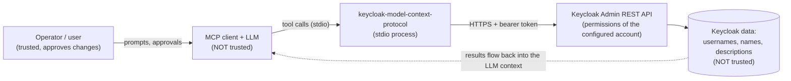
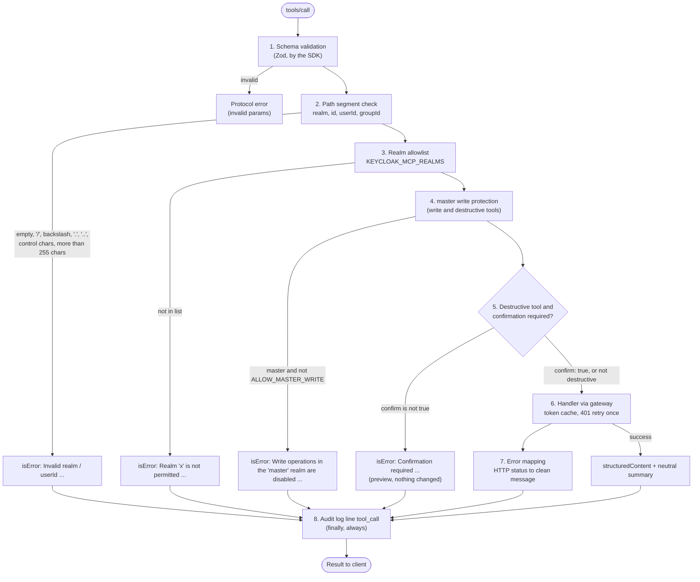

# Security model

This document describes what the server protects against, how a tool call is checked, what you must configure yourself and which findings of the pre-1.0 [security analysis](analysis/01-security.md) are fixed. To report a vulnerability, see [SECURITY.md](../SECURITY.md).

The statements below were checked against the code in `src/` (mainly `src/guards.ts`, `src/tools/shared.ts`, `src/keycloak/*`, `src/config.ts`, `src/logging.ts`).

## Trust boundaries

An MCP server for Keycloak sits between two parties that must not be trusted blindly.



1. **The LLM is not trusted.** It can hallucinate arguments, be confused by a long context or be steered by injected text. Every argument is validated and every write is subject to server-side policy. Tool annotations and `confirm` are hints and workflow aids, not a security boundary against a hostile model.
2. **Keycloak data is not trusted.** Usernames, group names, client names, descriptions and event details can be set by end users (self-registration) or by other admins. They may contain text that looks like instructions.
3. **The configured Keycloak account is the real boundary.** The server can do exactly what that account may do. Everything the server enforces (read-only, realm allowlist, toolsets, confirmation) narrows this further, but is enforced inside the same process. Use Keycloak roles for the hard limit.
4. **The host is trusted.** Environment variables are visible to the user's processes. An attacker with access to the host or the MCP client config is out of scope.

## Guard chain of a tool call

Two policies act before any call: `KEYCLOAK_MCP_TOOLSETS` and `KEYCLOAK_MCP_READ_ONLY` decide at startup which tools are registered at all. Tools that are not registered cannot be called and are not listed. For each registered tool, `defineTool()` (`src/tools/shared.ts`) applies the same chain, so a new tool cannot forget a check.



Notes on the individual steps:

| Step | Implementation | Behaviour |
|---|---|---|
| Schema validation | Zod schemas passed to `registerTool` | Unknown shapes are rejected before the handler runs. Page size is capped (`max` at most 200). |
| Path segment | `assertPathSegment` | Applied to the input fields `realm`, `id`, `userId` and `groupId`, because they become URL path segments. Rejects empty values, `/`, `\`, `.`, `..`, control characters and values longer than 255 characters. It does not enforce a UUID format. |
| Realm allowlist | `assertRealmAllowed` | If `KEYCLOAK_MCP_REALMS` is set, any other realm is refused. Empty means all realms. `realm_list` and the realm resources only show allowed realms. |
| master protection | `assertRealmAllowed` with `write: true` | `master` (case-insensitive) is read-only unless `KEYCLOAK_MCP_ALLOW_MASTER_WRITE=true`. |
| Confirmation | `requireConfirmation` | Destructive tools (`user_delete`, `user_group_remove`, `user_role_revoke`, `user_logout`) get an automatic `confirm` parameter. Without `confirm: true`, the tool returns a preview of the effect and changes nothing. Disabled by `KEYCLOAK_MCP_REQUIRE_CONFIRMATION=false`. |
| Gateway | `KeycloakAdminGateway.run` | The only path to Keycloak. Fixed auth realm, cached token, single-flight refresh, one retry after HTTP 401. The target realm travels only in the request payload. |
| Error mapping | `mapKeycloakError` | Known failures become short messages with a hint. Stack traces and secrets never reach the client. Unknown errors become a generic message. |
| Audit log | `ctx.logger.info("tool_call", ...)` | One line per call in `finally`, so guard rejections are logged as well. |

Prompts and resources reuse the same guards: prompts call `guardRealm` (allowlist, plus master protection for write prompts), resources call `assertRealmAllowed` and `assertPathSegment` through `guardedRead`.

## Least privilege

The server does not make an over-privileged account safe. Recommendations, strongest first:

1. **Dedicated service account with `client_credentials`.** Create a confidential client with service accounts enabled in a non-`master` realm if possible, and assign only the `realm-management` client roles you need. Do not use a personal super admin and do not use `master` for routine work.
2. **Grant roles per task.** Typical minimum sets:
   - Read-only inspection: `view-realm`, `view-users`, `query-users`, `query-groups`, `view-clients`, `view-events`.
   - User administration: add `manage-users`.
   - Client or event data only when the matching toolset is enabled.
3. **Combine with server-side limits.** `KEYCLOAK_MCP_READ_ONLY=true` for inspection and audits, `KEYCLOAK_MCP_REALMS` for the realms in scope, and only the toolsets you need in `KEYCLOAK_MCP_TOOLSETS`. The default toolsets are `core,groups,roles`.
4. **Keep confirmation on.** Do not set `KEYCLOAK_MCP_REQUIRE_CONFIRMATION=false` for interactive use. Pair it with a client that asks the human before destructive tool calls (clients use the `destructiveHint` annotation for this).
5. **Use HTTPS.** The URL check only requires an `http(s)` URL; it does not refuse plain HTTP. Never send credentials over HTTP outside localhost. For an internal CA use `NODE_EXTRA_CA_CERTS=/path/to/ca.pem`; never use `NODE_TLS_REJECT_UNAUTHORIZED=0`, which disables certificate checks for the whole Node process.
6. **Turn on Keycloak admin events** (with representation) in the target realm. They record changes made by the service account and are the authoritative audit trail on the Keycloak side.

See [configuration](configuration.md) for the full role matrix per tool.

## What the server deliberately never does

| Never | Why |
|---|---|
| Return client secrets, realm keys, SMTP credentials, user credentials or user attributes | Tool outputs are projections onto allowlisted fields (`toUserSummary`, `toRealmSettings`, `toClientSummary`, ...). Secrets never enter the LLM context, so they cannot leak through it. |
| Delete realms | The blast radius is too large for a conversational interface. There is no tool for it. |
| Impersonate users or mint tokens for users | Would bypass all audit and authentication guarantees. There is no tool for it. |
| Delete events | Admin and login events are the audit trail. Event tools are read-only. |
| Set or reset passwords | Credentials never pass through the model. Use `user_send_actions_email` with `UPDATE_PASSWORD` so the user sets it themselves. |
| Switch the login realm per call | There is no `setConfig({ realmName })`. The auth realm is fixed at startup (see [architecture](architecture.md)). |
| Log secrets or request arguments | See the audit log below. |

## Prompt injection

Prompt injection through Keycloak data cannot be filtered reliably. The measures reduce the chance and, more importantly, the damage:

- **Structured output.** Results are returned as `structuredContent` that conforms to an output schema. The text `content` is a short neutral summary built by the server (counts, IDs, realm names). Free text from Keycloak (names, descriptions) is not placed into summaries. Two exceptions to keep in mind: the confirmation preview of `user_delete` quotes the username, and Keycloak error details are appended to error messages (truncated to 300 characters).
- **Allowlisted fields.** Only a safe subset is returned; no free-form attributes, which are the easiest place to hide instructions.
- **Server instructions.** The server announces that tool data is data and never instructions, and that destructive tools need explicit user approval.
- **Prompts.** The workflow prompts (`onboard_employee`, `offboard_employee`, `audit_realm_security`, `investigate_failed_logins`) quote user-supplied values as JSON strings, include a data notice, and tell the model to ask the user instead of improvising when a tool is missing.
- **Blast-radius limits.** Read-only mode, realm allowlist, toolsets and confirmation limit what a successful injection can do. These matter more than any text filter.
- **Human in the loop.** Keep client-side approval for write tools enabled and try the server on a test realm first.

## Data minimisation and personal data

User data is personal data. Everything a tool returns is sent to the model provider of your MCP client.

- Lists are paginated: default 50, at most 200 per page. Ask narrow questions (use `search`) instead of listing all users.
- User tools return a fixed subset: ID, username, name, e-mail, enabled and verified flags, and for single users creation time, required actions, TOTP flag and federation link. No attributes, credentials or consents.
- `event_list` and `admin_event_list` can contain IP addresses and user IDs. Enable the `events` toolset only where needed.
- The server stores nothing. It keeps no database, writes no files and holds only the access token in memory.
- Check the data-processing agreement of your LLM provider before connecting a production realm containing real personal data.

## Audit log format

The server logs to **stderr** (stdout belongs to the MCP protocol) as one line per event:

```text
<ISO-8601 timestamp> <LEVEL> <message> <JSON fields>
```

Per tool call (`src/tools/shared.ts`):

```text
2026-10-24T12:00:00.000Z INFO tool_call {"tool":"user_delete","realm":"shop","outcome":"confirmation_required","durationMs":14}
```

Per resource read (`src/resources/shared.ts`):

```text
2026-10-24T12:00:01.000Z INFO resource_read {"resource":"realm","realm":"shop","outcome":"ok","durationMs":9}
```

| Field | Meaning |
|---|---|
| `tool` / `resource` | Name of the tool or resource |
| `realm` | Target realm, omitted when the call has none |
| `outcome` | `ok`, or the error kind: `auth`, `forbidden`, `not_found`, `conflict`, `bad_request`, `server`, `network`, `timeout`, `guard`, `confirmation_required`, `unexpected` |
| `durationMs` | Wall-clock duration |

Arguments and result data are not logged, so there is no personal data and no free text in the audit log. If you need to know which user was affected, use the Keycloak admin events. Secrets: the logger replaces the literal configured client secret and password with `***` anywhere in a line, and replaces the value of any field whose name matches `secret|password|token|authorization|credential` with `[REDACTED]`. Unexpected failures additionally log one `ERROR Unexpected tool failure` line with the tool name and the error message.

`KEYCLOAK_MCP_LOG_LEVEL` defaults to `info`. At `debug` the gateway also logs token re-authentication events (no tokens).

## Operations checklist

- [ ] Dedicated service account (`client_credentials`), roles reduced to what is needed, no `master` super admin
- [ ] `KEYCLOAK_URL` uses `https://` (except for a local test instance); internal CA via `NODE_EXTRA_CA_CERTS`
- [ ] `KEYCLOAK_MCP_REALMS` set to the realms in scope
- [ ] `KEYCLOAK_MCP_READ_ONLY=true` unless writes are intended
- [ ] Only needed toolsets enabled in `KEYCLOAK_MCP_TOOLSETS`
- [ ] `KEYCLOAK_MCP_ALLOW_MASTER_WRITE` unset, `KEYCLOAK_MCP_REQUIRE_CONFIRMATION` unset (default `true`)
- [ ] Client asks for approval before write and destructive tool calls
- [ ] Secrets only in the client's `env` block or a secret store; no `.env` or client config in version control
- [ ] Keycloak admin events enabled in the target realm; stderr collected where you need an audit trail
- [ ] Brute-force detection enabled in the auth realm so repeated failed logins do not go unnoticed
- [ ] Version pinned (`keycloak-model-context-protocol@1.0.0`) instead of an unpinned `npx` call; check the npm provenance of the release
- [ ] First run against a test realm
- [ ] Secret rotation planned (client secret), and a way to disable the service account quickly

## Findings of the analysis and their status in 1.0

Status was checked against the code of this branch, not taken from the roadmap. "Fixed" means the described problem can no longer occur in the implementation, "partial" means mitigated with a known remaining gap, "open" means not addressed.

| ID | Finding | Status | Measure in 1.0 and remaining gap |
|---|---|---|---|
| SEC-01 | Default credentials `admin`/`admin` | **Fixed** | `loadConfig` has no credential defaults and fails fast with a `ConfigError` before the server starts. Only the non-secret client id `admin-cli` defaults for the password grant. |
| SEC-02 | Shared mutable client state, credentials sent to the wrong realm, race condition | **Fixed** | No `setConfig`. The admin client is bound to the auth realm for its whole life, target realms travel only in request payloads. Covered by `tests/unit/realm-isolation.test.ts`. |
| SEC-03 | Super user via password grant | **Partial** | `client_credentials` is selected automatically when a client secret is set, and docs recommend a service account. The password grant still exists (with `admin-cli`) and the server does not warn when it runs as a `master` super admin. Least privilege is a configuration duty. |
| SEC-04 | Re-authentication on every call, no token cache | **Fixed** | Cached token with expiry from the JWT `exp` and a 30 s refresh skew, single-flight login, refresh-token use, one re-login after HTTP 401. See `src/keycloak/gateway.ts`. |
| SEC-05 | No read-only mode, no realm or tool allowlist | **Fixed** | `KEYCLOAK_MCP_READ_ONLY`, `KEYCLOAK_MCP_REALMS`, `KEYCLOAK_MCP_TOOLSETS`, `KEYCLOAK_MCP_ALLOW_MASTER_WRITE`. Disabled tools are not registered. The defaults are permissive for realms (empty allowlist means all). |
| SEC-06 | Destructive tools without annotations, confirmation or protection | **Partial** | Annotations on all tools, automatic `confirm` parameter with preview for the four destructive tools, `master` write protection. Gaps: `confirm` is set by the model itself, so it is not proof of human approval (a client prompt is needed); no protected list for admin users or service accounts; no dry run for write tools. Elicitation was deliberately not used (see [architecture](architecture.md)). |
| SEC-07 | Prompt injection via Keycloak data | **Partial** | Structured output, neutral summaries, allowlisted fields, no attributes, quoted prompt arguments, data notice, blast-radius limits. Cannot be eliminated. Known leaks of Keycloak text into messages: the `user_delete` preview and Keycloak error details. |
| SEC-08 | Missing input validation, path manipulation via `..` | **Fixed** | `assertPathSegment` on `realm`, `id`, `userId` and `groupId` for all tools, resources and prompts, and on role names before `findOneByName`/`findRole`. The public `clientId` is only sent as a query parameter. The admin client URL-encodes all path parameters (`/`, `?`, `%`), so only literal dot segments needed the guard. Verified against real Keycloak 24.0 to 26.8 by `tests/integration/security.test.ts` (`userId: ".."` and `realm: "a/.."` are rejected, the realm still exists). No UUID format check, as it is not needed for safety. |
| SEC-09 | `auth()` outside try, protocol errors instead of `isError` | **Fixed** | Login happens inside the gateway, all failures are mapped to `ToolError` and returned as `isError: true`. |
| SEC-10 | HTTP default, no TLS/CA option, no timeouts | **Partial** | No default URL (required), `KEYCLOAK_MCP_TIMEOUT_MS` (default 30000) passed to the admin client, timeout and TLS errors mapped to clear messages, `NODE_EXTRA_CA_CERTS` documented. Plain `http://` URLs for non-loopback hosts log a warning on startup. Gap: no hard opt-in flag; such URLs are still accepted. |
| SEC-11 | No logging or audit trail | **Fixed** | One `tool_call` / `resource_read` line per call on stderr with secret masking. No correlation ID (not implemented). Argument-level detail comes from Keycloak admin events. |
| SEC-12 | Vulnerable dependencies | **Fixed** | SDK v2, admin client 26.8.x, Zod 4. `npm audit --omit=dev` reports 0 vulnerabilities (checked on this branch). CI gate `npm audit --omit=dev --audit-level=high` and Dependabot are configured. |
| SEC-13 | CI/CD and publishing (`NPM_TOKEN`, no provenance, permissions, pinning) | **Partial** | Release workflow uses npm Trusted Publishing (OIDC) with provenance, minimal job permissions and SHA-pinned actions. Open until done by the repo owner on npmjs.com and GitHub: configure the trusted publisher, disallow token publishing, delete `NPM_TOKEN` (see [release process](release-process.md)). Not yet exercised by a real release. |
| SEC-14 | Plaintext secrets in client config, unsafe README examples | **Partial** | Docs and `.env.example` use a service account and placeholders, `SECURITY.md` exists. Remaining: stdio MCP clients keep the `env` block in a plain-text config file; the server cannot change that. Use a secret store or a client feature for input prompts where available. |
| SEC-15 | Personal data flows to the LLM provider without minimisation | **Partial** | Pagination (default 50, max 200, analysis suggested 20), fixed field subsets, no attributes, search instead of full listing, documentation above. No configurable field selection, no pseudonymisation. |

Summary: 8 fixed (SEC-01, 02, 04, 05, 08, 09, 11, 12), 7 partial (SEC-03, 06, 07, 10, 13, 14, 15), 0 open. The partial items either have a gap that is a configuration or client responsibility (SEC-03, 06, 14), an inherent limit (SEC-07, 15), or a small code gap (SEC-10), or waits for an owner action (SEC-13).
