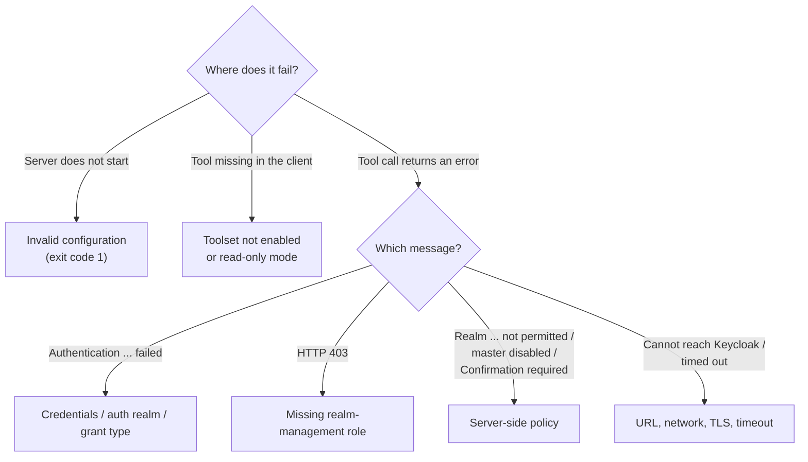

# Troubleshooting

Find your symptom, check the cause, apply the fix. Quoted messages are the exact texts from `src/config.ts`, `src/guards.ts` and `src/keycloak/errors.ts`. Text in `<...>` is a placeholder. Configuration details are in [configuration](configuration.md), the security background in [security](security.md).



## Quick reference

| Symptom (message) | Section |
|---|---|
| `Invalid configuration:` and the process exits | [Start without configuration](#server-does-not-start) |
| `Authentication against Keycloak realm '...' failed (HTTP 400/401)` | [Authentication errors](#authentication-errors-401-invalid_grant) |
| `Keycloak denied the operation (HTTP 403)` | [403](#403-keycloak-denied-the-operation) |
| `Not found (HTTP 404)` | [404](#404-not-found) |
| `Conflict (HTTP 409)` | [409](#409-conflict) |
| `The request to Keycloak timed out` | [Timeout](#timeouts) |
| `Cannot reach Keycloak at ...` | [TLS and network](#network-and-tls-errors) |
| A tool does not show up | [Toolset not active](#a-tool-is-missing) |
| `Confirmation required.` | [Confirmation](#confirmation-required) |
| `Realm '...' is not permitted by KEYCLOAK_MCP_REALMS` | [Realm not permitted](#realm-not-permitted) |
| `Write operations in the 'master' realm are disabled.` | [master write protection](#master-write-protection) |

## Server does not start

**Symptom.** The client shows the server as failed or disconnected. Running it in a terminal prints, for example:

```text
Invalid configuration:
  - KEYCLOAK_URL: is required (base URL of the Keycloak server)
```

or

```text
Invalid configuration:
  - No credentials configured: set KEYCLOAK_CLIENT_ID + KEYCLOAK_CLIENT_SECRET (client_credentials) or KEYCLOAK_USERNAME + KEYCLOAK_PASSWORD (password).
```

**Cause.** The server validates the environment at startup and exits with code 1 if it is incomplete. There are deliberately no default credentials. Other messages of the same kind:

| Message | Cause |
|---|---|
| `KEYCLOAK_URL: must be a valid http(s) URL` | The URL is malformed or uses another scheme. |
| `KEYCLOAK_CLIENT_ID: is required for the client_credentials grant` | Grant is `client_credentials` (explicit, or because a client secret is set) but no client ID. |
| `KEYCLOAK_CLIENT_SECRET: is required for the client_credentials grant` | Client ID is set, secret is missing. |
| `KEYCLOAK_USERNAME: is required for the password grant` / `KEYCLOAK_PASSWORD: is required for the password grant` | Grant is `password` but username or password is missing. |
| `KEYCLOAK_GRANT_TYPE: must be 'client_credentials' or 'password'` | Typo in the grant type. |
| `KEYCLOAK_MCP_TOOLSETS: unknown toolset '<name>' (valid: core, groups, roles, clients, sessions, events, security, all)` | Typo in the toolset list. |
| `KEYCLOAK_MCP_TIMEOUT_MS: must be a number of milliseconds` | Not a number. |
| `KEYCLOAK_MCP_LOG_LEVEL: must be one of: debug, info, warn, error` | Invalid log level. |

**Fix.** Set the missing variables in the `env` block of your MCP client (see [clients](clients.md)). Variables are not inherited from your shell by most GUI clients. Test in a terminal:

```bash
KEYCLOAK_URL=https://keycloak.example.com KEYCLOAK_CLIENT_ID=<id> KEYCLOAK_CLIENT_SECRET=<secret> \
  npx -y keycloak-model-context-protocol
```

The server logs `keycloak-model-context-protocol started` to stderr and then waits for MCP messages on stdin. Startup does not contact Keycloak; the first login happens on the first tool call, so a wrong URL or password shows up there, not at startup.

If the log shows `KEYCLOAK_ADMIN is deprecated; use KEYCLOAK_USERNAME instead.` (or the same for `KEYCLOAK_ADMIN_PASSWORD`), rename the variable. See [Migration from 0.0.x](migration-1.0.md).

## Authentication errors (401, invalid_grant)

**Message.**

```text
Authentication against Keycloak realm '<realm>' failed (HTTP 401). Check KEYCLOAK_CLIENT_ID/KEYCLOAK_CLIENT_SECRET or KEYCLOAK_USERNAME/KEYCLOAK_PASSWORD and KEYCLOAK_AUTH_REALM. Keycloak says: <detail>
```

The same text appears with `HTTP 400`. The `Keycloak says:` part carries Keycloak's own explanation, for example `invalid_grant` or `Invalid user credentials`.

| Grant | Typical cause | Fix |
|---|---|---|
| `client_credentials` | Wrong client ID or secret (`unauthorized_client`, `Invalid client or Invalid client credentials`) | Copy the secret again from *Clients → your client → Credentials*. |
| `client_credentials` | *Service accounts roles* is disabled on the client (`unauthorized_client`) | Enable *Service accounts roles* and *Client authentication* on the client. |
| `client_credentials` | The client exists in another realm than `KEYCLOAK_AUTH_REALM` | Set `KEYCLOAK_AUTH_REALM` to the realm that contains the client. The default is `master`. |
| `password` | Wrong username or password (`invalid_grant`, `Invalid user credentials`) | Check the credentials. Several failures can lock the account through brute-force detection. |
| `password` | Account has required actions or MFA (`invalid_grant`, `Account is not fully set up`) | Use a dedicated account without required actions, or switch to `client_credentials`. |
| `password` | Client `admin-cli` has *Direct access grants* disabled, or the client you set needs a secret | Enable direct access grants, or set `KEYCLOAK_CLIENT_ID` (and `KEYCLOAK_CLIENT_SECRET` if the client is confidential). |
| both | The user or client lives in a realm other than the auth realm | Match `KEYCLOAK_AUTH_REALM` to the realm where the account is defined. |

**Message.** `Authentication realm '<realm>' or the token endpoint was not found (HTTP 404). Check KEYCLOAK_URL and KEYCLOAK_AUTH_REALM.` The realm name is wrong, or the base URL needs or must not have the `/auth` prefix. Keycloak 17+ (Quarkus) serves without `/auth`; older installations and some proxies still use it. Test with `curl <KEYCLOAK_URL>/realms/<realm>/.well-known/openid-configuration`.

**Message after a working period.** `Keycloak rejected the access token (HTTP 401). The credentials may be invalid or the token expired.` The server already retried once with a fresh login. The credentials were probably changed or the client or user disabled in the meantime.

## 403: Keycloak denied the operation

**Message.**

```text
Keycloak denied the operation (HTTP 403). The configured account lacks the required admin permissions (e.g. realm-management roles such as view-users, manage-users, view-realm) in the target realm. Keycloak says: <detail>
```

**Cause.** Login worked, but the account may not do this in the target realm. For a service account, open *Clients → your client → Service accounts roles* and assign client roles of the `realm-management` client (of the target realm; for the `master` realm they are `<realm>-realm` roles).

| Tool area | Roles typically needed |
|---|---|
| `realm_get`, resources | `view-realm` |
| `user_search`, `user_get`, `group_members_list` | `view-users` (and `query-users`) |
| `user_create`, `user_update`, `user_delete`, `user_send_actions_email`, `user_group_add/remove`, `user_role_assign/revoke`, `user_logout`, `user_brute_force_unlock` | `manage-users` |
| `group_list` | `query-groups` or `view-users` |
| `role_list`, `user_roles_list` | `view-realm`, `view-users` |
| `client_list`, `client_get` | `view-clients` |
| `event_list`, `admin_event_list` | `view-events` |

The complete matrix is in [configuration](configuration.md). `realm_list` returns only realms the account can see; an empty list usually means missing roles or an allowlist that excludes everything.

## 404: Not found

**Message.** `Not found (HTTP 404). The realm or the requested resource does not exist.` Tools also report specific cases, for example `User <id> does not exist in realm '<realm>'.`, `Realm '<realm>' does not exist.` or `Unknown role(s) in realm '<realm>': <names>. Nothing was changed.`

**Causes and fixes.**

- The `realm` argument is the realm's *name*, not its display name. Use `realm_list` to see valid names.
- The user, group or client ID is stale or belongs to a different realm. Look it up again with `user_search`, `group_list` or `client_list`.
- Role names are case-sensitive. List them with `role_list` first.

## 409: Conflict

**Message.** `Conflict (HTTP 409). The resource already exists or is in conflict. Keycloak says: <detail>` Typical: `User exists with same username` or `User exists with same email` on `user_create`, or an e-mail duplicate on `user_update` when the realm forbids duplicate e-mails.

**Fix.** Search first (`user_search` with `exact: true`) and update the existing user instead, or choose another username or e-mail.

## Timeouts

**Message.** `The request to Keycloak timed out after <ms> ms. Increase KEYCLOAK_MCP_TIMEOUT_MS or check the server.`

**Causes.** Keycloak is slow or overloaded (large realm, a heavy search), a proxy or firewall drops packets silently, or the host is unreachable.

**Fix.** Narrow the query (`search`, smaller `max`). Raise `KEYCLOAK_MCP_TIMEOUT_MS` (default `30000`) if the instance is just slow. If even `curl` to the URL hangs, fix the network path first.

## Network and TLS errors

**Message.** `Cannot reach Keycloak at <url>. Check KEYCLOAK_URL, network connectivity and TLS settings.` This message is also used for DNS errors (`ENOTFOUND`), refused connections (`ECONNREFUSED`) and certificate errors.

| Check | How |
|---|---|
| Is the URL right and reachable from the machine that runs the server? | `curl -i <KEYCLOAK_URL>/realms/master` |
| Is the port right? | Container default is 8080 (HTTP) or 8443 (HTTPS). |
| Self-signed or internal CA certificate? | Run the server with `NODE_EXTRA_CA_CERTS=/path/to/ca.pem` in its `env`. Use the CA certificate in PEM format. |
| Hostname does not match the certificate | Use the host name from the certificate, not an IP address. |

Do **not** set `NODE_TLS_REJECT_UNAUTHORIZED=0`: it disables certificate validation for the whole process, including the token request that carries your credentials.

## A tool is missing

**Symptom.** The model says a tool does not exist, or `tools/list` lacks it.

**Cause 1: toolset not enabled.** Only `core`, `groups` and `roles` are enabled by default. `client_list` and `client_get` need `clients`, `user_sessions_list` and `user_logout` need `sessions`, `event_list` and `admin_event_list` need `events`, `user_brute_force_status` and `user_brute_force_unlock` need `security`.

**Fix.** Enable it explicitly, or use `all`:

```text
KEYCLOAK_MCP_TOOLSETS=core,groups,roles,sessions
KEYCLOAK_MCP_TOOLSETS=all
```

**Cause 2: read-only mode.** With `KEYCLOAK_MCP_READ_ONLY=true` every tool that is not read-only is not registered (create, update, delete, assign, unlock, logout, ...). This is intended. Unset it if you want to change data.

After changing the environment, restart the MCP client or reload the server; most clients read the tool list only once per connection. The tools and their toolsets are listed in the [tools reference](tools-reference.md).

## Confirmation required

**Message.**

```text
Confirmation required. This would: permanently delete user '<username>' (id <id>) from realm '<realm>'. Nothing was changed. Ask the user for approval, then call this tool again with confirm: true.
```

**Cause.** `user_delete`, `user_group_remove`, `user_role_revoke` and `user_logout` are destructive. By default they only show a preview.

**Fix.** This is the expected flow. Ask the human, then repeat the call with `confirm: true`. If a model sets `confirm: true` without asking, tighten your client's approval settings. `KEYCLOAK_MCP_REQUIRE_CONFIRMATION=false` removes the preview step; do not do that for interactive use.

## Realm not permitted

**Message.** `Realm '<realm>' is not permitted by KEYCLOAK_MCP_REALMS (allowed: <list>).`

**Cause.** `KEYCLOAK_MCP_REALMS` is set and does not contain the realm.

**Fix.** Add the realm to the comma-separated list (`KEYCLOAK_MCP_REALMS=shop,staging`) and restart, or use a different realm. An empty or unset variable allows all realms. The same check applies to prompts and resources.

## master write protection

**Message.** `Write operations in the 'master' realm are disabled. Set KEYCLOAK_MCP_ALLOW_MASTER_WRITE=true to allow them.`

**Cause.** Write and destructive tools are blocked in `master` by default. Reading is allowed.

**Fix.** Do the change in a different realm, or set `KEYCLOAK_MCP_ALLOW_MASTER_WRITE=true` if you really need to administer `master` and have a very good reason. This also requires the account to have the roles in `master`.

## Invalid input

**Message.** `Invalid <label>: must be non-empty and must not contain '/', '\', '..' or control characters.` where `<label>` is `realm`, `id`, `userId` or `groupId`.

**Cause.** The value cannot be used as a URL path segment. Usually the model passed a path, a name with a slash, or an empty string instead of an ID.

**Fix.** Look the ID up with the search tool and pass only the ID. Other validation failures (wrong types, `max` above 200, missing required fields, `Provide at least one field to update.`, `Provide exactly one of \`id\` or \`clientId\`.`) are shown by the client as invalid parameters.

## Find the logs

The server writes logs to **stderr**, never to stdout. Every tool call produces a line like:

```text
2026-10-24T12:00:00.000Z INFO tool_call {"tool":"user_search","realm":"shop","outcome":"ok","durationMs":42}
```

`outcome` is `ok` or the error kind (`auth`, `forbidden`, `not_found`, `conflict`, `bad_request`, `server`, `network`, `timeout`, `guard`, `confirmation_required`, `unexpected`). Set `KEYCLOAK_MCP_LOG_LEVEL=debug` for more detail.

| Client | Where to look (locations can change between versions) |
|---|---|
| Claude Desktop (macOS) | `~/Library/Logs/Claude/mcp-server-<name>.log` and `mcp.log` |
| Claude Desktop (Windows) | `%APPDATA%\Claude\logs\` |
| Claude Code | `claude mcp list` shows the status, `/mcp` inside a session, and `claude --debug` prints server stderr |
| VS Code | Command *MCP: List Servers* → server → *Show Output*, or the *Output* panel |
| Cursor | *Output* panel → *MCP Logs* |
| Anywhere | Run the server in a terminal as shown above, or use the MCP Inspector |

## Debug with the MCP Inspector

The [MCP Inspector](https://github.com/modelcontextprotocol/inspector) lets you call tools by hand and shows the raw protocol messages and server stderr.

```bash
npx @modelcontextprotocol/inspector \
  -e KEYCLOAK_URL=https://keycloak.example.com \
  -e KEYCLOAK_CLIENT_ID=<id> \
  -e KEYCLOAK_CLIENT_SECRET=<secret> \
  -e KEYCLOAK_MCP_TOOLSETS=all \
  -- npx -y keycloak-model-context-protocol
```

For a local checkout, build first and replace the last line with `-- node dist/index.js`. In the browser UI, open *Tools → List tools*, run `realm_list`, then the tool you are debugging. If a call works in the Inspector but not in your client, compare the `env` block of the client with the flags above, and check that the client restarted after the change.

## Still stuck?

Collect the exact message, the server version (shown in the `started` line of the log), the Keycloak version and your configuration **without secrets**, then open an issue. For security problems follow [SECURITY.md](../SECURITY.md) instead.
